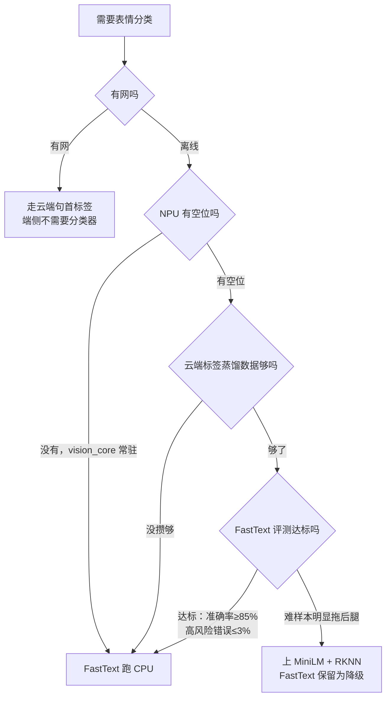

# FastText 与 MiniLM 分类器架构对比：端侧表情分类，先上轻量、再谈增强

**核心摘要**：机器人离线（断网/弱网）时，端侧 Qwen-1.5B 只负责生成纯文本，脸上的表情要交给一个独立的文本分类器来配。候选有两个：**轻量级的 FastText（几 MB，CPU 亚毫秒）和增强级的 MiniLM / BERT-tiny（10～25MB，转 RKNN 走 NPU）**。从底层架构看，两者的根本区别是：**FastText 是「查静态词向量表 → 求平均 → 一条直线打分」，词与词之间从头到尾不交互，只有词级语义；MiniLM 是 Transformer 自注意力编码器，每个词都要和全句所有词两两交互、被上下文改写，具有句级组合语义。** 实测 RK3588 已经是满载状态（NPU 被人脸识别常驻占用），最终选择是：**FastText 起步、当端侧主力；MiniLM 是数据飞轮攒够数据、且 NPU 确认有空位之后的升级项，升级后 FastText 也不退役，变成 NPU 被占时的降级保险。**

> 适用硬件：LubanCat RK3588（7.7G 内存，8 核 ARM，三核 NPU）。
> 分类器输入：端侧 Qwen-1.5B 生成的整段纯文本（一次回复只过一次）。
> 分类器输出：10 个表情 key（happy/sad/angry/surprised/scared/eye_roll/embarrassed/confused/shy/neutral）的概率分布。
> 相关背景：整体表情方案见 `语音交互/2026-10-23_机器人表情生成方案-云端带脸说话端侧离线配脸.md`，分类器训练落地见 `模型训练/2026-07-11_机器人表情标签分类器-从方案设计到训练落地.md`。

***

## 一、先建立直觉：分类器在替谁干活

有网时，机器人的表情由云端对话模型在回复最前面直接打一个标签（`<happy>正文`），端侧只管播放，**根本不需要分类器**。

断网时，大脑换成端侧 Qwen-1.5B。这个级别的小模型在资源紧张时句首标签很不稳定（括号缺失、自造标签、漏标），所以让它只做自己最擅长的事——说话；表情由一个独立分类器读它生成的文本，吐出一个表情 key。

用两个角色来理解这两个分类器：

- **FastText 像「看关键词的前台」**：看到「哈哈」就判开心、看到「对不起」就判尴尬。不读上下文、不琢磨反话，但一眼扫完，几乎不占工位，永远在岗。
- **MiniLM 像「会读上下文的实习生」**：能品出「你可真行啊」是夸奖还是翻白眼，反讽、否定这类难样本判得准。但要占用 NPU 这个稀缺工位，还得先培训（转 RKNN）。

记住一个总纲：**FastText 能认字，MiniLM 能懂话。** 下面拆开看它们各自怎么算。

***

## 二、FastText：一本会打分的词典

### 2.1 四步计算流程

**① 分词（词 + 子词 n-gram）**：句子切成词，同时把词拆成字符级 n-gram（比如「开心」会带上「开」「心」「开心」以及带边界标记的组合）。这一步是为了对付没见过的词——哪怕「开心果」没在词典里，它身上的「开心」碎片也能贡献一点正向信号。

**② 查静态词向量表**：模型的绝大部分参数就是一张大表，每个词（和 n-gram）在表里占一个固定向量。所谓「静态」，是指**一个词不管出现在哪句话里，取出来的向量永远是同一个**。

**③ 求平均（池化）**：把句子里所有词的向量直接加起来、再求平均，压成一个句子向量。这一步没有任何选择、没有任何加权——**词和词之间不说话，各自把自己的向量倒进同一个桶里搅匀**。

**④ 线性打分**：句子向量过一层线性变换（本质是一次矩阵乘法加偏置），再 softmax 归一化成 10 类概率。这是整个模型里唯一的「判断」环节。

### 2.2 它的语义到哪一层

FastText 不是「完全没有语义」。词向量在训练中会编码词的相似性，所以它知道「开心」和「高兴」意思近、「难过」和「伤心」意思近——这是**词级别的静态语义**。

但它缺的是把词组合起来理解的能力，三个典型表现：

1. **不懂词序**：「狗咬人」和「人咬狗」用词完全一样，平均后的向量也一样，在它眼里是同一句话；
2. **不懂否定**：「我很开心」和「我很不开心」都有「开心」这个强正向词，否定词「不」的分量很难压过它；
3. **不懂反讽**：「你可真行啊，这都能忘」里「真行」是正向词，它看不到后半句是在把这个正向拧成反话。

一个补充：FastText 可以开启 word n-gram，把「不开心」「真行啊」这种紧邻搭配当成一个整体查表，**死记**住一部分局部词序。但这只是背搭配——训练时没背过的说法（「开心不起来」「不是很开心」）照样抓瞎，而且中间隔着词的长距离反讽，n-gram 窗口根本够不着。

### 2.3 优点和死穴

| 项 | 说明 |
|----|------|
| 优点 | 模型几 MB；CPU 上亚毫秒；训练几分钟、迭代快；不碰 NPU，永远可用 |
| 死穴 | 反讽、正话反说、网络梗、长距离呼应——所有需要「词与词组合」的句子 |
| 兜底 | 低置信或模型不可用时，再退一层到关键词规则（「哈哈」「？」「！」），最终落 happy |

***

## 三、MiniLM：会把句子读进去的 Transformer

### 3.1 四步计算流程

**① 分词 + 位置编码**：词被切成 token（Transformer 常用更小的子词单元），同时给每个位置打上编号。位置编码让模型知道词的先后——这是 FastText 平均操作里天然丢失的信息。

**② 自注意力：每个词把全句看一遍**。这是 Transformer 的核心，也是它和 FastText 最本质的区别。每个词先变出三个向量：

- **Q（查询，Query）**：我在关心什么；
- **K（键，Key）**：我能提供什么；
- **V（值，Value）**：我实际的内容。

每个词拿自己的 Q 去和全句所有词的 K 算相关度（点积），归一化成一组权重，再按这组权重把所有词的 V 加权混合到自己身上。**结果是：一个词的新向量，是全句所有词按「与我的相关度」调出的混合物。** 用「你可真行啊，这都能忘」走一遍：

- 「行」的 Q 去问全句，和「忘」的 K 算出很高的相关度；
- 于是「行」的向量里大量混入了「忘」所带的负面信息；
- 「行」从一个正向词，被上下文**当场改写**成反讽——这正是 FastText 里那个「永远正向」的「行」做不到的事。

**③ 多层堆叠**：MiniLM-L6 有 6 层、BERT-tiny 有 2 层。每一层都做一次「自注意力 + 前馈网络（FFN）」，外加残差连接和 LayerNorm。词的向量经过一层被改写一次，层数越深，组合的信息越复杂。

**④ 池化 + 分类头**：取一个专门的汇总位（或对所有位置平均），再过一个线性分类头输出 10 类概率。

### 3.2 什么叫上下文（动态）语义

FastText 里一个词只有一个固定向量；MiniLM 里**同一个词在不同句子里向量不同**：

- 「苹果好吃」里的「苹果」混入了「吃」的信息，是水果；
- 「苹果手机」里的「苹果」混入了「手机」的信息，是品牌。

词的表示是在推理时根据当前句子现算出来的，所以没见过的新说法也能推断，而不是只能靠训练时背过。这就是「句级组合语义」。

### 3.3 代价：O(n²)、要 NPU、要转 RKNN

自注意力要让每个词和每个词配对，n 个词就要算 n×n 次相关度——**计算量是 O(n²)，句子长度翻倍，注意力的算力约变 4 倍**（FastText 只是 n 次查表，O(n)）。这就是为什么：

- MiniLM 裸跑 CPU 要几毫秒到十几毫秒，且长句明显变慢；
- 端侧要把它转成 RKNN 跑 NPU，靠 NPU 的矩阵乘并行能力把时间压下来；
- 而 Transformer 转 RKNN 有算子回退、变长序列、INT8 量化动分数等一系列坑（见 `端侧部署/` 相关文章），周期不短。

***

## 四、正面对比：大词典 vs 组合规则

### 4.1 架构级对比

| 对比维度 | FastText（轻量级） | MiniLM / BERT-tiny（增强级） |
|----------|--------------------|------------------------------|
| 网络形态 | 词向量查表 + 平均 + 一个线性层 | 多层 Transformer（自注意力 + FFN） |
| 词与词交互 | 无，词各自独立 | 有，每层两两交互、跨全句 |
| 词序信息 | 靠 word n-gram 背一点紧邻搭配 | 位置编码，显式知道顺序 |
| 语义级别 | **词级静态语义**（一个词一个固定向量） | **句级上下文语义**（向量随句子变） |
| 模型大小 | 几 MB | 10～25MB |
| 计算量 | O(n)，随词数线性增长 | O(n²)，两两配对 |
| 运行位置 | CPU 即可，不碰 NPU | 需转 RKNN 走 NPU |
| 单句延迟 | 亚毫秒 | 几毫秒～十几毫秒 |
| 训练 / 部署 | 训练几分钟，直接跑 | 要转 RKNN、调 NPU 兼容性，周期长 |
| 难样本 | 弱：反讽、网络梗、正话反说易错 | 强：能结合上下文理解真实态度 |
| 定位 | 端侧主力，起步就用 | 数据积累后的升级项 |

### 4.2 参数本质：钱花在了不同地方

这是最容易被忽略、但最有解释力的一点：

- **FastText 的参数≈一本大词典**：参数几乎全是「词向量表」，词表（含 n-gram）有多大，表就有多大。训练学的是「**这个词一般出现在什么情绪里**」，再加一个线性打分表。
- **MiniLM 的参数≈一套组合规则**：参数是每层的 Q/K/V 投影矩阵和 FFN，**与词表大小无关、对所有词复用**。训练学的是「**词之间该怎么互相影响**」。

一个背字典，一个学语法。前者靠见过的词多，后者靠会推算。

### 4.3 三道考卷：差距全在「组合」上

| 测试句 | FastText（背词与搭配） | MiniLM（组合理解） |
|--------|------------------------|--------------------|
| 我很开心 | 「开心」→ happy ✓ | happy ✓ |
| 不是很开心 / 开心不起来 | 只在训练时恰好背过这个搭配才对，没见过的说法就崩 ✗ | 「不」通过注意力改写「开心」，新说法也能推出 ✓ |
| 你可真行啊，这都能忘 | 「真行」正向，且和「忘」隔着词，n-gram 够不着 ✗ | 注意力跨度全句，「行」与「忘」高相关 → eye_roll ✓ |

简单句两者都对，差距全部出现在需要组合的句子里——这也决定了评测时必须刻意制造反讽、正话反说、网络梗这类难样本。

***

## 五、RK3588 上的最终选择：先轻后重

### 5.1 设备现状：这是一台满载的板子

2026-10-22 实测：总内存 7.7G、可用约 4.1G，load average ≈ 1.9；人脸识别 vision_core 常驻 50% CPU、555MB 内存，NPU/CPU 都在占用；此外还有 head_service、asr_node、lip_sync 等常驻模块。

**结论：端侧表情必须走「极轻量、不抢 NPU、可降级」的路线，不能再压一个 Transformer 去和视觉抢工位。**

### 5.2 决策流程

### 5.3 升级到 MiniLM 的四个条件（缺一不可）

1. **场景是离线**：有网时表情由云端给，分类器不参与；
2. **NPU 确实有空位**：vision_core 等常驻任务不忙，且做了「NPU 忙自动回退」的开关；
3. **蒸馏数据攒够**：云端标签 + 数据飞轮已经产出足够的真实对话语料（冷启动没数据，增强模型也训不好）；
4. **FastText 在评测集上确实不达标**：混淆矩阵里反讽/否定类错误真实影响体验，而不是「为了升级而升级」。

### 5.4 升级后 FastText 不退役

两个分类器的输入完全一样（整段纯文本、只过一次、输出 10 类概率），所以决策层、滞回阈值（切新脸 >0.65、维持当前 >0.40）、规则兜底那套代码完全共用。上了 MiniLM 之后，FastText 退为第二道保险：NPU 被视觉/导航占满时自动切回，表情始终有输出。

对应落地路线图：阶段 3 先蒸馏 FastText 跑通离线链路，阶段 4 才做 MiniLM RKNN。

***

## 六、技术决策速查

| 决策点 | 备选 | 最终选择与理由 |
|--------|------|----------------|
| 端侧主力分类器 | FastText / MiniLM | **FastText**：几 MB、CPU 亚毫秒、不抢 NPU，满足离线配脸 |
| 增强分类器 | 现在上 / 之后上 | **之后上**：需 NPU 空闲 + 蒸馏数据够 + FastText 评测不达标，三个条件同时满足 |
| 增强模型运行位置 | CPU / NPU | **NPU（RKNN）**：自注意力 O(n²)，CPU 扛不住长句；但要做好算子回退和自动降级 |
| 让 1.5B 自己打标签 | 可以 / 不可以 | **不可以**：小模型标签不稳定，且多输出 token 拉长延迟 |
| 语义能力 | 词级 / 句级 | FastText 词级静态语义；MiniLM 自注意力做句级上下文语义 |
| MiniLM 上线后 FastText | 废弃 / 保留 | **保留**：NPU 被占时的降级保险，输入输出同构、零额外成本 |
| 验收口径 | —— | 准确率 ≥85%、单类召回 ≥70%、高风险错误 ≤3%、增量延迟 ≤20ms、内存增量 ≤50MB |

***

## 七、总结

1. **分类器只在离线时上场**：有网表情由云端句首标签给，端侧分类器是离线配脸的专用模块；
2. **FastText 是「查表 + 平均 + 直线打分」**：参数≈一本大词典，词与词不交互，只有词级静态语义，代价是几 MB、CPU 亚毫秒；
3. **MiniLM 是「自注意力 + 多层堆叠」**：每个词与全句两两交互、被上下文改写，具有句级组合语义，代价是 O(n²) 计算量、要转 RKNN 走 NPU；
4. **差距全在组合句**：简单句两者都对，否定、反讽、长距离呼应是 FastText 的死穴、MiniLM 的主场；
5. **RK3588 上先轻后重**：板子满载、NPU 被视觉常驻，FastText 起步当主力；NPU 有空位、数据攒够、FastText 评测不达标时再升级 MiniLM；
6. **升级不是替换**：MiniLM 主跑、FastText 降级兜底，决策层和滞回策略完全共用，工程上平滑切换。

> **一句话：FastText 靠一本会打分的词典认字，MiniLM 靠自注意力把句子读懂；在满载的 RK3588 上，先用永远在岗的 FastText 把离线链路跑起来，等数据和 NPU 都就位，再让 MiniLM 接手难样本——这不是偏好，是架构和资源算账后的必然顺序。**
