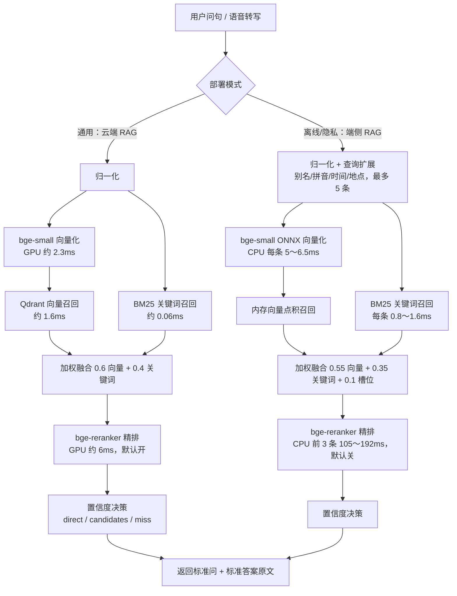

# 端侧与云端两套 RAG 方案对比：通用版用云端，端侧只保离线与隐私

**核心摘要**：为了让机器人能从客户的问答资料（一份 Excel）里找到标准答案，我先后做了两套 RAG：一套跑在云端 RTX 4090 服务器上，一套跑在机器人肚子里的 RK3588 开发板上。两套用的是**同一对模型**（bge-small-zh-v1.5 做向量、bge-reranker-base 做精排），检索思路也一样（向量召回 + 关键词召回 + 精排 + 置信度决策），但实测速度差距非常大：**云端把完整链路（含精排）全部打开，单次查询平均约 19 毫秒；端侧为了速度默认关闭精排，简单问句也要 13～26 毫秒，一旦打开精排拿到同等精度，立刻涨到 120～264 毫秒。** 所以最终结论是：**通用版本统一走云端 RAG；端侧 RAG 只在两种场景启用 —— 现场完全离线（无网络），或者客户明确要求数据不出本地（隐私安全）。**

> 云端方案：RTX 4090（CUDA），bge-small-zh-v1.5 + bge-reranker-base 均在 GPU 上，Qdrant 向量库，HTTP 服务端口 6034。
> 端侧方案：鲁班猫 RK3588S（8 核 ARM，无 GPU），bge-small-zh-v1.5 以 ONNX 跑 CPU，bge-reranker-base 已内置但默认关闭。
> 两套方案都**只检索、不生成**：命中后原样返回标准问和标准答案，不调用大模型改写。

***

## 一、先建立直觉：RAG 到底在干什么

把客户给的问答资料想象成一本**只有问答、没有目录的手册**，比如：

- 问：「你们公司在哪里？」答：「上海市浦东新区……」
- 问：「可以退款吗？」答：「签收后 7 天内支持……」

用户（或语音转写后的文字）问一句话，RAG 要做的事就是一个**翻书找答案的图书管理员**：

1. **语义召回（向量）**：用户说「店开在哪」，手册里写的是「公司地址」，字不一样但意思一样，向量模型负责把它们对上；
2. **关键词召回（BM25）**：碰上「ASC」「岸桥」这种专有名词，按字面关键词找反而最稳；
3. **精排（Rerank）**：两路各捞回十几条候选，再让一个更"较真"的模型把问题和候选逐条配对打分，排出最像的那条；
4. **拍板（决策）**：分数足够高就直接给答案（`direct`），模棱两可就给几个候选（`candidates`），都不像就承认不会（`miss`），而不是硬编一个答案。

记住一个关键点：**RAG 不是让大模型"发挥"，而是让它闭嘴 —— 手册里有的才答，没有的就拒答。** 所以两套方案命中后都直接返回标准原文。

***

## 二、两套方案的整体流程

两条路长得几乎一样，区别只在**脚下的硬件**：云端踩的是 GPU，端侧踩的是 ARM 小 CPU。同一个模型，在两个地方跑，速度天差地别。

***

## 三、云端方案：4090 上的完整形态

### 3.1 用了什么模型和组件

| 角色 | 模型 / 组件 | 说明 |
|------|------------|------|
| 向量 Embedding | `bge-small-zh-v1.5`（约 24M 参数中文小模型） | SentenceTransformer 加载，常驻 GPU |
| 精排 Rerank | `bge-reranker-base`（CrossEncoder，约 2.78 亿参数） | 常驻 GPU，候选最多 16 条，**默认开启** |
| 向量库 | Qdrant | 每个机器人一个 collection（`{robot_id}__faq`），天然数据隔离 |
| 关键词 | BM25Okapi（rank_bm25） | 进程内内存索引，从向量库重建 |

灌库方式很简单：客户的问答 Excel 通过 `/api/rag/documents` 灌进去，系统自动切条、向量化、入 Qdrant；内容没变会自动跳过，改了内容才重建。

### 3.2 基本功能

- **混合检索**：向量分 × 0.6 + BM25 分 × 0.4，换个说法、专有名词都能召回；
- **精排**：问题和候选逐条配对打分，FAQ 候选大多是几个字的短标准问，GPU 上开销极小；
- **三档决策**：高分 ≥ 0.72 直接答；0.55～0.72 或前两名分差太小给候选；低于 0.55 拒答；
- **精确匹配短路**：问句和标准问完全一致时直接定稿，跳过后面所有步骤；
- **多租户隔离**：按 robot_id 分库，A 客户的资料绝不会被 B 客户的机器人检索到。

### 3.3 实测响应时间（热路径）

测试时间 2026-10-20 / 10-23，4090，模型已加载到显存（不含首次启动加载模型的数秒）：

| 问句 | 端到端耗时 | 结果 |
|------|-----------|------|
| 公司在哪里 | 31.3 ms | candidates |
| 营业时间 | 15.5 ms | direct |
| 可以退款吗 | 15.6 ms | direct |
| 怎么联系客服 | 15.0 ms | miss |
| 有什么优惠 | 17.9 ms | direct |

**平均约 19 ms，最快 15 ms，最慢 31 ms。** 更大语料库（483 条文档）的现网日志也多在 20～30 ms。

分阶段拆开来，一次查询的钱花在：

| 阶段 | 耗时 |
|------|------|
| Embedding 向量化 | ~2.3 ms |
| Qdrant 向量检索 | ~1.6 ms |
| BM25 | ~0.06 ms |
| Rerank 精排（约 11 条短问） | ~6.0 ms |
| 合计（含 HTTP 协议、决策、序列化） | **15～31 ms** |

注意：这是**纯检索接口**的耗时，不含上层 Agent 调用大模型生成回复的时间；实测在本机发起，实际部署还要加上局域网/公网传输，但在局域网内这个开销通常只有几毫秒。

***

## 四、端侧方案：RK3588 上的"够用就好"形态

### 4.1 用了什么模型

| 角色 | 模型 / 方式 | 说明 |
|------|------------|------|
| 向量 Embedding | `bge-small-zh-v1.5`，**ONNX Runtime 跑 CPU** | 模型转成 ONNX 后，单句编码从 PyTorch CPU 的约 48 ms 压到 5～6.5 ms |
| 精排 Rerank | `bge-reranker-base`，ONNX 已备好 | **默认关闭**（`enable=false`），开启后前 3 条推理就要 105～192 ms |
| 关键词 | jieba 分词 + BM25Okapi | 纯内存 |
| 语料 | 143 条标准问答、846 条索引入口（标准问 + 相似问） | 支持下载新 Excel 后热更新，不换模型 |

### 4.2 端侧独有的"接地气"功能

因为端侧没有 GPU、预算紧，方案把功夫花在了**不依赖模型的规则前处理**上，这些在语音交互场景特别实用：

- **ASR 错词 / 别名纠正**：语音把「岸桥」识别成「按桥」、把「自动化岸桥」缩成「ASC」，词表替换纠正，0.03 ms；
- **拼音同音纠错**：识别含糊时转拼音做编辑距离匹配，约 6～11 ms（问句越长越慢）；
- **时间 / 地点指代解析**：「去年」「这里」结合请求里的日期和地点自动补全，如「这里去年的销售量」→「北部湾 2025 年的销售量」；
- **查询扩展**：上面几步最多生成 5 条扩展问句，每条都各跑一遍检索；
- **意图分类**：正则识别比较 / 时间 / 地点 / 操作等意图，动态调整各路权重；
- **精确匹配短路**：和云端一样，问句与标准问完全一致就跳过召回。

### 4.3 实测响应时间（2026-10-23，RK3588S）

**默认配置（Rerank 关闭）：**

| 问法 | 扩展条数 | 总耗时 |
|------|---------|--------|
| 机器人能做什么 | 1 条 | 14.2 ms |
| 火星天气怎么样 | 1 条 | 13.6 ms |
| 展厅机器人有哪些功能 | 1 条 | 19.1 ms |
| 自动化按桥产量（纠正为「岸桥」） | 2 条 | 25.5 ms |
| 这里去年的销售量是多少（时间+地点+别名） | 5 条 | 70.7 ms |

规律很清楚：**简单问句 13～26 ms，但每多一条扩展问句，就要多付一次向量编码（5～6.5 ms）和 BM25（约 1.5 ms），5 条扩展时冲到约 70 ms。** 其中拼音纠错和向量编码两项占了八成时间。

**打开 Rerank 后（与云端同等精度）：**

| 配置 | 重排推理耗时 | 整段总耗时 |
|------|------------|-----------|
| 精排前 3 条 | 105～192 ms | **120～264 ms** |
| 精排前 10 条（早期对照） | 310～680 ms | 335～751 ms |

2.78 亿参数的 CrossEncoder 在 ARM CPU 上是实打实的沉重负担，而且即使开了精排，部分问句排序后仍会从候选变成 miss（候选文本质量不足以支撑）。所以端侧**默认继续关着精排**，用扩展和规则弥补精度。

***

## 五、响应时间正面对比

| 对比项 | 云端 RAG（4090） | 端侧 RAG（RK3588） |
|--------|-----------------|-------------------|
| Embedding | ~2.3 ms（GPU） | 5～6.5 ms/条（CPU ONNX） |
| BM25 | ~0.06 ms | 0.8～1.6 ms/条 |
| Rerank | ~6 ms，**默认开** | 105～192 ms，**默认关** |
| 完整链路实际体感 | **15～31 ms（平均 19 ms）** | 关精排 13～26 ms（简单）～70 ms（复杂扩展）；开精排 120～264 ms |
| 精度 | 三路全开，精度最高 | 关精排靠规则补，长尾问法略逊 |
| 网络依赖 | 需要联网（含传输开销） | 完全不需要 |
| 数据位置 | 客户资料在云端服务器 | 全部留在机器人本地 |

**公平的同精度对比是：云端把向量 + BM25 + Rerank 全部打开，约 15～31 ms；端侧要达到同等配置，约 120～264 ms —— 相差约 8～10 倍。** 端侧那些 13～26 ms 的好看数字，是建立在"砍掉精排"的前提上的。

***

## 六、为什么云端能快这么多

通俗讲，模型推理本质是**海量的乘法加法**，GPU 就是几千个同时算账的小计算器，而 RK3588 的 CPU 只有几个力气中等的核：

- **向量模型**：同样一句话，GPU 约 2.3 ms，CPU（即使转了 ONNX）要 5～6.5 ms；
- **精排模型**：差距更夸张 —— GPU 约 6 ms，CPU 要 100～200 ms，差了 20～30 倍。参数量越大的模型，GPU 的并行优势越明显；
- 端侧为了把延迟压下来，只能一路做减法：PyTorch 换 ONNX、精排默认关闭、重排条数从 10 砍到 3、超过 200 ms 的重排结果直接丢弃。

这不是端侧方案写得不好，而是**物理规律决定的硬件差距**：端侧的优势从来不是快，而是"不联网、数据不出门、不要服务器钱"。

***

## 七、最终选型：通用云端，端侧保底

两套方案都真实跑通、实测之后，决策非常明确：

| 场景 | 采用方案 | 理由 |
|------|---------|------|
| **通用版本（默认）** | **云端 RAG** | 完整链路（含精排）平均 19 ms，精度最高；语料更新集中在云端，多机器人共享运维，客户换 Excel 即灌即用 |
| 完全离线场景（如矿山、码头、无网展厅） | 端侧 RAG | 断网也能答，代价是关闭精排、接受长尾问法精度略降 |
| 客户有隐私 / 数据安全要求（数据不出内网、不出设备） | 端侧 RAG | 语料、索引全部留在机器人本地，不经过任何外部服务器 |

工程上两套服务**保持同一套检索逻辑和模型版本**，只是模型加载位置和精排开关不同，这样语料格式、Excel 模板、决策口径完全通用，客户场景切换时不需要重新整理资料。

***

## 八、补充讨论：为什么不把模型导成 RKNN 跑 NPU

理论上 RK3588 自带 6 TOPS 的三核 NPU，把向量模型和重排模型导成 RKNN 似乎也能提速。实际评估后没有做，原因有五层 —— 不是技术上绝对不能做，而是**省错了地方、风险换不来收益**。

### 8.1 瓶颈不在 Embedding，在 Rerank

端侧 bge-small 转 ONNX 后单句编码已经只要 5～6.5 ms，就算 RKNN 压到 2～3 ms，一次查询也只省几毫秒。真正的耗时大头是 2.78 亿参数的 bge-reranker-base（105～192 ms），要优化只能动它。

### 8.2 Transformer 转 RKNN 远不如 CNN 顺

NPU 擅长的是**固定 shape 的卷积和矩阵乘**（视觉类模型），而 Rerank 是 XLM-RoBERTa 架构：

- attention、LayerNorm、GELU、Softmax 等算子在 NPU 上的支持成熟度不如 CNN；
- 输入是**变长序列**（问句从几个字到几十个字），要么 padding 到固定长度白算一截，要么按长度分桶导出多份模型；
- 一旦有算子不支持而**回退 CPU**，NPU↔CPU 之间的 DDR 数据交接开销可能让整体不增反降 —— 这是端侧部署里反复见过的坑。

### 8.3 INT8 量化会动精排的"命根子"——分数

NPU 主力跑 INT8，而精排恰恰是对分数最敏感的环节：量化后 CrossEncoder 的打分分布整体偏移，现有的阈值（0.72 / 0.55）和分差规则（0.05 就改判）都要拿领域语料重新标定，精度有实打实的风险。另外重排是 N 个「问题 × 候选」对逐条前向，变长 pair 难打包成 batch，NPU 利用率天然不高。

### 8.4 NPU 是共享资源，不能抢

端侧方案的红线是 RAG 不抢语音主链路资源。离线场景下 ASR、TTS、表情、视觉都在排队用 NPU，RAG 再挤进去，会让主链路出现抖动。CPU 上跑 ONNX 虽然慢，但占用的是另一部分资源、且随时可以丢弃重排结果让路。

### 8.5 收益算账：仍然打不过云端

即使转换一切顺利，乐观估计 rerank 从 100～200 ms 降到 30～80 ms，端侧总延迟仍在 40～100 ms，还是打不过云端 19 ms；而成本是转换、混合量化、逐层调试、语料校准、动态 shape 处理、工具链版本绑定，以及以后每次模型升级都要重来一遍。为一个**只服务离线/隐私的 fallback 路径**投入数周，性价比不成立。

> 什么情况下值得重新评估？当端侧 RAG 从"补充路径"变成"主力交付"（比如出现大量隐私客户、断网成为常态）。届时的优先级也很明确：**先转 Rerank（固定长度分桶 + 混合量化保精度），Embedding 继续用 ONNX 即可** —— 优化永远先打耗时最大的那块。

***

## 九、技术决策速查

| 决策点 | 备选 | 最终选择与理由 |
|--------|------|---------------|
| 通用版 RAG 位置 | 端侧 / 云端 | **云端**：同精度下 15～31 ms vs 120～264 ms，快约 8～10 倍 |
| 端侧精排 | 默认开启 / 默认关闭 | **默认关闭**：CPU 上 105～192 ms，且部分 query 重排后仍 miss，收益不抵延迟 |
| 端侧推理格式 | PyTorch / ONNX / RKNN | **ONNX**：单句编码 48 ms → 5～6.5 ms；RKNN 只对大模型有意义但量化动分数、NPU 抢资源，见第八节 |
| 答案生成 | LLM 改写 / 原文返回 | **原文返回**：FAQ 场景零幻觉、零生成延迟，客户资料怎么写就怎么答 |
| 端侧精度补偿 | 上大模型 / 规则前处理 | **规则扩展**：拼音纠错、别名、时间地点指代，都是毫秒级、无模型负担 |
| 数据隔离 | 统一大库 / 按 robot_id 分库 | **分库**：Qdrant collection 按机器人隔离，客户资料互不可见 |
| 端侧方案定位 | 与云端竞争 / 补充 | **补充**：只服务离线与隐私两类场景，不做通用版 |

***

## 十、总结

1. **一套模型，两种活法**：云端和端侧都用 bge-small-zh-v1.5 做向量、bge-reranker-base 做精排，链路都是「向量 + BM25 + 精排 + 三档决策」，命中后原样返回标准答案；
2. **云端完整链路约 19 ms**：4090 上精排默认全开，实测端到端 15～31 ms，精度和速度兼得，成为通用版本；
3. **端侧靠做减法求生**：RK3588 上 ONNX 跑 CPU、精排默认关，简单问句 13～26 ms、复杂扩展约 70 ms；一旦开精排对齐云端精度，就要 120～264 ms；
4. **端侧的价值在"离线"和"数据不出门"**：无网现场、隐私安全客户两类场景启用，其余一律走云端；
5. **差距来自硬件物理规律，不是方案优劣**：大模型在 GPU 上并行计算的优势，是端侧 ARM CPU 用规则和工程优化补不平的。
6. **RKNN 不是没想到，是算账后不划算**：Embedding 不是瓶颈，Rerank 转 RKNN 有算子回退、INT8 分数偏移、NPU 抢资源三重风险，乐观结果仍打不过云端，只在端侧 RAG 未来成为主力时再重新评估。

> **一句话：能联网、信得过云端，就让 4090 把活干得又快又准；要断网、要数据不出门，端侧稳稳兜底 —— 通用版选云端，不是偏好问题，是实测之后的事实问题。**
