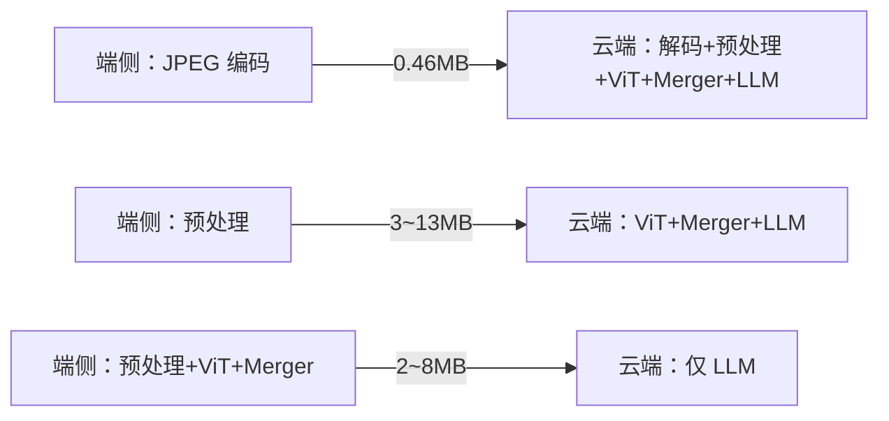

# 端云分工三选项-机器人语音交互怎么选

多模态语音交互的推理链路是"图片 → 视觉编码器 → 视觉 token → 大模型"，在这条链路上从哪里切开，就决定了端侧传什么、云端算什么。切法有三种：传图片、传像素、传 token。本文用一张 1024×1024 的图把三者的流量、延迟和适用场景算清楚：默认传图片最省心；传 token 不省流量、端到端反而更慢，它只在隐私、离线、端侧本就跑视觉等少数场景才划算。

## 一、先看懂一条多模态链路

机器人语音交互里，用户说"你看看我旁边有什么"，系统要同时用到耳朵和眼睛。眼睛这一路，无论模型叫什么名字，基本都是四段：

```text
① 预处理：拍照 → resize → 归一化
② 视觉编码器（ViT）：图片切成一个个小块，每块投影成向量
③ Merger：把相邻小块的向量合并压缩，变成"视觉 token"
④ 大模型（LLM）：视觉 token 和语音识别出的文本拼在一起，理解并生成回答
```

关键是第②步——图片怎么变成向量。以 Qwen3-VL 为例，编码器把图片按 16×16 像素切小块，每个小块（768 个像素值）投影成一个 1152 维向量；再把相邻 2×2 共 4 个小块拼起来，经一个 MLP 压成一个 2048 维的视觉 token。一张 1024×1024 的图，最终得到 1024 个视觉 token。

记住一个公式：

```text
视觉 token 数 = 图片总像素 ÷ 1024
```

端云分工，本质就是决定这条链路从哪里切开：端侧做到哪一步、剩下的交给云端。

## 二、三个选项：从三个位置切开

用"请人看图答题"打个比方：

- **选项一**：把照片寄给专家，专家自己看；
- **选项二**：按专家的规矩把照片贴在标准卡纸上再寄；
- **选项三**：自己先看完照片，写一份"所见摘要"寄给专家，专家只看摘要答题。

| 选项 | 端侧做什么 | 传什么 | 云端做什么 |
| --- | --- | --- | --- |
| 一：传图片（媒体码流） | 拍照、JPEG 编码 | 压缩图片 | 解码、预处理、ViT、Merger、LLM 全算 |
| 二：传像素（预处理张量） | 加 resize、归一化 | 像素张量 | 从 ViT 开始算 |
| 三：传 token（视觉向量） | 再加 ViT、Merger 全跑 | 视觉 token | 只做序列组装和 LLM |



## 三、流量对比：传 token 不省流量，反而更大

这是最反直觉的一点。很多人以为"传向量肯定比传图片小"，算完发现正好相反。以 1024×1024 单图为例：

| 选项 | 上行内容 | INT8 | FP16 | FP32 |
| --- | --- | --- | --- | --- |
| 一：传图片 | JPEG（base64 后） | **0.46 MB** | — | — |
| 二：传像素 | 像素张量 | 3.15 MB | 6.29 MB | 12.58 MB |
| 三：传 token | 视觉 token | 2.1 MB | 4.19 MB | 8.39 MB |

为什么会这样？JPEG 是给人眼看的压缩格式，能把视觉冗余压掉约 10 倍；而编码器输出的向量、归一化后的像素都是高熵数据，几乎无法再压缩。视觉 token 比 JPEG 大 **5～20 倍**。

选项二还有个问题：归一化后的像素张量连 gzip 都压不动，基本不独立使用，只在"要统一多设备的预处理口径"或"本机多进程"时才有意义。

**视频场景差距更夸张：**

```text
1080P H.264 约 3Mbps，约 0.37 MB/秒
端侧按 1 帧/秒抽帧、传 FP16 token，约 8.3 MB/秒（约 66Mbps）
→ 相差约 20 倍
```

所以视频流、屏幕共享一律传 H.264，不要在端侧逐帧跑视觉编码器。

## 四、延迟账：端侧跑视觉，为什么更慢

选项三还有个隐藏成本。Qwen3-VL 用了 DeepStack，视觉特征要在第 8/16/24 层额外注入 3 次——端侧要导出的不是 1 份特征，而是 4 份，上传量再 ×4：

```text
1024 图、token 传 INT8：1 份 2.1MB，4 份 8.4MB
1024 图、token 传 FP16：1 份 4.2MB，4 份 16.8MB
```

把端到端首字响应时间（TTFT）拆开算（WiFi 局域网，云端 H100 级 GPU）：

| 阶段 | 选项一 | 选项三（旗舰 NPU） | 选项三（中端 NPU） |
| --- | --- | --- | --- |
| 端侧编码 | JPEG 约 10ms | ViT+Merger 约 400ms | 约 1.5～3s |
| 上行 | 0.46MB 约 20ms | 8.4MB 约 100ms | 8.4MB 约 100ms+ |
| 云端 ViT | 约 50ms | 0 | 0 |
| 云端 Prefill | 约 80ms | 约 80ms | 约 80ms |
| **TTFT 合计** | **约 165ms** | **约 580ms** | **约 1.7～3.2s** |

选项三用 400ms 起步的端侧算力，只省下云端约 50ms 的 ViT——这笔账必亏。

端侧 NPU 的实测数据也印证这一点：

- 旗舰手机 NPU 跑量化 ViT 约 28～35ms，但那是结构简单、token 少的 ViT-B/32；Qwen3-VL 配套的是约 4 亿参数、27 层的 SigLIP2，处理 1024 图要数百 ms；
- 中端芯片（如 RK3588）纯 CPU 跑，64×64 小图就要 295ms，1024 图随计算量线性放大，不可行；
- NPU 还普遍只支持固定形状（静态 shape），分辨率必须写死。

还有一个硬约束：**端侧跑的 ViT 必须和云端是同一套权重**，否则传上去的 token 对不上——模型不会报错，但会"一本正经地胡说"。

## 五、选项三到底什么时候才划算

选项三不是性能优化，而是"合规、成本、离线"特性。它只在这四种场景才值得上：

1. **隐私 / 合规硬约束**：图片法律上不能出端，此时延迟和成本都要让道；
2. **端侧本就要跑视觉**：机器人本地避障、检测已经在 NPU 上跑着 ViT，顺路导出 token 的边际成本接近零；
3. **弱网 + 高分辨率 + token 剪枝**：4K 原图 JPEG 也有好几 MB，端侧按问题只保留 10～30% 的关键 token，才可能反超；
4. **离线兜底**：断网时降级到端侧小模型，保证功能不中断。

> 注意第 2 条是机器人场景里选项三最可能成立的理由——不是为了省延迟，而是复用本地视觉。

## 六、机器人语音交互怎么抉择

结论先给：**默认走选项一，把选项三做成"隐私模式 / 离线模式"的开关。**

默认架构：

```text
端侧：唤醒、VAD、回声消除、端侧 ASR、低分辨率拍照
  → 一条 WebSocket（文本/音频/图片分帧，大图走对象存储）
  → 云端：Qwen3-VL 一把算，流式输出
  → 端侧：流式 TTS，边收边播
```

两个工程上常问的问题：

**1）图片什么时候传？——云端决策，端侧预取。**

不要让端侧做最终意图判断（多轮里"那它什么颜色"这种指代，端侧小模型判断不了）。正确做法：

```text
端侧听到"看看 / 这是什么"等词 → 先拍一张缓存（不发送）
云端大模型判断确实需要图       → 下发取图指令（function call）
端侧直接把缓存帧发出           → 省掉拍照往返
云端说不要                     → 缓存丢弃（不明确要就不传）
```

**2）语音和视觉是两条通道吗？——不是。**

端侧内部可以有语音、视觉两个独立程序（不同人开发），但对外只建一条统一通道，由端侧网关进程持有；图片必须挂到对应的对话轮次上，否则云端分不清"哪句话配的哪张图"。

决策树：

```text
是视频流 / 屏幕共享？             → 选项一（H.264）
普通拍照问答、端侧无强 NPU？      → 选项一（JPEG），最简单
图片禁止出端 / 端侧 ViT 常驻？    → 选项三（固定分辨率）
仅需统一预处理口径？              → 选项二
```

> **默认把照片交给云端；端侧抢着"看图"，省下的是云端的 50ms，赔上的是几百 ms 和 20 倍流量。**

## 七、自测

合上文章，应能直接回答：

1. 一张 1024×1024 的图，三个选项分别要传多少数据？（0.46 / 3.15～12.58 / 2.1～8.39 MB）
2. 为什么传 token 比传 JPEG 还大？（JPEG 能压掉视觉冗余，向量和归一化像素是高熵数据）
3. 选项三在延迟上为什么更慢？它真正的价值是什么？（端侧 ViT 远慢于云端，只为省 50ms；价值在合规、复用本地视觉、离线）
4. 机器人语音交互里，图片应该由谁决定什么时候传？（云端 function call 决策，端侧只做预取）
5. 视频场景为什么一律传 H.264？（比端侧 token 小约 20 倍）

## 参考资料

- 相关文章：本目录 `2026-09-16_什么是智能体-工作流与智能体的边界.md`
- 模型配置与权重：ModelScope `Qwen/Qwen3-VL-30B-A3B-Instruct-FP8`
- vLLM 多模态输入（外部 embedding 注入）：https://docs.vllm.ai/en/latest/features/multimodal_inputs/
- 车舱 Realtime 会话层设计：https://zsc.github.io/cockpit_realtime_tutorial/chapter4.html
- 端侧 NPU 视觉编码器实测：https://mvpfactory.io/blog/wiring-android-s-camerax-frame-analysis-to-a-quantized-llm-vision-encoder
- 端侧 ViT 预编码工程实践：https://developer.aliyun.com/article/1767831
