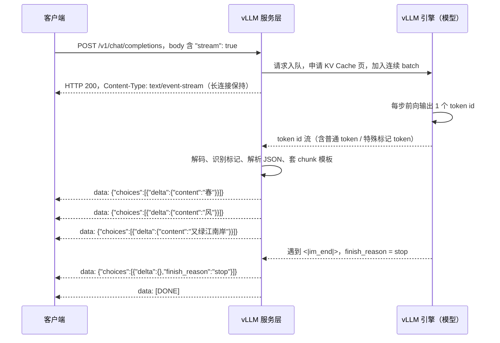

# vLLM 推理引擎 - 从 token 到 SSE 接口的全过程

大模型前向计算真正产出的只有 token id，接口里的 SSE 事件、`data` 报文、`tool_calls` 都是 vLLM 套模板构建的。本文讲清 token 长什么样、vLLM 如何把它翻译成 OpenAI 接口，并给出 Transformers 原生部署时自己解析封装的代码。

## 一、先纠正一个直觉：模型不会 "返回 JSON"

很多人第一次部署大模型时会有一个错觉：请求 `/v1/chat/completions`，模型思考了一会儿，"返回" 了一段 JSON 报文，里面有 `content`、有 `tool_calls`。

**这个理解是错的。** 模型从头到尾只做一件事：根据已有的 token 序列，预测下一个 token 是什么。它不知道什么是 HTTP，不知道什么是 SSE，更不知道自己输出的东西会被包成 JSON。整个过程可以拆成三层：


```
第一层：模型计算（数学）
  输入 token id → Transformer 前向 → logits（词表上几万个 token 的概率分布）
  → 采样/argmax → 下一个 token id（一个整数）
  → 循环，直到遇到结束标记

第二层：token 解码（翻译）
  token id 序列 → tokenizer 解码 → 文本字符串

第三层：接口封装（包装）
  文本字符串 → 识别其中的特殊标记和 JSON → 组装成 OpenAI 响应格式
  → 流式时切成一个个 SSE 事件（data: {...}）推给客户端
```

**只有第一层是模型干的，第二、三层都是推理框架（vLLM）干的。** 用一个类比：模型是一个只会往外蹦电报码的发报员，vLLM 是坐在旁边的翻译兼秘书 —— 负责把电报码译成人话、判断这段话是聊天还是要办事、再按标准公文格式誊写好、一句一句递到你手上。

## 二、token 到底是什么：不只是 "文本片段"

### 1. token 是 tokenizer 切出来的子词碎片

模型不认识文字，只认识整数。文字要先经过 tokenizer 切成 token、查词表映射成 id，模型才能处理。以 Qwen3 为例，一句普通的话切出来大概是：


```
原文：春风又绿江南岸
token：["春风", "又", "绿", "江南", "岸"]
id：   [102408, 1234, 56321, 789, 4567]   （数字为示意）
```

英文和函数名更碎，一个词可能被切成好几段：


```
get_weather → ["get", "_we", "ather"]
```

这意味着：**token 不是 "语义单位"，半个词、一个标点、一个空格都可能是一个 token。**

### 2. 特殊 token：function call 的 "标识" 就在这一层

词表里除了普通文本对应的 token，还有一类训练时就注册好的**特殊 token（special tokens）**，它们不显示给用户，却承担着 "格式信号" 的作用。以 Qwen3 的 ChatML 体系为例：


| 特殊 token       | 含义                      |
| -------------- | ----------------------- |
| \`<            | im\_start               |
| \`<            | im\_end                 |
| `<tool_call>`  | 助手接下来要输出工具调用            |
| `</tool_call>` | 工具调用内容结束                |
| `...`          | 思考过程开始 / 结束（Qwen3 思维模式） |

**当模型想调用工具时，它不会输出某种 "函数类型的数据"，而是输出&#x20;**`<tool_call>`**&#x20;这个特殊 token，再接着输出一段 JSON 文本。** 所以严格说，不存在 "function call 类型的 token"，存在的是：


* 一个**表示意图的标识 token**（`<tool_call>`）；

* 一串**按约定格式拼出 JSON 的普通文本 token**。

这两者合在一起，才构成一次完整的工具调用。

### 3. 一次 function call 的原始输出长什么样

调用 Qwen3 并告诉它有 `get_weather` 工具，问 "上海天气怎么样"，模型吐出来的 token id 解码后是：


```
<|im_start|>assistant
<tool_call>
{"name": "get_weather", "arguments": {"city": "上海"}}
</tool_call>
<|im_end|>
```

注意：


* 这在模型眼里和回答 "今天天气不错" 没有任何区别，**都是一串 token id**；

* 结构化的能力是模型在训练（对齐）阶段被教会的 —— 想调工具时，就按这个格式写；

* 而把这段文本变成 `{"tool_calls": [{"function": {"name": ..., "arguments": ...}}]}` 这种结构化对象，是框架的活。

## 三、vLLM 的两副面孔：推理引擎 + API 服务员

vLLM 内部其实是两个角色，理解这一点就理解了全文。

### 1. 引擎角色：让 token 出得又快又多

这是 vLLM 出名的看家本领，解决的是 "怎么高效地把 token 生成出来"：


* **PagedAttention**：把 KV Cache 像操作系统的虚拟内存一样分页管理。不同请求的显存不再各自占一大块连续空间，而是按页申请、用完即还，显存碎片几乎消失，同样一张卡能扛的并发请求数提升数倍；

* **Continuous Batching（连续批处理）**：传统做法是一批请求一起算、必须等最慢的那个算完才能换下一批；vLLM 让请求在 token 级别动态加入和退出 batch，一个请求结束立刻有新请求补进空位，GPU 不空转；

* **Chunked Prefill**：长 prompt 的预填充阶段切块执行，避免一个长请求卡住所有请求的解码；

* **Prefix Caching**：公共前缀（system prompt、few-shot 示例）的 KV Cache 自动复用。

### 2. 服务员角色：token 之后的 "套模板" 工作

这部分是本文重点，也是很多人没意识到的。token 从引擎里一批批出来后，vLLM 的服务层（OpenAI 兼容 API 服务器）依次做：


```
① 解码：token id → 文本，同时识别每个 token 是普通内容还是特殊标记
② 分流：
   - 普通文本 token → 归入 content
   - <tool_call> 之后的 token → 进入"工具调用解析通道"
   - 思考标记 token → 归入思维链内容（按接口决定是否透出）
③ 解析：把 <tool_call> 包裹的 JSON 解析成 {name, arguments} 结构
④ 套模板：按 OpenAI 协议组装响应对象
   {id, object, created, model, choices: [{index, message, finish_reason}], usage}
   其中 id、时间戳、finish_reason、token 用量统计全部是 vLLM 生成的
⑤ 流式推送：把上面的对象拆成增量 chunk，每个 chunk 包成 SSE 事件
```

**结论：SSE 报文里除了 content 里那几个字是模型生成的，其余所有字段 —— 外层 JSON、id、object、delta 结构、data: 前缀、\[DONE] 收尾 —— 全是 vLLM 自己构建的。**

### 3. 流式时一个容易忽略的细节：tool\_call 是增量拼出来的

非流式响应里，工具调用是一个完整对象：


```
{"tool_calls": [{"id": "call_abc", "type": "function",
                 "function": {"name": "get_weather", "arguments": "{\"city\":\"上海\"}"}}]}
```

但流式模式下，JSON 本身也是一个 token 一个 token 出来的，模型还没说完，框架就得开始推。vLLM 按 OpenAI 协议这样处理：


```
第1个 chunk：tool_calls 出现，给出 index 和函数名
  data: {"choices":[{"delta":{"tool_calls":[{"index":0,"id":"call_abc",
          "type":"function","function":{"name":"get_weather","arguments":""}}]}}]}
第2个 chunk：arguments 增量
  data: {"choices":[{"delta":{"tool_calls":[{"index":0,
          "function":{"arguments":"{\"city"}}]}}]}
第3个 chunk：arguments 继续增量
  data: {"choices":[{"delta":{"tool_calls":[{"index":0,
          "function":{"arguments":"\":\"上海\"}"}}]}}]}
```

客户端把同一 `index` 的 `arguments` 字符串像接水管一样拼起来，最后再 `json.loads`。**这套 "增量 JSON 拼接" 的协议和代码，同样是 vLLM 实现的，模型对此一无所知。**

## 四、SSE 报文全过程：一次请求的完整时序




图中从上到下有三类箭头，务必分清：


* 引擎 → 服务层：传递的是 **token id**（模型的全部产物）；

* 服务层内部：做**解码、解析、套模板**；

* 服务层 → 客户端：传递的是 vLLM 构建的 **SSE 文本**。

直接用 curl 可以看到最原始的报文：


```
curl http://localhost:8000/v1/chat/completions \
  -H "Content-Type: application/json" \
  -d '{
    "model": "Qwen/Qwen3-8B",
    "messages": [{"role": "user", "content": "写一句关于春天的诗"}],
    "stream": true
  }'
```

启动服务只需一条命令（vLLM 把 HTTP 服务器、SSE、工具调用解析全部内置）：


```
vllm serve Qwen/Qwen3-8B --host 0.0.0.0 --port 8000
```

## 五、如果用 Transformers 原生部署：这些脏活全得自己干

不用 vLLM，直接用 HuggingFace Transformers 也能部署，但第二、三层的工作要自己实现。完整的自封装分五步。

### 第 1 步：渲染对话模板

模型要求输入必须符合它的 ChatML 格式，`apply_chat_template` 会负责拼好（包括 `<|im_start|>`、角色、工具定义）：


```
from transformers import AutoTokenizer, AutoModelForCausalLM
import torch

tok = AutoTokenizer.from_pretrained("Qwen/Qwen3-8B")
model = AutoModelForCausalLM.from_pretrained(
    "Qwen/Qwen3-8B", torch_dtype=torch.bfloat16, device_map="auto"
)

tools = [{
    "type": "function",
    "function": {
        "name": "get_weather",
        "description": "查询某城市天气",
        "parameters": {
            "type": "object",
            "properties": {"city": {"type": "string"}},
            "required": ["city"],
        },
    },
}]

messages = [{"role": "user", "content": "上海今天天气怎么样？"}]
text = tok.apply_chat_template(
    messages, tools=tools, tokenize=False, add_generation_prompt=True
)
inputs = tok(text, return_tensors="pt").to(model.device)
```

### 第 2 步：生成，拿到 token id


```
out = model.generate(**inputs, max_new_tokens=512)
new_ids = out[0][inputs["input_ids"].shape[1]:]   # 只取新生成部分
```

`new_ids` 是一维整数张量 —— 这就是模型给你的全部东西。

### 第 3 步：解码成文本


```
raw_text = tok.decode(new_ids, skip_special_tokens=False)
print(raw_text)
# <tool_call>
# {"name": "get_weather", "arguments": {"city": "上海"}}
# </tool_call>
```

注意 `skip_special_tokens=False`：**做工具调用解析时必须保留特殊 token**，否则 `<tool_call>` 标记被丢掉，就不知道这段 JSON 是工具调用还是模型在 "讲故事"。只做纯文本展示时才用 `True`。

### 第 4 步：自己解析工具调用

写一个函数，从文本里提取 `<tool_call>` 块并解析 JSON：


```
import re, json

def parse_tool_calls(text: str):
    """从 Qwen 输出文本中提取工具调用，返回结构化列表；没有则返回空列表"""
    blocks = re.findall(r"<tool_call>\s*(.*?)\s*</tool_call>", text, re.DOTALL)
    calls = []
    for block in blocks:
        try:
            data = json.loads(block)
        except json.JSONDecodeError:
            continue  # 模型没输出完整，实际工程中可加重试/修复
        if isinstance(data, dict):
            data = [data]                  # 单个对象归一化成数组
        for item in data:
            calls.append({
                "name": item["name"],
                "arguments": item.get("arguments", {}),
            })
    return calls

calls = parse_tool_calls(raw_text)
# [{'name': 'get_weather', 'arguments': {'city': '上海'}}]
```

如果还要处理思维链，同理用正则提取思考标签里的内容；纯文本回答则取去掉所有标记之后的部分。**这一步就是 vLLM 服务层 "分流 + 解析" 的手工版。**

### 第 5 步：自己封装 HTTP + SSE

想要 HTTP 接口，用 FastAPI 包一层；想要流式打字机效果，用 `TextIteratorStreamer`，并自己按 SSE 格式（`data: {...}\n\n`）拼装：


```
import json
from fastapi import FastAPI
from fastapi.responses import StreamingResponse
from transformers import TextIteratorStreamer
from threading import Thread

app = FastAPI()

def gen_stream(messages: list):
    text = tok.apply_chat_template(messages, tokenize=False, add_generation_prompt=True)
    inputs = tok(text, return_tensors="pt").to(model.device)

    # Streamer 会累积 token 后再解码吐出文本片段，避免多字节字符被切成乱码
    streamer = TextIteratorStreamer(
        tok, skip_prompt=True, skip_special_tokens=True
    )
    Thread(
        target=model.generate,
        kwargs={**inputs, "streamer": streamer, "max_new_tokens": 512},
    ).start()

    for piece in streamer:
        chunk = {"choices": [{"delta": {"content": piece}, "finish_reason": None}]}
        yield f"data: {json.dumps(chunk, ensure_ascii=False)}\n\n"
    yield "data: [DONE]\n\n"

@app.post("/v1/chat/completions")
def chat(req: dict):
    return StreamingResponse(
        gen_stream(req["messages"]), media_type="text/event-stream"
    )
```

这里每个 `data: ...` 字符串都是我们自己拼的 —— 和 vLLM 内部做的事完全一样，只是简化了。

> 两个工程避坑点：
> **不要在 token 级别直接 decode 后&#x20;**
>
> `json.loads`
>
> ：一个 key 可能横跨多个 token，单个 token 不是合法 JSON，也可能把中文（多字节）切出乱码。要用 Streamer 取文本，或在内存里先缓冲完整 
>
> `<tool_call>`
>
>  块再解析；
> **流式 tool_call 要做增量缓冲**
>
> ：参考第三节 vLLM 的做法，按 index 拼接 arguments 字符串，等流结束后再解析。

### 第 6 步：执行工具，结果回灌

解析出工具调用后，在本地真正执行函数，再把结果以 `role: "tool"` 的消息追加到 messages，进行第二次生成，模型才会给出最终自然语言回答：


```
messages.append({"role": "assistant", "tool_calls": calls})
messages.append({"role": "tool", "tool_call_id": "xxx",
                 "content": json.dumps({"temp": "22℃", "weather": "晴"})})
# 再次 render → generate → decode，得到："上海今天晴，22℃左右"
```

这就是一次完整的 "ReAct 循环"，vLLM 通常配合外部 Agent 框架（如 LangGraph）完成。

## 六、vLLM 与 Transformers 原生对比


| 维度         | Transformers 原生（自封装）     | vLLM                          |
| ---------- | ------------------------ | ----------------------------- |
| 模型产物       | token id（相同）             | token id（相同）                  |
| 解码         | 自己 `decode`              | 内置                            |
| 工具调用解析     | 自己写正则 + json.loads       | 内置，输出标准 `tool_calls`          |
| HTTP / SSE | 自己用 FastAPI + Streamer 拼 | `vllm serve` 一键启动             |
| 并发能力       | 基本一次一个请求，batch 要自己组      | PagedAttention + 连续批处理，并发数倍提升 |
| 多卡 / 量化    | 手动 device\_map、量化库       | 原生 TP/PP、AWQ/GPTQ/FP8         |
| 适合场景       | 学习原理、单机调试、低频调用           | 生产环境、多用户、高并发                  |

一个常见的疑问：vLLM 是不是 "必需" 的？不是。Ollama、LMDeploy、SGLang 也都能做同样的事。但无论用哪个框架，**"模型只出 token、框架负责翻译和包装" 这个分层关系不变**，看懂了 vLLM，就看懂了所有推理框架。

## 七、自测

合上文章，应能直接回答：


1. 模型一次前向计算真正输出的是什么？（logits 采样后的 token id，一个整数序列）

2. token 有哪几类？function call 对应什么？（普通文本子词 + 特殊标记 token；`<tool_call>` 标识 + JSON 文本 token）

3. SSE 报文中哪些是模型生成的、哪些是 vLLM 构建的？（只有 content 里的文字是模型生成的，外层 JSON、delta、data 前缀、\[DONE]、id、usage 都是 vLLM 构建）

4. 流式模式下 tool\_call 的 arguments 是怎么到达客户端的？（按 index 分段增量推送，客户端拼接后再解析）

5. Transformers 原生部署要自己完成哪几件事？（渲染模板、generate 拿 token、decode、正则解析工具调用、FastAPI 拼 SSE、执行工具后回灌）

6. 为什么解析工具调用时 `skip_special_tokens` 要设 False？（丢掉 `<tool_call>` 标记就无法区分 JSON 是工具调用还是模型闲聊）

## 参考资料


* vLLM 官方文档（OpenAI 兼容服务、工具调用）：[https://docs.vllm.ai/](https://docs.vllm.ai/)

* vLLM 论文《Efficient Memory Management for Large Language Model Serving with PagedAttention》：[https://arxiv.org/abs/2309.06180](https://arxiv.org/abs/2309.06180)

* Qwen3 官方文档（ChatML 模板、Function Call 格式）：[https://qwen.readthedocs.io/](https://qwen.readthedocs.io/)

* Transformers 文档（apply\_chat\_template / TextIteratorStreamer）：[https://huggingface.co/docs/transformers/](https://huggingface.co/docs/transformers/)

* FastAPI StreamingResponse：[https://fastapi.tiangolo.com/advanced/custom-response/#streamingresponse](https://fastapi.tiangolo.com/advanced/custom-response/#streamingresponse)

* 相关文章：本目录 `2026-07-16_LangGraph入门-状态机与智能体编排实战.md`、`2026-09-16_什么是智能体-工作流与智能体的边界.md`