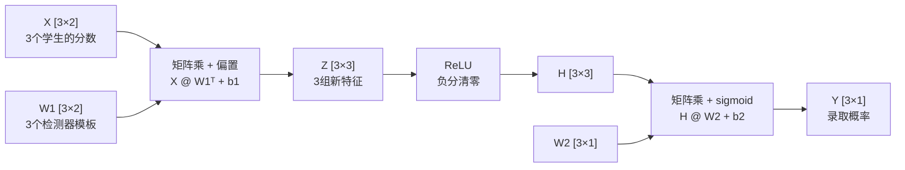

# 矩阵计算就是特征计算 —— 一个小模型的完整推理过程

神经网络看起来是一堆矩阵乘法，其实是一堆 "特征检测器" 在同时打分：一个神经元 `w·x+b` 是一个检测器，一层的多个神经元摞成权重矩阵，一次矩阵乘法就是所有特征同时算完。本文用一个 2→3→1 的录取判断小模型，把一次推理的每个数字手算一遍，并给出可直接运行的 NumPy 代码。


***

## 一、先给结论：矩阵的每一行是一个 "特征检测器"

很多人看模型代码，满屏都是 `X @ W`，于是觉得矩阵乘法很神秘。其实把它拆开看，对应关系非常朴素：


| 说法        | 实体              | 干什么            |
| --------- | --------------- | -------------- |
| 输入 `x`    | 原始特征            | 比如数学、英语两门分数    |
| `w·x + b` | 一个神经元 = 一个特征检测器 | 拿着自己的权重模板给输入打分 |
| 输出 `z`    | 一个新特征（检测器的打分）   | 分数越高，说明该特征越明显  |
| 多个神经元     | 多个特征检测器         | 同时检测多种不同的模式    |
| 权重矩阵 `W`  | 把所有检测器的模板摞起来    | 每一行是一个神经元的 `w` |
| `X @ Wᵀ`  | 一次矩阵乘法          | 所有样本、所有特征一次算完  |

**一句话：矩阵计算不是目的，而是 "批量算特征" 的组织形式。**

可以用一个生活类比理解：体检报告里有几十项指标，每个医生（神经元）只看自己关心的几项指标，各自下一个判断（新特征），主任医生（输出层）再把所有判断汇总成最终结论。矩阵乘法做的，就是让所有医生同时开工、一次交卷。


***

## 二、小模型登场：2 → 3 → 1

我们构造一个最小的神经网络，模拟 "研究生录取" 判断：


* **输入（2 个原始特征）**：数学分数、英语分数

* **隐藏层（3 个神经元，即 3 个特征检测器）**：


  * 神经元 1：理科倾向检测器

  * 神经元 2：文科倾向检测器

  * 神经元 3：综合优秀检测器

* **输出（1 个结果）**：录取概率


  ```mermaid
  flowchart LR
      X1["数学分数"] --> H1["神经元1<br/>理科倾向"]
      X2["英语分数"] --> H1
      X1 --> H2["神经元2<br/>文科倾向"]
      X2 --> H2
      X1 --> H3["神经元3<br/>综合优秀"]
      X2 --> H3
      H1 --> Y["录取概率"]
      H2 --> Y
      H3 --> Y
  ```

三个待判断的学生：


| 学生 | 数学 | 英语 | 直观特点 |
| -- | -- | -- | ---- |
| A  | 85 | 60 | 理科偏科 |
| B  | 55 | 90 | 文科偏科 |
| C  | 90 | 88 | 综合优秀 |

这些权重是我们手工设定的（真实模型里权重由训练学出来），但数值计算过程与真实模型**完全一致**：


```
        数学权重  英语权重   偏置阈值
神经元1 [ 0.9      0.1  ]    b = -70    理科：数学占90%
神经元2 [ 0.1      0.9  ]    b = -70    文科：英语占90%
神经元3 [ 0.5      0.5  ]    b = -85    综合：两门各占一半，阈值更高
```

输出层权重：`w=[0.5, 0.5, 5]`，偏置 `b=-10`，含义是 "综合优秀" 这一项含金量最高，偏科只算半个。


***

## 三、单个神经元：一个检测器怎么算

先只看学生 A 和 "理科倾向" 神经元。它做的事情就是**加权打分，再减去阈值**：


```
z₁ = 0.9×85 + 0.1×60 - 70
   = 76.5 + 6 - 70
   = 12.5
```

读作：学生 A 的加权分数是 82.5，超过阈值 70 分，高出 12.5 分 → **理科倾向检测到了**。

换成学生 B：


```
z₁ = 0.9×55 + 0.1×90 - 70
   = 49.5 + 9 - 70
   = -11.5
```

加权分数只有 58.5，没达到阈值 → **理科倾向没检测到**。

注意这里的权重就是检测器的 "模板"：`w=[0.9, 0.1]` 说的是 "我主要看数学，英语只作参考"。在真实的图像模型里，神经元的权重模板会更直观 —— 有的模板对竖边敏感，有的对横边、色块敏感，输入和模板越匹配，输出分数越高。


***

## 四、3 个神经元摞成矩阵：一次算 3 个特征

如果只算一个神经元，写一个点积就够了。但一层有 3 个神经元，难道要写 3 行点积？把 3 个神经元的权重向量**摞起来**，就得到权重矩阵 W₁：


```
W₁ = [ 0.9  0.1 ]
     [ 0.1  0.9 ]
     [ 0.5  0.5 ]

b₁ = [ -70, -70, -85 ]
```

学生 A 过这一层，就是一个矩阵乘向量，**一次算出 3 个新特征**：


```
z₁ = 0.9×85 + 0.1×60 - 70 = 12.5    理科倾向 ✓
z₂ = 0.1×85 + 0.9×60 - 70 = -7.5    文科倾向 ✗
z₃ = 0.5×85 + 0.5×60 - 85 = -12.5   综合优秀 ✗
```

这就是 "矩阵计算 = 特征计算" 的第一层含义：**矩阵的每一行负责产生一个特征，矩阵乘一次，3 个特征全部产出。**


***

## 五、3 个学生一起算：矩阵乘矩阵

现实中不会只判断一个学生。把 3 个学生也摞成矩阵 X（**每行一个样本**）：


```
X = [ 85  60 ]
    [ 55  90 ]
    [ 90  88 ]
```

一次矩阵乘法 Z = X @ W₁ᵀ + b₁，**9 个结果同时出来**（约定 "每行一个样本"，所以权重矩阵要转置）：


```
Z = [ 12.5   -7.5   -12.5 ]    ← 学生A
    [-11.5   16.5   -12.5 ]    ← 学生B
    [ 19.8   18.2     4   ]    ← 学生C
       理科    文科    综合
```

逐行解读这张 "特征表"：


| 学生 | 理科倾向  | 文科倾向 | 综合优秀  | 解读        |
| -- | ----- | ---- | ----- | --------- |
| A  | 12.5  | -7.5 | -12.5 | 只有理科检测器亮了 |
| B  | -11.5 | 16.5 | -12.5 | 只有文科检测器亮了 |
| C  | 19.8  | 18.2 | 4     | 三个检测器全亮   |

对比一下：手写 9 个点积要写 9 段代码，矩阵形式只有一行 `X @ W1.T + b1`。**算的东西一模一样，但形式上从 "9 次重复劳动" 变成了 "1 次批量操作"。**


***

## 六、ReLU 激活：负分清零，也是 "弯折" 的关键

矩阵乘法之后，通常紧跟一个激活函数。我们用最常见的 ReLU：


```
ReLU(z) = max(0, z)
```

它有两层含义：

**第一层（特征视角）：检测不到就不发声。** 打分为负说明模板没匹配上，直接归零，不占用后续判断的话语权：


```
H = [ 12.5    0      0  ]    ← A：只保留理科特征
    [  0    16.5     0  ]    ← B：只保留文科特征
    [ 19.8   18.2    4  ]    ← C：三个特征全保留
```

**第二层（原理视角）：没有它，多层网络会 "坍塌"。** 如果去掉激活函数，多层线性变换在数学上会合并成一个：


```
W₂(W₁x) = (W₂W₁)x
```

也就是说，**没有非线性，堆 100 层和堆 1 层没有区别，网络永远只能画直线**，无法处理 "内外圈" 这类线性不可分的问题。ReLU 只加了一个 "折角"，就让每个神经元的输出从直线变成折线；大量折线叠加，就能拼出任意复杂的弯曲边界（通用近似定理）。

所以一个完整的重复单元是：


```
线性变换（矩阵乘，产生特征） → 非线性激活（让特征能弯折、能筛选）
```


***

## 七、输出层：再做一次矩阵乘法得到结论

隐藏层产出了 3 个新特征，输出层要把它们组合成一个录取概率。输出层权重：


```
W₂ = [ 0.5, 0.5, 5 ]ᵀ    b₂ = -10
```

再做一次矩阵乘法：


```
学生A: 0.5×12.5 + 0.5×0    + 5×0 - 10 = -3.75
学生B: 0.5×0    + 0.5×16.5 + 5×0 - 10 = -1.75
学生C: 0.5×19.8 + 0.5×18.2 + 5×4 - 10 = 29
```

最后过 sigmoid 函数，把任意分数压到 0\~1 的概率区间：


```
sigmoid(x) = 1 / (1 + e⁻ˣ)
```


| 学生 | 综合分数  | 录取概率       | 结论        |
| -- | ----- | ---------- | --------- |
| A  | -3.75 | **2.3%**   | 偏科，基本不录   |
| B  | -1.75 | **14.8%**  | 偏科，希望渺茫   |
| C  | 29    | **≈ 100%** | 综合优秀，几乎必录 |

网络的判断与人类直觉完全一致：偏科不行，综合优秀才稳。


***

## 八、完整数据流与 shape 对账

把整个推理过程画成数据流：




shape 对账表（每一行的数字都能在矩阵里找到来源）：


| 张量    | shape    | 读法                  |
| ----- | -------- | ------------------- |
| X     | \[3 × 2] | 3 个样本，每个样本 2 个原始特征  |
| W₁    | \[3 × 2] | 3 个检测器，每个检测器看 2 个输入 |
| Z / H | \[3 × 3] | 3 个样本，每个样本产出 3 个新特征 |
| W₂    | \[3 × 1] | 输出层把 3 个特征组合成 1 个分数 |
| Y     | \[3 × 1] | 3 个样本，各得 1 个录取概率    |

矩阵乘法的 shape 规则只有一条：**内侧对齐，外侧保留**：


```
[3 × 2] @ [2 × 3] = [3 × 3]
        [3 × 3] @ [3 × 1] = [3 × 1]
```


***

## 九、可直接运行的 NumPy 代码


```
import numpy as np

# 输入：3 个学生的两门分数（每行一个样本）
X = np.array([[85, 60],
              [55, 90],
              [90, 88]], dtype=np.float32)

# 隐藏层：3 个特征检测器（每行一个神经元的权重模板）
W1 = np.array([[0.9, 0.1],
               [0.1, 0.9],
               [0.5, 0.5]], dtype=np.float32)
b1 = np.array([-70, -70, -85], dtype=np.float32)

# 输出层：把 3 个新特征组合成录取分数
W2 = np.array([[0.5],
               [0.5],
               [5.0]], dtype=np.float32)
b2 = -10.0

# ---- 一次完整推理（全部是矩阵计算）----
Z = X @ W1.T + b1              # [3×2] @ [2×3] = [3×3]：3 个特征同时算完
H = np.maximum(0, Z)           # ReLU：负分清零
score = H @ W2 + b2            # [3×3] @ [3×1] = [3×1]：输出层组合
Y = 1 / (1 + np.exp(-score))   # sigmoid：压成概率

print(np.round(Y, 4))
# [[0.023 ]
#  [0.148 ]
#  [1.0   ]]
```

代码里只有两次矩阵乘法，但它们完成了：**3 个检测器 × 3 个样本 = 9 次特征提取，以及 3 次最终汇总**。


***

## 十、放大到真实模型：结构完全同构

小模型看懂了，真实大模型只是把同样的结构放大，没有任何新东西：


| 维度     | 本文小模型           | 真实大模型（以 LLaMA 类为例）        |
| ------ | --------------- | ------------------------- |
| 输入特征数  | 2               | 4096（词向量维度）               |
| 单层检测器数 | 3               | 11008 甚至更多（FFN 中间层）       |
| 层数     | 1 个隐藏层          | 32 层以上                    |
| 一批样本数  | 3 个学生           | 几百到几千条序列                  |
| 矩阵形状   | \[3×2] @ \[2×3] | \[N×4096] @ \[4096×11008] |
| 单次乘法含义 | 3 个特征检测         | 上万个特征检测同时进行               |

Transformer 里的注意力机制同样不例外：Q、K、V 三次投影就是三次矩阵乘法，每个投影头可以理解为一个 "关注某种词语关系" 的检测器：


```
Attention(Q, K, V) = softmax(Q @ Kᵀ / √d) @ V
```

这解释了为什么模型里 90% 以上的浮点运算都是矩阵乘法：


1. **前向传播**：每一层的特征提取都是矩阵乘；

2. **反向传播**：梯度沿层回传，链式法则展开后还是矩阵乘；

3. **注意力 / 卷积**：卷积经 im2col 变换后也是矩阵乘。

而 GPU 之所以算得快，正是因为这堆计算**结构完全同构**：成千上万个互不依赖的乘加运算，可以摊到几千个核心上同时执行；矩阵越大，硬件利用率越高。NVIDIA 的 Tensor Core 本质上就是专门为矩阵乘加（MAC）定制的电路。


***

## 十一、自测与记忆锚

### 11.1 自测题


| # | 问题                                    | 答案要点                              |
| - | ------------------------------------- | --------------------------------- |
| 1 | 一个神经元 `w·x+b` 对应什么？                   | 一个特征检测器，用权重模板给输入打分；它的输出才是一个新特征    |
| 2 | 为什么多个神经元的计算可以写成一次矩阵乘法？                | 把每个神经元的权重摞成矩阵的一行，矩阵乘一次就同时产出所有特征   |
| 3 | `[3×2] @ [2×3] = [3×3]`，结果矩阵里每个元素是什么？ | 第 i 行第 j 列 = 第 i 个样本在第 j 个检测器上的打分 |
| 4 | 去掉激活函数，多层网络会怎样？                       | 线性层合并 W₂W₁，多层等价于一层，只能表达直线         |
| 5 | 为什么矩阵乘法特别适合 GPU？                      | 大量结构同构、互不依赖的乘加运算，天然并行             |

### 11.2 三句话记忆锚


| 层   | 一句话                                              |
| --- | ------------------------------------------------ |
| 神经元 | **一个&#x20;**`w·x+b`**&#x20;就是一个特征检测器，输出是一个新特征。** |
| 矩阵  | **权重矩阵的每一行是一个检测器，一次矩阵乘 = 所有特征同时算完。**             |
| 非线性 | **激活函数让直线弯折、让负分静默；没有它，多层网络等于一层。**                |


***

## 关联文章


* `模型原理/2026-09-23_计算图-算子-张量与shape.md` — 张量、shape 与计算图的完整概念，本文是其 "矩阵为什么在算特征" 的具象补充

* `模型原理/2026-06-22_大模型推理流程.md` — 放大后的真实模型推理流程

* `模型原理/2026-09-27_内存带宽为何决定解码速度-算术强度与带宽三因子.md` — 矩阵乘法的算力与内存账

* `模型原理/2026-08-03_数值类型FP32-FP16-BF16-INT8-INT4位结构与量化原理.md` — 矩阵元素在真实模型里的存储格式


***

*数值口径声明：本文所有中间结果（Z、H、综合分数）与概率值均由 NumPy 复算，权重为手工设定的教学示例，不代表任何真实录取模型；sigmoid 概率分别为 2.30%、14.80%、100%。*

*来源：整理自 2026-10-08 关于 "模型里为什么这么多矩阵计算" 的概念学习对话。*