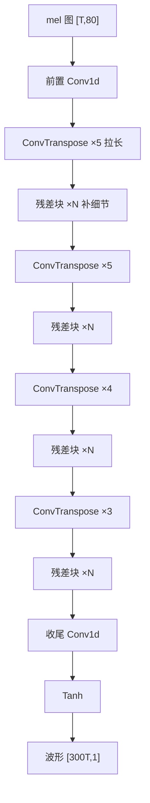

# HiFiGAN 声码器原理 - mel 频谱图如何还原成波形

HiFiGAN 是 TTS 的「最后一跳」：把声学模型产出的 mel 频谱图（一张压缩的「声音热力图」），还原成喇叭能播放的波形。它的核心动作只有两个 —— 用 4 个转置卷积（ConvTranspose）把时间轴逐级拉长，上采样率连乘为 300，一帧 mel 展开成 300 个采样点；每级拉长后用残差块（多组不同膨胀率的卷积）把声音的纹理细节补细。整条生成器是纯卷积、无注意力、无 LayerNorm，所以结构简单、端侧好部署。训练时它是 GAN（带判别器），部署时只留生成器。


***

## 一、定位：它在 TTS 链路的哪一跳

### 1.1 链路位置


HiFiGAN 卡的是最后那一跳：**前面的模型负责「该说什么」，HiFiGAN 负责「把它真正变成声音」。**

### 1.2 为什么必须有这一步

mel 频谱图是给模型看的「压缩图」，**喇叭不认它**—— 声卡只接受一个个连续的采样点（波形）。就像你有了一张房屋的设计图，但人要住进去，还得有人照着图把房子盖出来。HiFiGAN 就是这个「照着 mel 图把声音盖出来」的施工队。

### 1.3 一句话边界

**它不生成内容，只还原声音。** 说什么话、什么语气，是上游声学模型决定的；HiFiGAN 拿到的是已定稿的 mel，它只负责高保真地还原。指望它改内容是误用。

> 相关边界：本知识库 
>
> `模型原理/2026-06-27_Qwen3-TTS-0.6B模型架构与原理.md`
>
>  讲的是「文本→mel」这前半段（含自回归 Talker），本篇只讲「mel→波形」这后半段的声码器。


***

## 二、输入输出：一张小图 → 一条长波形

### 2.1 实测的输入输出（以 `hifigan_csmsc.onnx` 为准）


| 项  | 名称                    | 形状          | 类型    |
| -- | --------------------- | ----------- | ----- |
| 输入 | `logmel`              | `[T, 80]`   | float |
| 输出 | `transpose_103.tmp_0` | `[300T, 1]` | float |


* 输入 **T 帧 mel、每帧 80 个 mel 频带**；

* 输出 **300T 个采样点**，单列存储（概念上是一条一维波形，张量形状是 `[N, 1]`）。

### 2.2 为什么输出会「变长」300 倍

mel 是**压缩**表示：一帧 mel 记录的是一小段时间（12.5ms）内声音的频谱概括，而这一小段在波形里实际有 **300 个采样点**。所以还原时必须把每帧「展开」，输出自然比输入长。


* 采样率 24000 Hz，帧移 hop = 300，一帧时长 = 300 / 24000 = **12.5 ms**；

* 实测：喂 10 帧 mel → 出 3000 点；喂 100 帧 → 出 30000 点，倍数恒为 300。

### 2.3 生活类比


| 类比   | 压缩侧      | 展开侧        |
| ---- | -------- | ---------- |
| 乐谱   | 一个音符（符号） | 演奏成一串持续的声音 |
| 解压文件 | 小压缩包     | 解压后的大文件    |
| 图像   | 缩略图      | 放大后的高清图    |

**一句话：mel 是「压缩图」，波形是「展开后的原件」，HiFiGAN 做的是「解压」。**


***

## 三、先搞懂「原料」：mel 频谱图是什么

### 3.1 波形怎么变成 mel 图


1. **STFT**：把波形切成一小段一小段，每段做傅里叶变换，得到「这段时间里有哪些频率、各有多响」；

2. **mel 滤波**：人耳对频率的感知不是均匀的 —— 低频分辨得细、高频分辨得粗。用一组 mel 滤波器把频率轴按这个规律压缩成 80 个频带。

### 3.2 它长什么样

mel 频谱图是一张**二维热力图**：


* **横轴** = 时间；

* **纵轴** = mel 频率（音高，从低到高）；

* **颜色 / 数值** = 能量（这个音有多响）。

所以它本质是「声音的照片」—— 把一条随时间剧烈起伏的曲线，定格成一张能一眼看出音高和节奏的小图。语音模型爱用它，是因为它比原始波形小得多、规律得多、好处理。

> 注意「配对契约」：声码器和训练时的 mel 提取参数（帧长、帧移、频带数、log 写法）是
>
> **绑定**
>
> 的。换一套 mel 参数，声码器出来的声音就会发闷、变调甚至全毁。这是部署时最容易踩的坑。


***

## 四、生成器怎么把图变成声音（核心）

### 4.1 整体数据流




### 4.2 上采样：负责「拉长」


* 共 **4 个 ConvTranspose（转置卷积）**，每级把时间轴拉长一截；

* 上采样率为 **\[5, 5, 4, 3]，连乘 = 5×5×4×3 = 300**；

* 不是一次拉到 300 倍，而是**逐级放大**—— 这样每一级都能在比较「温和」的尺度上处理，结果更稳。

### 4.3 残差块：负责「补细节」


* 每级拉长后，波形是「糊」的（像马赛克放大后边缘模糊）；

* **残差块（ResBlock）** 用多组卷积 + 残差连接（Add）把纹理修清楚；

* 块内用**不同膨胀率（dilation）的卷积**，让卷积「看」得更远，从而补全更长跨度的声音纹理。

### 4.4 收尾


* 最后一个 Conv1d 把通道收成 1；

* 过 **Tanh** 把数值压到 `[−1, 1]`—— 这正是波形采样点的正常取值范围；

* 输出 `[300T, 1]`。

### 4.5 实测算子构成（852 个节点）


| 算子                                       | 数量    | 作用                      |
| ---------------------------------------- | ----- | ----------------------- |
| Conv                                     | 74    | 残差块卷积、前置 / 收尾卷积         |
| **ConvTranspose**                        | **4** | **4 级上采样**              |
| LeakyRelu                                | 77    | 激活函数                    |
| Add                                      | 126   | 残差连接、偏置                 |
| Tanh                                     | 1     | 输出激活                    |
| Constant / Unsqueeze / Squeeze / Reshape | 558   | Paddle 导出产生的形状 / 常量辅助节点 |

剥掉大量「形状调整」辅助节点，**真正干活的就是 Conv + ConvTranspose + LeakyReLU + Add + Tanh**。


***

## 五、两个关键部件：拉长与补细的配合


|     | 上采样（ConvTranspose） | 残差块（ResBlock） |
| --- | ------------------ | ------------- |
| 干什么 | 把时间轴拉长             | 把拉长后的纹理补细     |
| 类比  | 把缩略图放大             | 修图师 AI 补全马赛克  |
| 少了它 | 长度不够，出不了完整波形       | 声音发糊、发噪、细节丢失  |

**为什么残差块要用「膨胀卷积」：** 普通卷积每次只能看到相邻的几个点；把膨胀率调大（如 1、3、5），卷积就能在不增加参数的情况下「看」到更远的范围。一个残差块里并列几组不同膨胀率的卷积，等于同时用「近看、中看、远看」三种视角把声音补全。

整条流水线就是反复地「**拉长 → 补细 → 再拉长 → 再补细**」，像一条从粗到精的声音加工线。


***

## 六、几个反直觉点

**① 没有注意力，是纯卷积网络。**

HiFiGAN 里没有 Transformer 那套 MultiheadAttention，也没有 LayerNorm。这是它的优点：结构规则、计算可预测、跑得快、端侧转换简单。

**② 训练时是 GAN，部署时只留生成器。**

HiFiGAN 名字里的 GAN 说明它训练时有「判别器」（多周期 / 多尺度判别器，负责分辨真假声音），但**部署时判别器完全丢弃，只用到上面讲的生成器**。所以模型文件里看不到判别器。

**③ 拉长不是一次到位，而是 4 级连乘。**

5×5×4×3 = 300，逐级放大比一次性放大更稳、更好训练。

**④ 输出不是「一维」，是&#x20;**`[N, 1]`**。**

概念上是一条一维波形，但张量存成单列二维数组（最后一维为 1），这是 Paddle 导出的写法。


***

## 七、为什么端侧好部署


* **全是规则卷积**：Conv1d / ConvTranspose1d 是 NPU MAC 引擎的主场，计算密集、规则、量化友好；

* **无注意力、无 LayerNorm**：避开了端侧最头疼的两类算子；

* **唯一的算子风险点就是 4 个 ConvTranspose**：转置卷积的「散射累加」访存模式和普通卷积相反，部分 NPU 支持差。若不支持，可用「最近邻上采样 + 普通 Conv1d」等价替换，再用精度、耗时、算子数、融合是否被拆开去验收。

这也解释了为什么 P0-1 把 HiFiGAN 作为 \*\*「必须拿下的首胜」\*\*—— 它结构最简单、坑最少，最适合用来建立「ONNX → 算子核查 → 转换 → 上板」的完整往返。


***

## 八、可运行代码

### 8.1 加载模型、喂 mel、出波形（onnxruntime）


```
import numpy as np
import onnxruntime as ort

sess = ort.InferenceSession("hifigan_csmsc.onnx", providers=["CPUExecutionProvider"])

# 输入：[T, 80] 的 logmel（实际要用与训练一致的 mel 提取产生）
T = 100
mel = np.random.randn(T, 80).astype(np.float32) * 0.1   # 此处仅示意形状

wave = sess.run(None, {"logmel": mel})[0]   # 输出 [300T, 1] = [30000, 1]
print(wave.shape)

# 存成可播放 wav（24kHz、16bit）
import wave
pcm = np.clip(wave[:, 0], -1, 1)
pcm = (pcm * 32767).astype("<i2")
with wave.open("out.wav", "wb") as w:
    w.setnchannels(1)
    w.setsampwidth(2)
    w.setframerate(24000)
    w.writeframes(pcm.tobytes())
```

> 注意：随机 mel 出的只是噪声，用来验证形状；要听到正常声音，必须用真实音频、按该模型的 mel 参数提取 mel。

### 8.2 概念骨架：「拉长 + 补细」的最小结构


```
import torch, torch.nn as nn

class ResBlock(nn.Module):
    """补细节：不同膨胀率卷积 + 残差连接"""
    def __init__(self, ch, dilations=(1, 3, 5)):
        super().__init__()
        self.convs = nn.ModuleList([
            nn.Sequential(nn.LeakyReLU(0.1),
                          nn.Conv1d(ch, ch, 3, padding=d, dilation=d))
            for d in dilations
        ])
    def forward(self, x):
        for c in self.convs:
            x = x + c(x)          # 残差 Add
        return x

class MiniVocoder(nn.Module):
    """拉长：逐级上采样，每级后接残差块补细"""
    def __init__(self, upsample_rates=(5, 5, 4, 3)):
        super().__init__()
        ch = 16
        self.head = nn.Conv1d(80, ch, 7, padding=3)
        self.stages = nn.ModuleList()
        for r in upsample_rates:
            self.stages.append(nn.ModuleDict({
                "up": nn.ConvTranspose1d(ch, ch, kernel_size=r, stride=r),
                "refine": ResBlock(ch),
            }))
        self.tail = nn.Conv1d(ch, 1, 7, padding=3)

    def forward(self, mel):              # mel [B, 80, T]
        x = self.head(mel)
        for st in self.stages:
            x = st["up"](x)              # 拉长
            x = st["refine"](x)          # 补细
        return torch.tanh(self.tail(x))   # [B, 1, 300T]
```


***

## 九、自测题与记忆锚

### 9.1 自测题


| # | 问题                    | 答案要点                                    |
| - | --------------------- | --------------------------------------- |
| 1 | HiFiGAN 的输入、输出各是什么类型？ | 输入 mel 频谱图 `[T,80]`；输出波形 `[300T,1]`     |
| 2 | 为什么输出比输入长？倍数是多少？      | 一帧 mel 展开成 hop=300 个采样点（24kHz 下 12.5ms） |
| 3 | 时间轴靠什么拉长？共几级？         | 4 个 ConvTranspose，率 \[5,5,4,3]，连乘 300   |
| 4 | 残差块干什么？为什么用膨胀卷积？      | 补纹理细节；膨胀卷积在不增参数下「看」得更远                  |
| 5 | 有没有注意力 / LayerNorm？   | 都没有，纯卷积、LeakyReLU                       |
| 6 | 训练时的 GAN 判别器部署时去哪了？   | 丢弃，只留生成器                                |
| 7 | 端侧主要算子风险是什么？怎么替换？     | 4 个 ConvTranspose；可换成上采样 + 普通 Conv1d    |

### 9.2 三句话记忆锚


| 层  | 一句话                                       |
| -- | ----------------------------------------- |
| 角色 | **HiFiGAN 是 TTS 最后一跳，把 mel 图「解压」成波形。**    |
| 拉长 | **4 个转置卷积逐级拉长（5×5×4×3=300），一帧出 300 点。**   |
| 补细 | **残差块用膨胀卷积补细节；无注意力、无 LayerNorm，纯卷积最好部署。** |


***

## 关联文章


* `模型原理/2026-10-10_TTS架构与声码器种类.md` — TTS 功能骨架与声码器五代路线总览

* `模型原理/2026-06-27_Qwen3-TTS-0.6B模型架构与原理.md` — 「文本→mel」前半段，自回归 Talker

* `模型原理/2026-08-03_PyTorch-ONNX-RKNN模型格式对比与转换链路.md` — 模型转换链路与 EP 分发

* `模型原理/2026-08-03_数值类型FP32-FP16-BF16-INT8-INT4位结构与量化原理.md` — 量化的位级基础

* `模型原理/2026-09-23_Silero-VAD原理-流式推理机制.md` — 语音链路里 VAD 这一跳的机制

* `模型原理/2026-09-29_RK3588推理数据流-CPU缓存与NPU的DDR交接.md` — NPU 侧数据通路

* `模型原理/2026-10-08_矩阵计算就是特征计算-小模型推理全过程.md` — 卷积 / 矩阵乘在算什么


***

*数值口径声明：本文输入输出形状、算子数量、hop 倍数均由 onnxruntime /onnx 对&#x20;*`hifigan_csmsc.onnx`*&#x20;实测得到（输入&#x20;*`[T,80]`*、输出&#x20;*`[300T,1]`*、852 节点、4 个 ConvTranspose）。上采样率 \[5,5,4,3] 与 24kHz 采样率为该模型的配置；不同声码器（不同采样率、hop、mel 数）的具体数字会变，以各自模型打印的 shape 与官方文档为准。*

*来源：整理自 2026-10-10「L1 回炉」关于 HiFiGAN 输入输出与生成器流程的学习对话。*