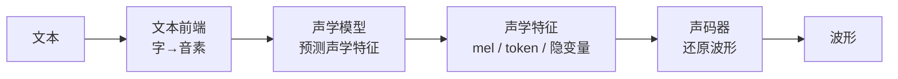
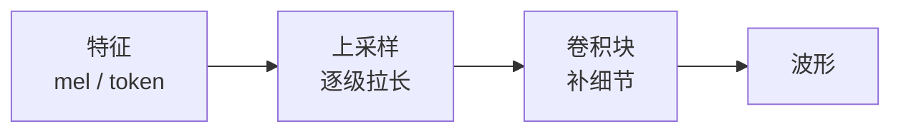
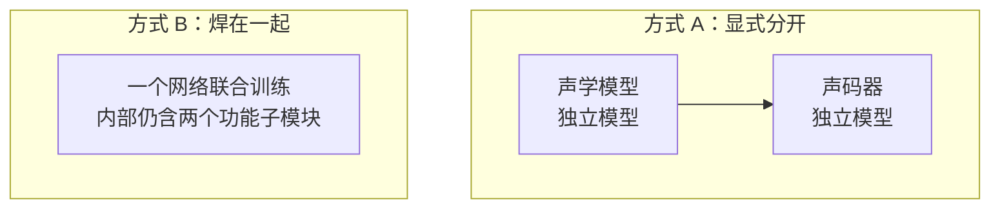

# TTS 架构与声码器种类

TTS 拆开看就两件事：**声学模型**把文本「预测」成声学特征（mel 频谱图或离散 token），**声码器**再把特征「还原」成喇叭能播放的波形。声码器本身有五代路线 —— 信号处理、自回归、并行 GAN/ISTFT、扩散、神经编解码；但现在主流的并行声码器，骨架几乎都是「上采样拉长 + 卷积补细」，和 HiFiGAN 同构。这两个功能在物理上可以分成两个独立模型（Tacotron2 + HiFiGAN、Qwen3-TTS），也可以焊在一个网络里联合训练（VITS、NaturalSpeech）。记住功能骨架，看到任何新 TTS 都能自动拆开。

***

## 一、先看全貌：TTS 的功能骨架

### 1.1 一条功能链

### 1.2 三段各干什么

| 段        | 干什么           | 输入 → 输出   |
| -------- | ------------- | --------- |
| 文本前端（可选） | 文本规范化、把字转成音素  | 文字 → 音素序列 |
| 声学模型     | 「预测」这句话该发什么声音 | 音素 → 声学特征 |
| 声码器      | 把特征「还原」成波形    | 声学特征 → 波形 |

### 1.3 一个用词纠正：声学模型是「预测」不是「算」

文本里没有声音，mel 不可能从文字里「提取」出来，而是声学模型**想象 / 预测**的「这句话应该长这样」的描述。只有 STFT 那种从波形得到频谱的过程才叫「算」。

***

## 二、两个主角：声学模型与声码器

|      | 声学模型                               | 声码器                       |
| ---- | ---------------------------------- | ------------------------- |
| 角色   | 决定「说什么、什么语气」                       | 负责「把它真正变成声音」              |
| 输入   | 音素 / 文本                            | 声学特征                      |
| 输出   | 声学特征（mel /token）                   | 波形                        |
| 典型代表 | Tacotron2、FastSpeech2、Talker、各种 LM | HiFiGAN、Vocos、EnCodec 解码器 |
| 改变它  | 影响内容、韵律、音色                         | 影响音质、自然度、速度               |

**声学特征不只有 mel**：

| 形态             | 是什么            | 谁在用                   |
| -------------- | -------------- | --------------------- |
| mel 频谱图        | 压缩的「声音热力图」，最常见 | Tacotron、F5、CosyVoice |
| 离散 codec token | 神经编码器量化出的编号    | VALL-E、Qwen3-TTS      |
| 隐变量 z          | 网络内部的连续表示      | VITS、NaturalSpeech    |

***

## 三、声码器为什么必须有

mel 是给模型看的**压缩图**，喇叭不认它 —— 声卡只接受一个个连续的采样点。就像有了房屋设计图，还得有人照着图把房子盖出来。

* **波形 → mel** 是「分析」（压缩、拍摄）；

* **mel → 波形** 是「合成」（还原、施工）。

声码器躲不掉的共同难题是**变长**：一帧特征记录一小段时间的概括，而这一小段在波形里有 hop 个采样点，还原时必须把每帧展开。以 `hifigan_csmsc.onnx` 实测：一帧 mel 展开成 300 个采样点（24kHz 下 12.5ms）。

***

## 四、声码器的五代路线

### 4.1 怎么看速度：先认识 RTF

**RTF（实时率）= 合成耗时 ÷ 音频时长。** RTF < 1 表示快于实时（能实时出声），数字越小越快。下面的 RTF 都是**量级**，随硬件、模型大小、扩散步数变化很大，只用来横向比较几代的快慢。

| 代际 | 代表声码器 | 机制 | 速度（RTF 量级） | 端侧适宜度 | 搭它的主流 TTS |
|---|---|---|---|---|---|
| ① 信号处理 | Griffin-Lim、WORLD | 公式反推相位 / 拼参数 | WORLD 快（CPU≈0.1）；Griffin-Lim 慢（≈1~10） | WORLD 适宜；Griffin-Lim 不适宜 | 早期 Tacotron、ESPnet demo |
| ② 自回归 | WaveNet、WaveRNN、LPCNet | 逐采样点串行 | WaveNet 极慢（≈10~100）；LPCNet 可 CPU 实时（≈0.1~0.8） | 仅 LPCNet 适宜 | Tacotron2 原版、手机端 TTS |
| ③ 并行 GAN/ISTFT | MelGAN、**HiFiGAN**、BigVGAN、Vocos | 上采样拉长 + 卷积补细，并行 | 很快（GPU≈0.01，CPU≈0.2~1） | **最适宜**，NPU/CPU 都能跑 | FastSpeech2、PaddleSpeech、CosyVoice、F5 |
| ④ 扩散 | DiffWave、WaveGrad | 从噪声多步去噪 | 慢（≈1~20，看步数） | 不适宜 | NaturalSpeech 1、研究系统 |
| ⑤ 神经编解码 | EnCodec、SoundStream、DAC | token → 上采样卷积解码 | 快（GPU≈0.01，端侧≈0.2~1） | 适宜，解码器轻量 | VALL-E、Qwen3-TTS、Bark |

### 4.2 ① 信号处理

没有神经网络。Griffin-Lim 纯靠迭代算法从幅度谱反推相位，要反复几十次 STFT，慢且机械；WORLD 用基频 F0、频谱包络、非周期分量三类参数合成，CPU 上轻量、可实时。早期 Tacotron 教程常拿 Griffin-Lim 兜底（NVIDIA 官方 demo），WORLD 则用于传统参数式和轻量 TTS。

### 4.3 ② 自回归

WaveNet 是第一个深度神经声码器，用膨胀卷积、逐采样点生成，质量高但极慢（GPU 上 RTF 都常大于 10）。WaveRNN、LPCNet 做了轻量化，其中 **LPCNet 专为手机 CPU 设计、可实时**。Tacotron2 原版就是配 WaveNet；但串行无法并行，端侧只有 LPCNet 这类轻量版可行。

### 4.4 ③ 并行 GAN/ISTFT（主流）

非自回归，整段并行，速度快、质量高，是端侧 TTS 的标配。

* **HiFiGAN / BigVGAN**：转置卷积上采样 + 残差块补细节，GAN 训练；

* **Vocos**：主干卷积上采样，末段用 ISTFT 直接转波形，更快。

最经典的组合是 **FastSpeech2 + HiFiGAN**；PaddleSpeech、CosyVoice、F5-TTS 也都用这一代（CosyVoice、F5 用 Vocos）。

### 4.5 ④ 扩散

从纯噪声开始，像「雕刻」一样多步去噪出波形，质量很高，但要迭代几十上百步，RTF 常大于 1、不实时。可通过少步蒸馏加速，但会掉质量。NaturalSpeech 1 用的就是扩散声码器，多见于研究 / 高保真系统，端侧暂不适宜。

### 4.6 ⑤ 神经编解码

先有个神经编码器把波形量化成离散 token（残差矢量量化 RVQ），解码器再把 token 还原成波形。解码器是卷积上采样、轻量、可并行，端侧友好。它是语音大模型（codec LM）的基础：**VALL-E 用 EnCodec、Qwen3-TTS 用自家 Code2Wav、Bark 也用 EnCodec**。

***

## 五、关键规律：主流并行声码器骨架同构

剥掉各代的包装，③ 并行声码器和 ⑤ 编解码器的**解码部分**，骨架几乎一样：

* **拉长**：用上采样（转置卷积 / 上采样 + 卷积）把时间轴放大，一帧展开成 hop 个点；

* **补细**：用卷积（常用膨胀卷积扩大感受野）把拉长后的纹理修清楚。

**为什么端侧好部署**：全是规则卷积，计算密集、量化友好；没有注意力、没有 LayerNorm，避开了端侧最头疼的算子。唯一的小风险是转置卷积（部分 NPU 支持差，可换成「上采样 + 普通卷积」）。

***

## 六、物理打包：两种方式

功能骨架不变，但这两个功能在工程上有两种装法：

|    | 方式 A：显式分开                                 | 方式 B：焊在一起          |
| -- | ----------------------------------------- | ------------------ |
| 训练 | 各自训练                                      | 联合训练               |
| 替换 | 声码器可独立换                                   | 改动牵一发动全身           |
| 流式 | 天然可拆成流水线                                  | 需专门设计              |
| 代表 | Tacotron2/FastSpeech2 + HiFiGAN、Qwen3-TTS | VITS、NaturalSpeech |

Qwen3-TTS 是典型的 A：Talker（声学模型）和 Code2Wav（声码器）是两个独立进程，通过共享内存边生成边解码，实现帧级流式。

***

## 七、主流端到端 TTS 怎么对号

端到端 TTS 是**完整系统**，不能整体塞进五代里；只有它的「最后一跳」才属于某一种。**判据是看声码器吃什么：**

| 系统        | 前半段：声学模型                | 中间表示        | 声码器（代际）           |
| --------- | ----------------------- | ----------- | ----------------- |
| VALL-E    | 自回归 LM 预测 token         | codec token | ⑤ EnCodec 解码器     |
| Qwen3-TTS | Talker 自回归（28 层）        | 16 路 token  | ⑤ 因果卷积 Code2Wav   |
| CosyVoice | LM 出 token + flow 转 mel | token → mel | ③ Vocos / HiFiGAN |
| F5-TTS    | flow matching（DiT）      | mel         | ③ Vocos           |

* **吃 mel** → ③：CosyVoice、F5 用 Vocos（CosyVoice 早期用 HiFiGAN）；

* **吃离散 token** → ⑤：VALL-E 用 EnCodec、Qwen3-TTS 用 Code2Wav。

前半段的 flow matching 与 ④ 扩散同宗，但它负责「生成 mel」，不是声码器。

***

## 八、可迁移的拆模型方法

以后看到任何 TTS，哪怕号称「端到端、一个模型」，都问两句话：

1. **它的声学特征是什么？**（mel /token/ 隐变量）

2. **最后一跳谁把它变成波形？**（吃什么特征 → 对应哪一代声码器）

这一问，就能把任何新模型拆回「声学模型 + 声码器」的骨架。这比背任何模型清单都管用 —— 具体模型会变，这个功能骨架不变。

***

## 九、自测题与记忆锚

### 9.1 自测题

| # | 问题                          | 答案要点                               |
| - | --------------------------- | ---------------------------------- |
| 1 | TTS 的两个核心功能是什么？             | 声学模型（文本→特征）、声码器（特征→波形）             |
| 2 | 声学模型为什么叫「预测」不叫「算」？          | 文本里没有声音，特征是想象出来的                   |
| 3 | 声码器的五代路线？                   | 信号处理、自回归、并行 GAN/ISTFT、扩散、神经编解码     |
| 4 | 哪一代最适合端侧？为什么？               | ③，规则卷积、并行、无注意力、量化友好                |
| 5 | 并行声码器的共同骨架？                 | 上采样拉长 + 卷积补细                       |
| 6 | 物理打包有哪两种？                   | 显式分开（两模型）、焊在一起（联合训练）               |
| 7 | VALL-E / Qwen3-TTS 用哪一代声码器？ | ⑤（吃 token）；CosyVoice、F5 用 ③（吃 mel） |

### 9.2 记忆锚

| 层   | 一句话                                |
| --- | ---------------------------------- |
| 骨架  | **TTS = 声学模型（预测特征）+ 声码器（还原波形）。**   |
| 声码器 | **五代路线，主流并行的都是「上采样拉长 + 卷积补细」。**    |
| 对号  | **看声码器吃什么：吃 mel 是 ③，吃 token 是 ⑤。** |
| 打包  | **功能不变，可分开装、也可焊一起。**               |

***

## 关联文章

* `模型原理/2026-10-10_HiFiGAN声码器原理-mel频谱图到波形.md` — ③ 中 HiFiGAN 的完整输入输出与生成器机制

* `模型原理/2026-06-27_Qwen3-TTS-0.6B模型架构与原理.md` — Talker + Code2Wav 两阶段流式架构

* `模型原理/2026-09-23_Silero-VAD原理-流式推理机制.md` — 语音链路里 VAD 另一跳的机制

* `模型原理/2026-08-03_PyTorch-ONNX-RKNN模型格式对比与转换链路.md` — 模型转换链路

* `模型原理/2026-08-03_数值类型FP32-FP16-BF16-INT8-INT4位结构与量化原理.md` — 量化的位级基础

* `模型原理/2026-08-10_CNN与视觉模型端侧部署优势.md` — 卷积模型为何适合端侧

***

*数值口径声明：本文关于声码器的代际划分、模型归属与机制描述为通用技术框架；其中 hop 倍数（300）、输入输出形状（*`[T,80]`*&#x20;→&#x20;*`[300T,1]`*）由 onnxruntime 对&#x20;*`hifigan_csmsc.onnx`*&#x20;实测得到。Qwen3-TTS 的 12Hz token、16 路码本、1920 倍上采样等数字来自其模型文档。RTF 数值为公开经验的量级估算、非本文实测，随硬件、模型大小、扩散步数变化，仅用于横向比较。不同模型的具体数值会变，以各自 shape 与官方文档为准。*

*来源：整理自 2026-10-10 关于「声码器种类与 TTS 架构」的系列学习对话。*