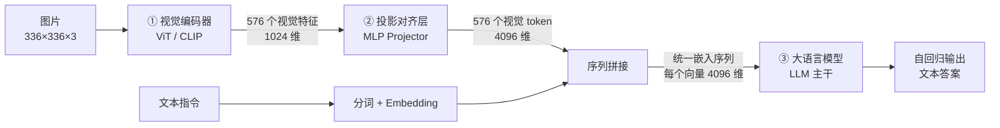

# VLM 视觉语言模型架构与原理 —— 以 LLaVA 为例

## 核心摘要

视觉语言模型（Vision-Language Model，VLM）的本质是"给大语言模型（LLM）装上眼睛"：用视觉编码器（ViT/CLIP）把图片切成补丁并编码为一串连续的视觉特征向量，再用一个轻量投影层（Projector）把这些向量"翻译"成与 LLM 词嵌入同维度、同语义空间的视觉 token，最后与文本 token 拼接成统一序列，交给 LLM 主干在自注意力中完成跨模态融合，自回归输出文本。整个过程没有专门的融合模块——融合发生在注意力里；视觉 token 全程是连续向量而非离散 ID；绝大部分算力消耗在 LLM。本文以最经典的 LLaVA-1.5（CLIP ViT-L/14 + 两层 MLP + Vicuna-7B）为例，逐 token 走完从图片到文字的完整链路。

---

## 一、VLM 是什么：给 LLM 装上眼睛

LLM 只会读文字。无论模型多强，它的输入输出都只有词表里的 token——你问它"这张图里有什么"，它连图都接不到。

VLM（Vision-Language Model，视觉语言模型，也叫多模态大模型）解决的就是这件事：在 LLM 前面接一个"视觉前端"，让模型能够：

- **看图说话**：图像描述、视觉问答（"这张图里有几个人？"）
- **读懂图表与文档**：截图问答、OCR + 理解、表格抽取
- **执行带图指令**："把图里的猫圈出来""这张海报的标题是什么字体"
- **给机器人当眼睛**：识别物体、判断场景、读仪表、理解手势

一句话：**LLM 是大脑，VLM = 眼睛 + 翻译官 + 大脑。**

> 类比：LLM 像一位博学但天生眼盲的教授，你把问题写成文字递给他，他对答如流；VLM 则是给他配了一双眼睛和一位贴身翻译——眼睛负责看，翻译负责把看到的东西"说"成教授能懂的语言，最后仍由教授组织语言回答。

---

## 二、核心难题：眼睛的"语言"和大脑的"语言"不通

为什么不能直接把图片像素喂给 LLM？存在两层不匹配：

1. **形态不匹配**：图片是 `336×336×3` 的像素阵列，而 LLM 期待的输入是"一串固定维度的向量序列"；
2. **语义空间不匹配**：视觉编码器输出的特征向量（如 1024 维）与 LLM 词嵌入向量（如 4096 维）不仅维度不同，连"坐标系"都不同，直接拼在一起，LLM 的注意力无法解读。

所以 VLM 必须回答两个工程问题：

| 问题 | 由谁解决 |
|------|----------|
| 图片怎么变成一串 token？ | 视觉编码器（ViT / CLIP） |
| 视觉 token 怎么变成 LLM 看得懂的 token？ | 投影对齐层（Projector） |

解决之后，剩下的事全部交给现成的 LLM——这正是 VLM 设计最优雅的地方：**不重造大脑，只做"接口适配"。**

---

## 三、VLM 的经典三段式架构

绝大多数开源 VLM（LLaVA、Qwen-VL、InternVL、MiniCPM-V 等）都是同一张"三段式"图纸：

| 组件 | 职责 | 典型实现 | 参数量 |
|------|------|----------|--------|
| ① 视觉编码器 | 像素 → 视觉特征 | CLIP ViT-L/14、SigLIP | 约 0.3B |
| ② 投影对齐层 | 视觉特征 → LLM 嵌入空间 | 两层 MLP / 线性层 / Q-Former | 约 21M，极小 |
| ③ LLM 主干 | 跨模态融合 + 语言生成 | Vicuna、LLaMA、Qwen | 7B+，绝对大头 |

一个关键事实：**三段里只有投影层是为多模态专门训练的，视觉编码器和 LLM 通常都拿现成的预训练权重（冻结或微调）。** 因此 VLM 的训练成本远低于从零训一个模型。

---

## 四、关键组件逐个拆

### 4.1 视觉编码器：把图片切成"补丁"

视觉编码器的任务是把一张二维图片变成一串向量，主流做法是 Vision Transformer（ViT）：

1. 把图片均匀切成 N×N 个小块（patch，补丁），例如 14×14 像素一块；
2. 每个 patch 的像素拉成一维向量，再线性投影到隐藏维度；
3. 加上**位置嵌入**，告诉模型每个 patch 在图中的位置；
4. 送入 Transformer 编码器做多层自注意力——浅层提取边缘纹理，深层提取物体部件与关系。

VLM 几乎都用 CLIP（或 SigLIP）的权重初始化 ViT。因为 CLIP 预训练时用"图片-文字对比学习"见过海量图文对，它的视觉特征天生贴近语言语义，比纯图像分类训练的 ViT 更适合接 LLM。

> 类比：把一张报纸剪成 576 张小方块，每块带一小块图案，每块就是一个"视觉 token 毛坯"；ViT 编码器像一位质检员，逐块提炼，说出每块画的是纹理、边缘还是物体部件。

### 4.2 投影对齐层：视觉 token 的"翻译官"

编码器输出的向量还停留在"纯视觉语义空间"，LLM 看不懂。投影层负责维度映射和语义对齐，常见三种方案：

| 方案 | 结构 | 代表模型 | 特点 |
|------|------|----------|------|
| 线性投影 | 一个 Linear | 简单 baseline、TinyLLaVA | 最简单，能力有限 |
| **MLP 投影** | 2 层 Linear + GELU | **LLaVA**、Qwen-VL、InternVL | 开源主流，效果好 |
| Q-Former / Resampler | 一组可学习 query 做交叉注意力 | BLIP-2、Flamingo、MiniCPM-V | 同时压缩 token 数量 |

**关键本质：投影层不是把视觉变成离散的单词 ID，而是把连续视觉特征"搬"进 LLM 的词嵌入空间**，让它和文本 token 向量规格完全一致，LLM 的注意力可以直接处理。

> 类比：把外国规格的零件（视觉特征）加工成与本厂标准零件（文本嵌入）完全相同的尺寸和接口，就能送上同一条生产线。Q-Former 更进一步，像一位"摘要员"，从 576 块里提炼出 32 个精华块，缩短序列、降低算力。

### 4.3 LLM 主干：融合发生在注意力里

拼接好的统一序列送入 LLM 的多层 Transformer，每一层对所有 token 一起做多头自注意力：

- 每个 token 都能关注序列里的**所有其他 token**，不管它原本是视觉还是文本；
- 文本 token 从视觉 token 提取图像信息，视觉 token 之间也互相补充全局信息；
- **没有专门的"跨模态融合模块"，融合完全发生在自注意力计算里。**

比如模型要生成"猫"这个词时，对应的注意力头会自动聚焦到图片中猫所在区域的那些视觉 token，提取出对应语义。

### 4.4 必须记住的事实：视觉 token 不是离散 ID

| | 文本 token | 视觉 token |
|---|---|---|
| 形态 | 整数 ID（词表查表）→ 嵌入向量 | 从头到尾都是连续特征向量 |
| 数量 | 可变 | 固定（如 576 个） |
| 能否在词表中找到 | 能 | 不能 |

少数闭源或早期模型尝试过把视觉完全离散化（用 VQ 向量量化生成视觉码），但 LLaVA 这类开源主流方案都是**连续嵌入**方案。

---

## 五、完整 Token 流转：以 LLaVA-1.5 为例

LLaVA-1.5 的配置如下，下面 6 步走完从图片到文字的全过程：

| 项目 | 配置 |
|------|------|
| 视觉编码器 | CLIP **ViT-L/14**（336px 输入版），24 层，隐藏维 1024 |
| 投影层 | **两层 MLP**：Linear(1024→4096) → GELU → Linear(4096→4096)，约 21M 参数 |
| 语言模型 | **Vicuna-7B**（LLaMA-2 架构），32 层，隐藏维 4096 |
| 输入分辨率 | 336×336，patch 尺寸 14×14 |

### 步骤 1：图片分块 —— 把像素切成"视觉补丁"

- 输入：一张 336×336 的 RGB 图片；
- 操作：ViT 按 14×14 像素均匀切块；
- 输出：**24×24 = 576 个图像补丁**（336 ÷ 14 = 24）。

每个补丁被拉成一维向量：14×14×3 = **588 维**，这就是视觉 token 的"毛坯"；同时加上位置嵌入，标记它在图片中的位置。

> 类比：把一整张报纸剪成 576 张小方块，每个方块上有一小块图案，后续每个方块对应一个视觉 token。

### 步骤 2：视觉编码 —— 像素补丁变成深度视觉特征

- 输入：576 个带位置信息的 patch 向量；
- 操作：送入 CLIP ViT-L/14 的 Transformer 编码器，经多层自注意力提取深层语义特征（轮廓、物体、纹理、关系）；
- 输出：**576 个视觉特征向量**，每个 **1024 维**（ViT-L 隐藏维）。

此时的 token 还处于**纯视觉语义空间**，LLM"看不懂"——维度和语义空间都不匹配。

### 步骤 3：投影对齐 —— 翻译成 LLM 能懂的格式

- 输入：576 个 1024 维视觉特征向量；
- 操作：通过两层 MLP 投影层（MM Projector）做维度映射和语义对齐；
- 输出：**576 个对齐后的视觉嵌入向量**，每个 **4096 维**——与 Vicuna-7B 的词嵌入维度完全一致。

这一步不是生成离散单词 ID，而是把视觉特征**投影到 LLM 的词嵌入空间**，让它看起来和文本 token 向量"规格完全一致"。

> 类比：把外国规格的零件加工成与本厂标准零件完全相同的尺寸和接口，送上同一条生产线。

### 步骤 4：序列拼接 —— 视觉 + 文本拼成统一序列

- 输入：576 个视觉嵌入向量 + 文本指令（如"描述这张图片里有什么"）；
- 操作：
  1. 文本指令经**词表**转成离散 token ID，再经嵌入层转成 4096 维文本嵌入向量；
  2. 用 576 个视觉嵌入向量替换 prompt 里的 `<image>` 占位符；
  3. 按 LLaVA 对话模板拼接，例如模板：
     `<s> USER: 描述这张图片 <image> ASSISTANT: `
- 输出：**一条长度为 N+576 的统一嵌入序列**（N 为文本 token 数，通常几十到上百个）。

序列里每个向量都是 4096 维，没有任何区别，LLM 本身分不清哪个是视觉、哪个是文本，统一当作 token 处理。

### 步骤 5：统一注意力计算 —— LLM 主干完成跨模态融合

- 输入：拼接好的完整嵌入序列；
- 操作：送入 LLM 多层 Transformer 主干，每层做多头自注意力：
  - 对所有 token 一起生成 Q、K、V 三个向量；
  - 每个 token 自由关注序列里的**所有其他 token**，不分视觉还是文本；
  - 文本 token 自动从视觉 token 提取图像信息，视觉 token 也互相补充全局信息。

这是全流程最核心的地方：**没有专门的"跨模态融合模块"，融合完全发生在自注意力里。** 当模型要生成"猫"时，相应注意力头会自动聚焦到图片中猫所在区域的视觉 token。

### 步骤 6：自回归生成 —— 逐 token 输出文本答案

- 输入：经过所有 Transformer 层的最终特征序列；
- 操作：LLM 按标准自回归方式生成：
  1. 基于输入序列预测下一个 token 的概率分布；
  2. 选出概率最高的 token（词表中的一个词），作为第一个输出词；
  3. 把该 token 的嵌入加回输入序列末尾；
  4. 重复上述过程，直到输出结束符 `</s>`。
- 输出：**纯文本的离散 token 序列**，最终解码成自然语言句子。

### 5.1 Shape 对账表

| 阶段 | 张量形状 | 读法 |
|------|----------|------|
| 输入图片 | `[336, 336, 3]` | 336×336 RGB 像素 |
| patch 毛坯 | `[576, 588]` | 576 块，每块 14×14×3 |
| 视觉编码后 | `[576, 1024]` | 576 个视觉特征，ViT-L 隐藏维 |
| 投影对齐后 | `[576, 4096]` | 576 个视觉 token，与 LLM 同维 |
| 拼接序列 | `[N+576, 4096]` | 文本 + 视觉统一序列 |
| 最终输出 | 长度 M 的 token ID | 纯文本答案 |

**视觉 token 数量的通用公式：视觉 token 数 = (H ÷ patch) × (W ÷ patch)**。分辨率越高，视觉 token 越多，看得越细，但算力和 KV cache 开销也越大。

---

## 六、几条关键认知（常见误区）

1. **视觉 token 不是离散 ID**：文本 token 有整数 ID，视觉 token 全程是连续特征向量，只是维度和语义空间与文本对齐了。
2. **注意力是双向的**：不仅文本能"看"图像，图像 token 也能"看"文本，从而理解用户问的是什么，"高亮"对应的图像区域。
3. **算力主要在 LLM**：视觉编码器和投影层占比很小，绝大部分算力消耗在 LLM 的自注意力上——这就是 VLM 推理速度与同参数 LLM 相近的原因。
4. **图片带来固定的 KV cache 开销**：576 个视觉 token 在 Vicuna-7B（32 层、FP16）下产生约 **288 MiB** 额外 KV cache（576 × 2(K/V) × 32 层 × 4096 × 2 字节）。多图、高分辨率场景下这笔开销不可忽略。
5. **高分辨率是把双刃剑**： InternVL 等支持动态高分辨率切图（tile），小目标、文字识别更准，但每多一个 tile 就多一份 token 与 KV cache。

---

## 七、VLM 家族的架构变体

| 模型 | 视觉编码器 | 投影/连接方式 | 视觉 token 数 | 特点 |
|------|------------|---------------|---------------|------|
| **LLaVA / LLaVA-1.5** | CLIP ViT-L/14 | 两层 MLP | 576 | 结构最简单，开源范式标杆 |
| BLIP-2 | ViT-G | Q-Former（32 个可学习 query） | 32 | 冻结两端，只训 Q-Former，极省算力 |
| Flamingo | NFNet / CLIP | Perceiver Resampler（64 token）+ 门控交叉注意力 | 64 | 支持多图、少样本，交叉注意力而非统一序列 |
| Qwen-VL | ViT-bigG | 交叉注意力压缩 + 位置编码 | 256 | 中文强，支持分辨率/框坐标输入 |
| InternVL | InternViT-6B | MLP + 动态高分辨率 tile | 每 tile 256 | 视觉编码器规模大，高分辨率小目标强 |
| MiniCPM-V | SigLIP | Resampler 压缩 | 64~（少量） | 端侧友好，2B~8B 规模 |

两条技术路线的分野：

- **统一序列派（LLaVA 系）**：视觉 token 直接拼进输入序列，全部用自注意力，结构简单、易训练；
- **交叉注意力派（BLIP-2/Flamingo 系）**：视觉 token 不进主序列，LLM 通过独立的交叉注意力层"按需查阅"，并用 query 压缩视觉 token，序列短、省算力，但结构更复杂。

---

## 八、知识点速查表

| 概念 | 所在阶段 | 作用 |
|------|----------|------|
| Patch（补丁） | 视觉编码 | 把图片切成 14×14 小块，每块对应一个视觉 token |
| 位置嵌入 | 视觉编码 | 告诉模型每个 patch 的空间位置 |
| ViT / CLIP | 视觉编码器 | 像素 → 1024 维视觉特征；CLIP 特征贴近语言语义 |
| MLP Projector | 投影对齐 | 1024 → 4096 维，把视觉特征搬进 LLM 词嵌入空间 |
| Q-Former / Resampler | 投影对齐 | 用可学习 query 压缩视觉 token 数量（32/64 个） |
| 视觉 token | 投影后 | 连续向量，不是离散 ID，规格与文本嵌入一致 |
| 统一序列 | 拼接 | 文本 + 视觉 token 拼成 N+576 序列，LLM 不加区分 |
| 自注意力融合 | LLM 主干 | 无专门融合模块，跨模态融合在注意力中完成 |
| 自回归生成 | 输出 | 逐 token 预测、拼回、直到 EOS |
| 视觉 token 公式 | 全局 | (H ÷ patch) × (W ÷ patch) |

---

## 九、延伸思考：端侧与机器人场景

- **端侧算力账要算两笔**：视觉编码器（ViT/CNN）算子固定、在 NPU 上很友好；真正的瓶颈是 7B 级 LLM 的权重显存与 KV cache。一张图 288 MiB 的 KV cache 在 16G 显存的板子上是实实在在的压力。
- **端侧 VLM 的三条瘦身路径**：① 小 LLM（1.5B~3B，如 TinyLLaVA、Qwen2-VL-2B、MiniCPM-V）；② 压缩视觉 token（Q-Former/Resampler、token merging、降低分辨率）；③ 量化（LLM 权重量化 + KV cache INT8/FP8）。
- **分辨率要按任务选**：机器人场景里"识别有没有人/抓哪个物体"用 336 甚至更低即可；读仪表小字、识别二维码才需要高分辨率 tile——不要无脑上高分辨率，浪费的是 token 预算。
- **架构选择**：追求简单、易部署、易做 LoRA 微调，选 LLaVA 式统一序列；追求多图、长视频、低 token 预算，可考虑交叉注意力 + Resampler 路线。
- **与纯视觉模型的分工**：YOLO 等专用视觉模型在检测/分割上更快更省，端侧应"专用模型做感知、VLM 做语义理解与问答"，而非让 VLM 包揽所有视觉任务。

---

## 参考资料

- Liu et al. *Visual Instruction Tuning*（LLaVA）, NeurIPS 2023: [arXiv:2304.08485](https://arxiv.org/abs/2304.08485)
- Liu et al. *Improved Baselines with Visual Instruction Tuning*（LLaVA-1.5）, 2023: [arXiv:2310.03744](https://arxiv.org/abs/2310.03744)
- Radford et al. *Learning Transferable Visual Models From Natural Language Supervision*（CLIP）, ICML 2021: [arXiv:2103.00020](https://arxiv.org/abs/2103.00020)
- Dosovitskiy et al. *An Image is Worth 16x16 Words*（ViT）, ICLR 2021: [arXiv:2010.11929](https://arxiv.org/abs/2010.11929)
- Li et al. *Bootstrapping Language-Image Pre-training with Frozen Image Encoders and Large Language Models*（BLIP-2）, ICML 2023: [arXiv:2301.12597](https://arxiv.org/abs/2301.12597)
- Alayrac et al. *Flamingo: a Visual Language Model for Few-Shot Learning*, NeurIPS 2022: [arXiv:2204.14198](https://arxiv.org/abs/2204.14198)
- Chen et al. *InternVL: Scaling up Vision Foundation Models and Aligning for Generic Visual-Linguistic Tasks*, 2024: [arXiv:2312.14238](https://arxiv.org/abs/2312.14238)

---

## 关联文章

- `模型原理/2026-06-22_大模型推理流程.md` — 纯文本 LLM 的推理全流程，本文是其"加入视觉前端"的扩展
- `模型原理/2026-08-10_CNN与视觉模型端侧部署优势.md` — 纯视觉模型的端侧特性，与 VLM 互补
- `模型原理/2026-10-08_矩阵计算就是特征计算-小模型推理全过程.md` — 注意力与投影背后的矩阵计算本质
- `模型原理/2026-09-27_内存带宽为何决定解码速度-算术强度与带宽三因子.md` — VLM 解码速度的算力账
- `模型原理/2026-08-03_数值类型FP32-FP16-BF16-INT8-INT4位结构与量化原理.md` — 端侧 VLM 量化的基础

---

*数值口径声明：本文维度与数量（576 个 patch、1024/4096 维、投影层约 21M 参数、单图 KV cache 约 288 MiB FP16）均按 LLaVA-1.5 公开配置（336px、patch 14、ViT-L、Vicuna-7B 32 层）计算；高分辨率动态切图（tile）场景下 token 数与 KV cache 按 tile 数量线性增长。*

*来源：整理自 2026-10-12 关于"VLM 架构与 LLaVA token 流转"的学习材料。*
