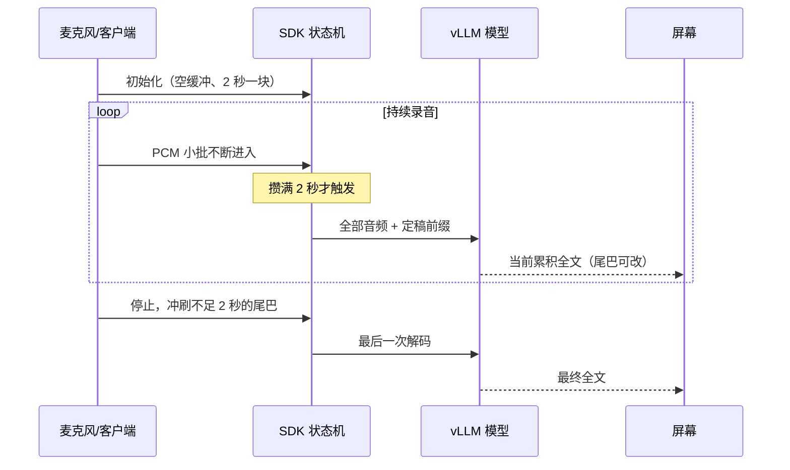

# Qwen3-ASR-0.6B模型架构与流式原理

## 核心摘要

Qwen3-ASR-0.6B 是阿里开源的语音转文字模型，结构上是「耳朵（AuT 编码器）+ 翻译官（投影层）+ 大脑（Qwen3-0.6B 语言模型）」三段：耳朵把声音压成小段，大脑像打字一样逐字写出结果。它最关键的设计是**耳朵「一次听多长」可调 + 文字「前缀定稿、尾巴退回重写」**，因此同一个模型既能离线整段识别，也能流式边听边出字，流式输入、流式输出均支持。开源版流式仅支持 vLLM 后端，首字延迟约 92ms。

---

## 一、整体思路：让语言模型来「听写」

传统语音识别像查字典：听一个发音、查一个字，各字之间基本独立，所以同音字、口语容易错。Qwen3-ASR 换了个思路——**把一个语言模型接在耳朵后面，让它听懂了再打字**。语言模型本来就会结合上下文写字，用它来听写，同音字（公园/公元）、人名地名、断句就更准。


| 组件 | 角色 | 干什么 |
|------|------|--------|
| AuT 编码器 | 耳朵 | 把声音压缩成一小段一小段，每 80ms 一段（每秒约 12.5 段） |
| Projector | 翻译官 | 很小的中间层，把声音片段转成大脑能懂的向量 |
| Qwen3-0.6B | 大脑 | 语言模型，根据上下文逐字写出结果，自动判语种，没人说话就输出空 |

模型还支持在提示词里给「热词」（如专有名词、人名），让大脑优先写对；同时它被训练成只做转写、不听从指令，防止被提示词注入。

---

## 二、流式输入输出原理（重点）

**结论：流式输入、流式输出都支持，且和离线共用同一个模型。** 它靠三个机制实现。

### 机制 1：耳朵「一次听多长」可调（动态注意力窗口）

耳朵理解声音时，看的时间窗口是**可变的，范围 1~8 秒**：

- **流式**：窗口收短到约 1 秒，来一块听一块，不用等整段说完；
- **离线**：窗口放到最长 8 秒，一次看得更全，精度更高。

这是「一个模型、两种模式」的基础——不是训了两个模型，而是窗口大小可调。

### 机制 2：声音切 2 秒小块，但「全部音频重喂」

麦克风边录边把声音切成 **2 秒一个小块**送进来。这里有个最反直觉、也最关键的点：

> **每来一个新块，模型并不是只听这 2 秒，而是把「从头至今的全部音频」重新喂一遍。**

既然全部重喂，为什么不用重新输出所有字？因为同时把**已经识别好的文字当前缀**塞给了大脑，大脑看到前缀就知道前面已经写完，只续写后面的新内容。这就是「声音重喂、文字不重写」的搭配。

```text
麦克风录音（每 0.1~0.3 秒一批）
      ↓ 边录边进
缓冲：攒满 2 秒（32000 个样本）切一块
      ↓
从头至今的全部音频  +  已识别文字前缀
      ↓ 一起送模型
模型只续写前缀之后的新字
```

### 机制 3：前缀定稿、尾巴退回重写

为了让屏幕上的字「前面不动、后面可改」，前缀并不是把上次结果整段照搬：

- **前 2 个块**：刚开口信息少，不设前缀，从头写，避免被错误开头带偏；
- **之后每块**：把上次结果的**最后 5 个字砍掉（退回）**再当前缀，让这 5 个字「退回重听」。

于是效果很像手机输入法：已经上屏的黑字不动，最后几个字是灰色候选，听到后文会悄悄订正（比如「公圆」改成「公园」），而不是整句重打。

### 完整时序



注意停止时要做一次「冲刷」：最后不足 2 秒的半句话也要送进去，否则结尾会丢字。

### 「流式输出」的两个粒度

| 粒度 | 场景 | 形态 |
|------|------|------|
| chunk 级 | 直接用 qwen-asr 库 | 每 2 秒拿到一次**累积全文**，尾巴会回改，UI 自己做黑定稿/灰临时 |
| token 级 | vLLM / SGLang 服务，`stream=true` | 大脑逐字生成，经 SSE 逐字推送，真正一个字一个字蹦出来 |

### 流式的三个限制

1. 开源版只能用 **vLLM** 后端跑（Transformers 后端不支持流式）；
2. 一次只处理一路，不支持批量；
3. 流式不返回字的时间戳（要时间戳需离线用配套的 Qwen3-ForcedAligner）。

---

## 三、规格与性能

| 项目 | 说明 |
|------|------|
| 参数构成 | 耳朵约 180M + 大脑 Qwen3-0.6B |
| 音频规格 | 16kHz、单声道 |
| 语言方言 | 52 种（30 种语言 + 22 种中文方言，含粤语、吴语、闽南语） |
| 单段上限 | 20 分钟 |
| 首字延迟 | 平均约 92ms |
| 其他能力 | 歌声、带背景音乐的歌曲也能识别 |

家族另有 1.7B 版本，复杂噪声和多语言更准；0.6B 胜在小、快，官方定位端侧/边缘部署。

---

## 四、一句话总结

> 耳朵听声音、大脑（Qwen3-0.6B）打字；靠「耳朵听多长可调（1~8 秒）+ 声音全部重喂、文字前缀定稿 + 尾巴退回 5 个字」这三个机制，用同一个模型实现边听边出字。开源流式只能用 vLLM、不支持批量和时间戳。

---

## 参考资料

- Qwen3-ASR GitHub: [https://github.com/QwenLM/Qwen3-ASR](https://github.com/QwenLM/Qwen3-ASR)
- Qwen3-ASR Technical Report: [https://arxiv.org/abs/2601.21337](https://arxiv.org/abs/2601.21337)
- qwen-asr PyPI: [https://pypi.org/project/qwen-asr/](https://pypi.org/project/qwen-asr/)
- SGLang 流式文档: [https://sgl-project.github.io/sglang-omni/cookbook/qwen3_asr.html](https://sgl-project.github.io/sglang-omni/cookbook/qwen3_asr.html)
- 相关文章：`2026-09-23_Silero-VAD原理-流式推理机制.md`
- 相关文章：`端侧部署/2026-10-14_SenseVoice架构原理与端侧部署.md`
