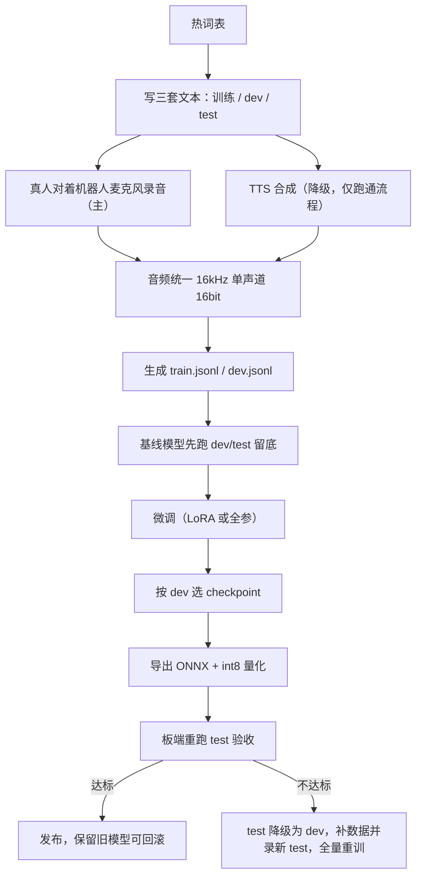

# SenseVoice-Small热词微调训练方法

**核心摘要**：SenseVoice-Small 没有运行时热词表，专有名词只能靠"录音 + 正确文本"微调进权重。本文讲清微调原理、数据配比（热词句、日常句、近音负例）、训练参数、双轨验收及导出 int8 到 RK3588 的完整方法。13 个热词、4 人录音、4090 分钟级训完，避免热词没学会、普通话变差。

> **阅读提示**
> 本文是训练落地篇，模型架构原理见同目录上级的 `端侧部署/2026-10-14_SenseVoice架构原理与端侧部署.md`。
> 文中的 RTF 数据来自 sherpa-onnx 官方在 RK3588 上的实测，训练耗时与显存为单卡 RTX 4090 实测。

---

## 一、为什么 SenseVoice 要靠微调加热词

很多人第一次接触 ASR 热词，以为像语音云服务一样"传一个词表文件"就生效。SenseVoice-Small 不是这种结构：

- 它是 **encoder-only + CTC + greedy 解码**，一次前向直接吐字，没有自回归解码器；
- 热词偏置（contextual biasing）需要在解码器打分时给词表里的词加分，**没有解码器就没有这个加分入口**；
- sherpa-onnx 官方文档也明确：只有 transducer 模型、且切到 modified_beam_search 才支持热词文件，SenseVoice 这类 CTC 模型不支持。

所以让 SenseVoice 认识专有名词，有三条路线：

| 路线 | 做法 | 优点 | 缺点 | 适用 |
|---|---|---|---|---|
| 后处理纠正 | 识别后用拼音/编辑距离把近音字替换成热词 | 零训练、随时改词表、不会改坏模型 | 只能处理错得"有规律"的词，强依赖上下文 | 词表小、更新频繁，首选 |
| **微调**（本文） | 用"含热词的录音 + 正确文本"训练 | 从声学层面真正学会，口音、噪声场景也能覆盖 | 词表更新要重新训、重新导出 | 热词稳定、有真机录音条件 |
| 换模型 | 换 SeACo-Paraformer（原生热词）或社区的 CPP 热词增强版 SenseVoice | 运行时动态热词 | 链路要重建，热词增强版端侧成熟度需自行验证 | 热词频繁变化、必须动态下发 |

实践中推荐**后处理 + 微调**两层一起用：微调负责声学绑定，后处理负责兜底。本文只讲微调这一层。

---

## 二、微调到底在调什么

先建立一个直觉：模型并不是"不认识这些字"。

"卡布奇诺""轨道吊"里的每个字，模型都认识。它缺的是"**这一串音 → 这一个专有写法**"的绑定。比如自造词"百忆门"，模型听到音后默认输出更常见的"北门"，这不是声学能力问题，是它从没见过"百忆门"这个组合。

微调要做的事，就是让模型在训练数据里反复见到：

```text
这段声音（百忆门的发音） → 这串文字（百忆门，而不是北门）
```

见得足够多，权重就会被轻轻拨过来。

由此引出三条关键认知：

**1. 训练样本必须是"音频 + 正确文本"对，词表本身不能训练。** 一个孤零零的词没有声音，模型无从学起。正确做法是把热词写进句子，再把句子录音，用"音频 + 转写文本"训练。

**2. 微调只改权重，不改网络结构。** 所以词表（tokens.txt）、模型尺寸、推理代码全都不变，导出部署的链路和官方模型完全一致。

**3. 普通热词和口音热词，数据要求不是一个量级：**

| 维度 | 普通热词（标准音下的专名） | 口音热词（带口音念专名） |
|---|---|---|
| 问题本质 | 只缺"字形绑定" | 音素映射 + 字形绑定双重陌生 |
| TTS 合成数据 | 有效，标准音可以直接合成训练 | **无效**，TTS 是标准音，教不会口音 |
| 数据来源 | TTS 即可，真人更好 | 必须目标人群真实录音 |
| 每词样本 | 10 条左右起步 | 20～50 条起步，且要多说话人 |

---

## 三、全流程总览



---

## 四、写文本：三种句子，三套集合

文本设计是整件事的核心，比训练本身重要。以当前 13 个热词为例：

- 餐饮点单类：卡布奇诺、冰椰青美式、冰拿铁、酷乐多、畅饮、兰亭、派对包
- 场站名称类：百忆门、陆轩、吊具、盛港、北部湾、轨道吊

### 1. 热词句：把词放进真实句式

每个热词写 **5～6 句不同的短句**，注意三个维度：

- **位置**：热词分别出现在句首、句中、句尾，防止模型只在固定位置识别；
- **口吻**：点单、确认、查询、疑问，按真实业务来；
- **长短**：2～10 个字的短句和十几个字的长句都要有。

```text
# 卡布奇诺（点单口吻）
我要一杯卡布奇诺
帮我来杯热的卡布奇诺
卡布奇诺现在做要等多久
你们店的卡布奇诺是中杯还是大杯
一杯卡布奇诺，谢谢

# 轨道吊（确认口吻）
请核对轨道吊
轨道吊到了吗
三号轨道吊已经开始作业
现在轨道吊是什么状态
```

只录单词是最常见的错误：脱离上下文的单词录音，模型在真实句子里照样识别不出来。

### 2. 日常句：防止"满脑子都是热词"

热词训练数据如果占比过高，模型会把普通词也往热词上靠（后面称为**误唤醒**）。必须混入大量不含热词的日常句，**占训练条数的 50%～70%**。

日常句不要写"今天天气不错"这种与业务无关的句子，要从真实业务指令里采：

```text
# 餐饮场景
我要一杯温水
堂食还是打包
帮我叫一下服务员
洗手间在哪

# 场站场景
请打开大门
三号门的快递取一下
今天有几艘船进港
帮我查一下路线
```

注意上面最后一句"帮我查一下路线"——这是刻意安排的**近音负例**，见下。

### 3. 近音负例句：验收必须有，训练建议加

热词微调最大的风险是"把普通词误识别成热词"。13 个词里有几个和常用词同音或近音，必须造对照句：

| 热词 | 对照的普通词 | 负例句示例 |
|---|---|---|
| 陆轩 | 路线（完全同音） | 帮我查一下路线、规划一条路线 |
| 兰亭 | 难题 | 这个问题有点难题 |
| 畅饮 | 长城 | 长城在哪个方向 |
| 吊具 | 钓局/吊句等 | （凡句中出现同音近音字的业务句都收） |
| 百忆门 | 北门 | 北门现在能走吗 |
| 盛港 | 胜利 | 任务已经胜利完成 |
| 北部湾 | 北部弯（转写歧义） | 港区北部弯度是多少 |

这类句子训练集放 20～30 条，**测试集必须单独再放一批**，用来量化误唤醒。

### 4. 三套文本：训练、dev、test

| 集合 | 文本来源 | 用途 | 谁来读 |
|---|---|---|---|
| 训练集 | 训练文本 | 梯度更新 | 参与训练的人 |
| dev 集 | **另写一套**，句式与训练错开 | 训练中选 checkpoint | 没参与训练的新人 |
| test 集 | **再写一套**，全程封存 | 最终发布验收 | 另外的新人 |

三条铁律：

1. 三套文本句子**互不重复**，dev/test 的句子训练时一次都没听过；
2. dev/test 由**没有参加训练的人**朗读，这样测到的是"新句子 + 新嗓子"，不是背稿；
3. 迭代时发现错词可以补**训练句**，但**绝不允许把 dev/test 句挪进训练集**，否则验收数字立刻作废。

### 5. 文本数量参考（4 人录音）

| 数据 | 文本条数 | 录音条数（4 人） |
|---|---|---|
| 热词训练句 | 65～80（每词 5～6 句） | 260～320 |
| 业务日常句 | 100～160 | 400～640 |
| 近音负例句 | 20～30 | 80～120 |
| dev 集（2～3 名新人） | 每词 3 句 + 负例 20 句 + 日常 30 句 | 同比例 |
| test 集（另外 2～3 名新人） | 同 dev 规模 | 同比例 |

每词验证句不要少于 3 句，否则一个词只有两三个样本，单条对错就有 30%～50% 的波动，结论不可信。

---

## 五、录音与 TTS

### 1. 真人录音（主力数据源）

录音要求：

- **在机器人面前、用机器人自己的麦克风录**，保留真实的距离、混响和现场噪声。在安静办公室用专业麦克风录出来的数据，到了现场会水土不服；
- **16kHz、单声道、16bit PCM WAV**，一句一个文件；
- 文件名能对应到"文本编号 + 说话人"，例如 `spk01_hot003.wav`；
- 同一句可以换人读，**不要把同一条录音复制多份充数**；
- 读错、被噪声盖住、被打断的句子直接重录；
- 让朗读者**用平时说话的自然状态读**，不要刻意念标准——部署时听到什么口音，录音就录什么口音。

### 2. 说话人数量

- 模型只服务固定点位、固定人群：4 人起步够用；
- 要面向不特定的客户：8～10 人以上，男女老少都覆盖；
- dev/test 的新人是硬性要求，不能省。

### 3. TTS 降级（只用来跑通流程）

没有真人配合时，可以先用 TTS 合成把整条训练管线跑通，但要清楚它的边界：

- TTS 是标准音、单一音色、无现场噪声，**只能保证这把音色上的热词字形绑定**；
- **dev/test 严禁使用 TTS 合成**，否则会得到"看起来 100% 正确"的假高分；
- 真人数据到位后，TTS 数据在训练集中占比建议不超过 30%，并用真人验证集重新验收；
- 千问 TTS 合成音频通常是 24kHz，必须**重采样到 16kHz**（用 ffmpeg 或 soxr，不要用低质量重采样引入混叠）：

```bash
ffmpeg -i tts_24k.wav -ar 16000 -ac 1 -sample_fmt s16 tts_16k.wav
```

---

## 六、生成训练 jsonl

SenseVoice 微调的数据格式是 jsonl，一行一个样本：

```json
{"key": "spk01_hot003", "text_language": "<|zh|>", "emo_target": "<|NEUTRAL|>", "event_target": "<|Speech|>", "with_or_wo_itn": "<|woitn|>", "target": "我要一杯卡布奇诺", "source": "/data/wav/spk01_hot003.wav"}
```

字段说明：

- `key`：音频唯一 ID；
- `source`：wav 绝对路径；
- `target`：转写文本，**不带标点**（本文场景统一用 `<|woitn|>`）；
- `text_language`：中文填 `<|zh|>`；
- `emo_target` / `event_target`：短句识别场景统一填 `<|NEUTRAL|>` / `<|Speech|>` 即可。

官方提供了 `sensevoice2jsonl` 工具，准备好 `wav.scp`（ID + 音频路径）和 `text.txt`（ID + 文本）两个清单就能自动生成，语言、情绪、事件标签由模型自动预测：

```bash
sensevoice2jsonl \
++scp_file_list='["train_wav.scp", "train_text.txt"]' \
++data_type_list='["source", "target"]' \
++jsonl_file_out="train.jsonl" \
++model_dir='iic/SenseVoiceSmall'
```

### 标注的两条死规矩

1. **写规范普通话用字，不按口音写谐音字。** 口音把"知识"读成 zí sī，文本仍然写"知识"。模型要学的就是"这个音 → 正确的字"，写成"资四"等于教它输出错别字。
2. **热词用字逐字核对。** 热词表是确定性答案，生成 jsonl 后用脚本扫一遍，确保每个词的写法与词表一字不差。

省事的标注方法：先用原始模型跑一遍录音生成初稿，再人工校对，重点查平翘舌、n/l 和热词用字。

---

## 七、开始训练

### 1. 环境准备

```bash
# FunASR 源码安装
git clone https://github.com/modelscope/FunASR.git && cd FunASR
pip3 install -e ./

# 微调脚本在 SenseVoice 仓库
git clone https://github.com/FunAudioLLM/SenseVoice.git
cd SenseVoice

# 国内下载权重走镜像
export HF_ENDPOINT=https://hf-mirror.com
```

### 2. 官方默认参数为什么不能直接用

官方 `finetune.sh` 的参数是为大规模训练设计的，直接套到几百条小数据上会"等于没训"：

| 配置项 | 官方默认 | 小数据建议 | 原因 |
|---|---|---|---|
| 学习率 lr | `2e-4` | `1e-5` | 数据少，大学习率容易把通用能力冲垮 |
| max_epoch | 50 | 10 | 小数据 50 轮必然过拟合 |
| validate_interval | 2000 步 | **1 步** | 几百条数据总步数可能就几百，2000 步走不到验证 |
| save_checkpoint_interval | 2000 步 | **1 步** | 同上，否则一个 checkpoint 都存不下来 |
| warmup_steps | 25000 量级 | 总步数的 5%～10%（约 20～50 步） | 预热没走完训练就结束，学习率一直被压在接近 0 的位置 |
| batch_type / batch_size | token / 6000 | 保持不变 | 显存占用平稳，实测峰值 5～6GB |

### 3. 改好的小数据训练命令

单卡、不开 DeepSpeed（官方脚本支持 `use_deepspeed=false`，单卡 4090 直接跑）：

```bash
CUDA_VISIBLE_DEVICES=0 \
torchrun --nproc_per_node=1 \
  /path/to/funasr/bin/train_ds.py \
  ++model="iic/SenseVoiceSmall" \
  ++trust_remote_code=true \
  ++train_data_set_list="data/train.jsonl" \
  ++valid_data_set_list="data/dev.jsonl" \
  ++dataset_conf.data_split_num=1 \
  ++dataset_conf.batch_sampler="BatchSampler" \
  ++dataset_conf.batch_size=6000 \
  ++dataset_conf.batch_type="token" \
  ++dataset_conf.num_workers=4 \
  ++train_conf.max_epoch=10 \
  ++train_conf.log_interval=1 \
  ++train_conf.validate_interval=1 \
  ++train_conf.save_checkpoint_interval=1 \
  ++train_conf.keep_nbest_models=10 \
  ++train_conf.avg_nbest_model=1 \
  ++train_conf.resume=true \
  ++train_conf.use_deepspeed=false \
  ++optim_conf.lr=0.00001 \
  ++scheduler_conf.warmup_steps=20 \
  ++output_dir="./outputs"
```

> `scheduler_conf.warmup_steps` 的配置路径随 funasr 版本略有差异，若报配置不存在，用 `--help` 或查对应版本的训练 yaml 确认。

### 4. 全参还是 LoRA

- 数据几百条、显存 16GB 以上：全参微调即可，234M 模型静态显存约 5GB，小语料峰值 5～6GB，按 16GB 预留；
- 数据更少、担心通用能力退化：用 LoRA（rank 8～16）更稳，改动面小；
- 两种方式可以都跑一遍，用 dev 集说话。

### 5. 数据增强

- 真人录音做 0.9 / 1.0 / 1.1 倍速度扰动，等效 3 倍数据，且不改变音素内容；
- 可以叠加机器人现场录的底噪；
- TTS 数据不再做增强。

### 6. 怎么选 checkpoint

不要默认用最后一个。官方配置会保留验证集上最好的若干个 checkpoint（`keep_nbest_models`），选择标准是：

1. dev 集**热词召回率最高**；
2. 同时**日常句 CER 相比基线没有明显变差**（建议涨幅不超过 1 个百分点）；
3. 两个条件冲突时，优先选日常句不掉的那一个——热词漏了可以靠后处理补，普通话坏了没有补救手段。

---

## 八、验收：三个指标 + 两条线

训练前，先用**未微调的原始模型**把 dev/test 跑一遍，留下基线数字。没有基线，"提升了多少"无从谈起。

| 指标 | 定义 | 目标 |
|---|---|---|
| 热词召回率 | 热词一字不差出现在转写中的比例 | 越高越好，自造词通常能到 90%+ |
| 误唤醒次数 | 近音负例句中普通词被误判成热词的次数 | **目标 0** |
| 日常句 CER | 业务日常句的字错率 | 相比基线涨幅 ≤ 1 个百分点 |

分工：

- **dev 集**：训练中反复看，用来选 checkpoint；训练结束后的错例分析、补数据决策也只看 dev；
- **test 集**：平时封存，不参与任何决策，只在最终发布前跑一次。

迭代规则：**在 dev 上做错例分析**（test 封存不看），发现某个词错了 → 补**新的训练句**（每词 5～10 句不同句式）→ 合并全部数据**从头启动一次新的训练**（不要在旧训练中途加数据，也不要 resume 续训）→ 重新用 dev 选 checkpoint。**test 只在发布前跑一次**；若 test 终验不达标还需继续迭代，这批 test 已经"看过"，应降级为 dev，并重新录制一批新 test 封存。

---

## 九、导出 ONNX 与 RK3588 板端验收

### 1. 用 sherpa-onnx 官方脚本导出

导出脚本在 sherpa-onnx 仓库 `scripts/sense-voice/export-onnx.py`，它会一次性生成：

- `model.onnx`：变长 ONNX（时间维是动态 shape，短句不需要 padding）；
- `model.int8.onnx`：动态量化版本，只量化 MatMul、权重 QUInt8，是官方验证过的安全量化方式；
- `tokens.txt`：词表。

微调后导出**必须改一处**：脚本中默认加载的是官方模型，要改成微调后的 checkpoint 目录：

```python
# export-onnx.py 中
model, params = SenseVoiceSmall.from_pretrained(
    model="./outputs/你选定的checkpoint", device="cpu"
)
```

并把微调模型目录下的 `model.py` 放到脚本同级（脚本依赖本地 model 定义）。微调没有扩词表时，tokens.txt 与官方完全一致，sherpa-onnx 直接兼容。

```bash
python export-onnx.py
# 产物：model.onnx / model.int8.onnx / tokens.txt
```

### 2. 为什么选 CPU int8，不转 RKNN

SenseVoice 是非自回归模型，计算规整、单次前向极短，RK3588 的大核 CPU 跑 int8 已经足够快；转 RKNN 固定窗口反而要给短句 padding、还可能遇到算子回退。以下是 sherpa-onnx 官方实测 RTF（越小越快，1.0 等于实时）：

| 核型 | 1 线程 | 2 线程 | 3 线程 | 4 线程 |
|---|---|---|---|---|
| Cortex-A76（大核） | 0.099 | 0.065 | 0.049 | 0.049 |
| Cortex-A55（小核） | 0.436 | 0.260 | 0.208 | 0.175 |

点单、确认类短句绑 A76 大核、2 线程即可，RTF 约 0.065，比实时快十几倍。

### 3. 板端验收（不能只在 x86 上验）

int8 量化可能吃掉微调带来的增益，所以**最终发布依据是板端 int8 模型的 test 结果**，不是训练侧的 fp32 结果：

```bash
# 0x10 绑 A76 大核；不绑核落到 A55 小核，性能差 4 倍以上
taskset 0x10 ./sherpa-onnx-offline \
  --num-threads=2 \
  --tokens=./model/tokens.txt \
  --sense-voice-model=./model/model.int8.onnx \
  --sense-voice-language=zh \
  test_wavs.txt
```

板端要同时确认三件事：

1. 三个指标（热词召回、误唤醒、日常句 CER）与 x86 上基本一致；
2. 真实业务音频下的 RTF 和延迟满足要求；
3. 长稳运行（连续几小时）内存不泄漏。

板端保留上一版模型，新版不达标直接切回。

---

## 十、常见翻车点速查

| 现象 | 根因 | 对策 |
|---|---|---|
| 热词单独念能识别，句子里不行 | 只录了单词 | 热词必须放进句首/中/尾的完整句子 |
| 普通词频繁被识别成热词 | 热词句占比过高，没加日常句 | 日常句占 50%～70%，加近音负例 |
| 训练集 100% 正确，新人全错 | 训练和验证用了同一批人/同一批句子 | dev/test 换新人、换新句子 |
| TTS 验证高分，真机一塌糊涂 | 验证集用了 TTS | 验证集只用真人录音 |
| 训完标准普通话也变差 | 学习率太大 / 没混通用语料 / 训太多轮 | lr 1e-5、混日常句、按 dev 早停 |
| 文字里出现"资四"这种错别字 | 按口音写了谐音标注 | 一律写规范字 |
| x86 正常，板上热词又错 | int8 量化掉点 | 以板端 int8 结果验收，敏感层保留 fp16 |
| 板上时快时慢 | 线程被调度到 A55 小核 | taskset 绑 A76 大核 |
| 训练 loss 一直不降 | warmup 太长，学习率没起来 | warmup 改为总步数 5%～10% |

---

## 十一、口音场景的补充

如果目标客户带明显口音（如广西口音：平翘舌不分、n/l 不分、前后鼻音不分），在上述方法上再加三条：

1. **朗读者必须包含目标口音人群**，最好就是客户本人；dev/test 新人也从同口音人群中选。用标准音录音做口音模型，等于白训；
2. **专人专用 30 分钟～2 小时有效录音即可见效**；要面向不特定的广西客户，必须多说话人、覆盖桂柳话/白话/壮语口音等不同音系，量级要到几十小时，否则模型只对一个人有效；
3. 客户说的是**带口音的普通话**，微调有效；如果是**方言直接夹杂**（桂柳话、白话整句），SenseVoice 词表和预训练语料都不覆盖，小数据微调救不回来，应评估云端大模型 ASR 兜底。

---

## 十二、实施清单

| 步骤 | 内容 | 预估耗时 |
|---|---|---|
| 1 | 确定热词表，写训练/dev/test 三套文本（含近音负例） | 0.5 天 |
| 2 | 组织 4 人对着机器人麦克风录音，新人录 dev/test | 0.5～1 天 |
| 3 | 音频统一 16kHz/单声道/16bit，生成 jsonl，初稿校对 | 0.5 天 |
| 4 | 原始模型跑 dev/test，留存基线 | 0.5 小时 |
| 5 | 单卡微调（数分钟），按 dev 选 checkpoint | 0.5 天（含调参） |
| 6 | 导出 ONNX/int8，板端跑 test 验收 | 0.5 天 |
| 7 | 不达标补数据重训；达标后保留旧模型，灰度发布 | 持续 |

冷启动从文本到首版模型约 2～3 天，GPU 训练本身只需几分钟，主要成本在录音和标注。

---

## 附：一行账

> SenseVoice-Small 的热词不是"配"进去的，是"喂"进去的：热词写进句子、句子录成音频、音频配上一字不差的规范文本，再用小学习率、混合日常句、近音负例和独立新人验证集把微调关在笼子里。热词召回率、误唤醒、日常句 CER 三个数字同时达标才算成功，最后以 RK3588 板端 int8 模型的验收结果为准——训练侧的高分不算数。

---

## 参考资料

- SenseVoice 官方仓库（含 finetune.sh、数据格式）：https://github.com/FunAudioLLM/SenseVoice
- FunASR 项目：https://github.com/modelscope/FunASR
- sherpa-onnx SenseVoice 导出脚本：https://github.com/k2-fsa/sherpa-onnx/tree/master/scripts/sense-voice
- sherpa-onnx RK3588 速度实测：https://k2-fsa.github.io/sherpa/onnx/sense-voice/pretrained.html
- sherpa-onnx 热词支持说明（仅 transducer）：https://k2-fsa.github.io/sherpa/onnx/hotwords/index.html
- 社区 CPP 热词增强版 SenseVoice：https://www.modelscope.cn/models/dengcunqin/SenseVoiceSmall_hotword
- 相关文章：`端侧部署/2026-10-14_SenseVoice架构原理与端侧部署.md`
- 相关文章：`端侧部署/2026-10-09_RK3588大小核与CPU绑定-为什么不绑核会抖动.md`
