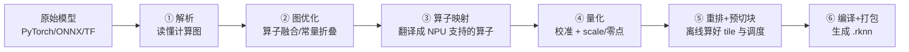
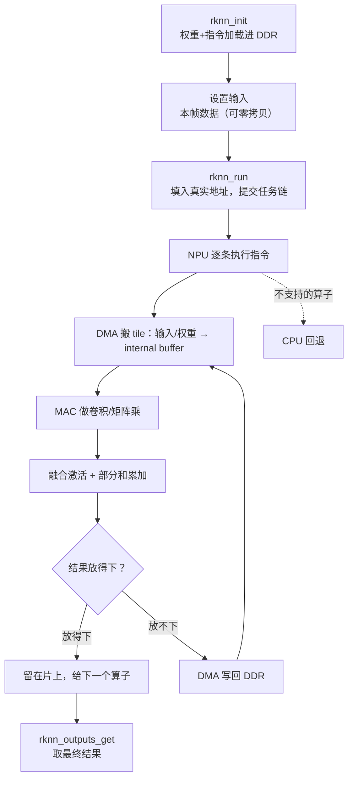
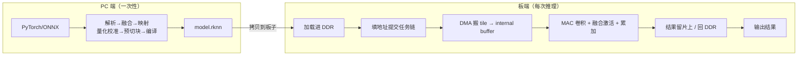

# RKNN-Toolkit2 模型转换与运行原理

**核心摘要**：用大白话讲清两件事——RKNN-Toolkit2 在 PC 上"转换"模型时内部到底做了什么，以及 `.rknn` 在 RK3588 上"运行"时 NPU 到底怎么跑。转换好比把通用菜谱改造成工厂专属的"作业指导书 + 预制菜"，运行则是工厂照指导书用传送带把食材一小把一小把搬到案板上现做。

> **环境与口径**
> 目标芯片：RK3588（3 核 NPU，每核 2 TOPS，共 6 TOPS @INT8）
> 工具链：PC 端 rknn-toolkit2（转换+量化），板端 librknnrt（C/C++）或 rknn-toolkit-lite2（Python，只推理）
> 本文是"端到端通俗原理"入门文；具体的六步操作流程、量化档位选型、工具链选型见文末关联文章

---

## 一、先建立整体认知：转换和运行是两个完全不同的阶段

很多人第一次接触 RKNN 会把"转换"和"运行"混在一起，其实它们发生在不同的地方、不同的时间，干的事也完全不同：

| | 转换（Conversion） | 运行（Inference） |
|---|---|---|
| 在哪做 | x86 PC 上 | RK3588 板子上 |
| 什么时候做 | 模型上线前，**一次性**做 | 每来一帧数据，**每次都跑** |
| 用什么工具 | RKNN-Toolkit2 | librknnrt / toolkit-lite2 |
| 产出 | 一个 `.rknn` 文件 | 这一帧的推理结果 |
| 通俗类比 | 把通用菜谱改造成工厂作业指导书 + 预制菜 | 工厂照着指导书流水线生产 |

贯穿全文用一个"工厂做菜"的类比：

- **原始模型**（PyTorch/ONNX）= 一份用通用语言写的菜谱，每一步是一道工序（算子）；
- **RKNN-Toolkit2** = 一位工艺工程师，负责把菜谱改造成自动化流水线能直接照做的标准作业指导书，并提前把食材洗好、切好（预制菜）；
- **板子上的 NPU** = 工厂的自动化流水线；
- **DDR** = 大仓库（容量大但离流水线远）；
- **internal buffer** = 流水线旁边的小案板（离手近但面积小）；
- **DMA** = 传送带，负责在仓库和案板之间运食材，不用工人（CPU）动手；
- **tile（切块）** = 案板太小，一次只拿一小把食材，做完再拿下一把。

先记住一句话：**转换是"备好功课"，运行是"照章办事"**。

---

## 二、转换前：先搞懂"模型"到底长什么样

要理解转换，先得知道原始模型是什么。一个深度学习模型，本质上是一张**计算图（Computation Graph）**：

- 图里的**节点**是一个个算子（Operator）：卷积 Conv、池化 Pooling、激活 ReLU、矩阵乘 MatMul、逐元素相加 Add 等；
- 图里的**边**是张量（Tensor）：数据以多维数组的形式，从一个算子流向另一个算子；
- 数据从图的一端（输入）进去，经过一连串算子，从另一端（输出）出来。

不同框架（PyTorch、TensorFlow、ONNX、Caffe）对这张图有各自的"方言"写法——同一个卷积，参数排列、算子命名、数据排布都可能不一样。而 NPU 这个"工厂"只认一种语言。于是就需要 Toolkit2 做一次"翻译 + 改造"。

---

## 三、转换时，Toolkit2 内部依次做了什么

这是第一个核心。调用 `rknn.build()` 之后，工具内部并不是简单地"换个文件后缀"，而是按顺序做了下面六件事。

### ① 解析：把菜谱读懂

读入原始模型文件，还原出完整的计算图——有哪些算子、每个算子的参数是什么、张量之间怎么连接、数据是什么形状（shape）。这一步相当于工程师先把整份菜谱通读一遍。

### ② 图优化：合并工序、去掉废动作

在真正翻译之前，先把菜谱"精简"，最典型的优化有三种：

- **算子融合（Operator Fusion）**：把本来分开的几个算子合成一个。最常见的是 `Conv + BN + ReLU` 三步并成一步，就像把"洗菜 + 切菜 + 腌制"合并成"备菜"一个动作。好处是中间结果不用再搬到仓库、再搬回来，直接在流水线旁边做完。
- **常量折叠（Constant Folding）**：能提前算好的固定数值，直接在转换时算好，不必留到运行时每次重算。
- **死节点消除（Dead Node Elimination）**：删掉那些结果根本没人用的算子，少做无用功。

### ③ 算子映射：翻译成 NPU 语言

把通用算子逐个映射成 NPU 能执行的算子。这一步会做一次"能力对照"：

- 大部分标准算子（卷积、池化、常见激活、矩阵乘）NPU 都有对应实现，直接映射；
- 少数算子 NPU 不支持，会被标记出来——这些算子运行时只能**回退给 CPU 做**，或者在转换前就通过改写规避；
- 像 Loop/RNN 这类控制流算子属于"一票否决"，通常需要在转换前就把图改写掉。

> 注意：**"算子名字在支持清单上" ≠ "该算子的参数 NPU 也接受"**。比如卷积的步长、填充、尺寸超了硬件规格，照样跑不了。这也是为什么要做算子核查（详见《导出 ONNX 后的六步流水线》）。

### ④ 量化：把小数换成整数

这是最影响"又快又省"的一步，也是最容易让人困惑的一步，单独展开讲。

原始模型用的是带小数的浮点数（FP32/FP16，比如 0.123、1.456），算得慢、占地方。量化就是把它们映射成 INT8（只有 256 个整数档位），靠两个东西保证映射完还能还原：

- **校准（Calibration）**：INT8 只有 256 个"格子"，但每层数值的实际范围是任意的，你得先知道"这一层的数大概在什么范围"。方法是用几十到几百张**有代表性的图片**（校准集）前向跑一遍，统计每一层输出的实际数值范围（min/max 或直方图）。校准**只跑前向、不改权重**，纯粹是"测量"。
- **换算系数（scale 和 zero_point）**：
  - `scale`（刻度）是一个浮点数，决定"一个整数格子代表多大的浮点"，即格子宽度；
  - `zero_point`（零点）是一个整数，决定"浮点 0 对应哪个整数格子"。因为网络里有大量的 0（padding、ReLU 输出），0 必须能被精确表示。

举个具体例子：假设校准测得某层数值范围是 -3.0 ~ 9.0，那么：

- scale = (9.0 − (−3.0)) / 255 ≈ 0.0471；
- zero_point ≈ 64（即浮点 0 落在整数 64 这个位置）；
- 浮点 6.0 会被映射成整数 191，还原时 (191−64)×0.0471 ≈ 5.98，和 6.0 只差 0.02——这就是量化误差，很小。

校准集必须贴近真实场景，否则量出来的范围不准，量化误差就大。不同算法（normal / KL 散度 / MMSE）的区别，在于"怎么利用统计到的范围"，比如 KL 散度会主动砍掉长尾，让占大多数的数值更精确。

### ⑤ 布局重排 + 预切块：把"案板怎么摆"提前算好

这是非常关键、却最容易被忽略的一步。NPU 流水线旁边的案板（internal buffer）很小，一次放不下整个模型的数据，所以必须切成小块（tile）。**切多大、先搬哪块、后搬哪块、中间结果怎么放，这些都在转换时由工具离线算好并固化**，而不是运行时临时决定。

同时，权重会按照 NPU 拿取最顺手的方式重新排列（布局重排），避免运行时还要现场调整。

这一步就是"预制菜"：食材怎么切、每一份装多少、下锅顺序，全部提前定好。

### ⑥ 编译 + 打包：生成 .rknn

最后把上面所有结果翻译成 NPU 能直接执行的**指令**，连同权重、结构、量化参数一起打包，导出成一个 `.rknn` 文件。

---

## 四、`.rknn` 文件里到底装了什么

`.rknn` 不是一个纯粹的"权重文件"，它更像一个压缩包，里面装了四样东西：

| 内容 | 说明 |
|---|---|
| **权重** | 已经量化（INT8）、已按 NPU 布局重排好的权重 |
| **网络结构** | 算子之间的连接关系、每个算子的参数 |
| **量化参数** | 每层的 scale、zero_point，以及层间对齐用的换算系数 |
| **NPU 指令** | 预编译好的执行指令，tile 切分和 DMA 调度已固化在里面 |

理解这一点很重要：**板子上的 NPU 不是在"现看菜谱现想怎么做"，而是照着一份已经排好每一步的作业指导书机械执行**。运行时真正要做的，只是把"食材放在仓库的哪个位置"填进指令，然后按下启动键。

---

## 五、运行时：从加载到出结果

这是第二个核心。`.rknn` 拷到板子后，一次完整推理按下面的顺序发生。

### 第 1 步：rknn_init——把指导书和食材搬进仓库

加载 `.rknn`，把权重和指令放进 DDR（大仓库），同时创建推理上下文。此时可以选择性地开启片上 SRAM（Share Memory），给后续中间结果一个"离流水线更近的中转台"。

### 第 2 步：设置输入——把这一帧的原料放好

把本帧数据（图片、音频等）放进 DDR。常规做法是 CPU 先做预处理再拷贝；更高级的做法是**零拷贝**——直接让 NPU 从摄像头、视频解码器那里拿物理地址，省掉一次 CPU 到 NPU 的搬运，对低延迟场景很关键。

### 第 3 步：rknn_run——填地址、提交任务链

runtime 把指令里的"占位地址"替换成数据在 DDR 中的真实地址，然后把一串任务（任务链）提交给 NPU。NPU 会按指令的连接顺序，一条接一条地执行。

### 第 4 步：NPU 流水线作业——真正的计算在这里

这是运行时最核心的动作，对每个算子循环往复：

1. **搬小块**：DMA 把输入 tile 和权重 tile 从 DDR 搬到片上案板（internal buffer）；
2. **计算**：MAC 乘加阵列做卷积（或矩阵乘），紧接着在同一任务里完成融合好的激活（ReLU 等）；
3. **累加**：如果输入通道太多、一次放不下，就分块计算，每块产生"部分和"（partial sum），在累加器里逐块相加，全部加完才得到完整结果；
4. **放结果**：
   - 结果能留在片上，就直接留给下一个算子，不回仓库；
   - 片上放不下，就用 DMA 写回 DDR，下一个算子再切 tile 重新搬进来。

为了不让流水线"等米下锅"，NPU 普遍采用**双缓冲（double buffering）**：算当前这一块的同时，传送带已经在搬下一块，搬运和计算重叠进行，尽量不闲着。

### 第 5 步：不支持的算子，交回 CPU

遇到 NPU 没有对应指令的算子，会切回 CPU 计算，算完再把结果搬回 NPU。这会打断流水线、产生额外的 DDR 往返和同步，所以不支持算子的比例要尽量低——这也是为什么转换阶段要做算子核查和图改写。

### 第 6 步：rknn_outputs_get——取成品

把最终结果从 DDR 取出来，再做后处理（比如检测框解码、NMS、结果格式化），交给应用。

---

## 六、运行时几个关键概念，一次讲清

### 片上存储其实分两层

口语里常说的"片上缓存"，在 RK3588 上要分清两个层次：

| 层次 | 是什么 | 谁来管 |
|---|---|---|
| **internal buffer（核内，约 384KB/核）** | NPU 核内的工作区，tile 直接喂给 MAC，最内层 L1 scratchpad 更小（约 32KB 硬上限） | 硬件按指令自动管理，软件不能自由寻址 |
| **Share Memory（约 1MB 系统片上 SRAM，约 956KB 可分配）** | 离 NPU 比 DDR 近的"中转台"，可放小的中间张量 | 软件可管理，需在 init 时显式开启 |

简单说：**算子内部计算用 internal buffer；跨算子的中间结果才考虑 Share Memory**。默认不开 SRAM 时，每个算子基本是"DDR → NPU → DDR"往返，此时性能受 DDR 带宽约束。

### 权重太大怎么办

有人会问：输入太大可以切 tile，权重太大怎么办？输入难道不需要跟完整权重计算吗？

把卷积看成矩阵乘（`A × B = C`），其中 A 是输入、B 是权重，关键的"归约维"是输入通道。权重太大时有两种切法：

- **沿输出通道切（各算各的）**：不同输出通道之间互相独立，切完每块各自直接出结果，**不需要累加**；
- **沿输入通道切（分块累加）**：每块只算一部分输入通道，产生部分和，再逐块累加，遍历完所有输入通道才得到完整结果。

所以数学上"输出一个点确实要用到完整的权重（全部输入通道）"，但这个"完整"是靠**分块累加拼出来的**，不需要权重一次性全部在片上。卷积核的空间尺寸（3×3 等）通常很小，整块放片上、不切。

### 为什么一切都围绕"切块"

根本原因是硬件的物理约束：**片上空间（离计算最近的地方）极小，而模型数据量极大**。切块是唯一能让"小案板"做"大菜"的办法。转换时把切块方案离线算好，运行时机械执行，二者配合，才让一块几十块的板子能跑原本需要大显卡的模型。

---

## 七、一张图总结全过程

记住这条主线：

- **转换** = 在 PC 上把通用模型"读懂 → 合并工序 → 量化成整数 → 提前切块 → 翻译成 NPU 指令 → 打包成 `.rknn`"；
- **运行** = 板端把 `.rknn` 装进 DDR，NPU 按指令用 DMA 搬 tile、算一块、留一块或放回一块，流水线跑完出结果。

---

## 参考资料

- 本库关联文章：
  - 《导出 ONNX 后的六步流水线》——对齐验证、算子核查、图改写、转换、校准、对拍的完整操作流程
  - 《RK3588 模型打包工具链选型》——什么模型走哪条工具链（rknn-llm / Toolkit2 / 拆图）
  - 《RKNN-Toolkit2-2.3.2-量化打包类型与选型》——FP16 / w8a8 / w16a16i 等量化档位
  - 《端侧 LLM 部署硬件瓶颈与量化选型》——量化与内存瓶颈的更深入讨论
- RKNN-Toolkit2 官方用户指南（模型转换、量化、算子支持清单）
- RK3588 数据手册（NPU 算力、片上 buffer、Share Memory 规格）
