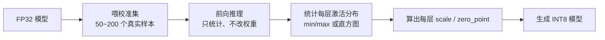
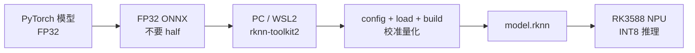

# 模型量化是什么？RK3588 量化原理与实操

**核心摘要**：用大白话讲清 "量化"—— 它就是把模型里无穷无尽的小数（浮点 FP32），换算成有限的整数（INT8，每层只有 256 个格子），换来模型体积约缩小 4 倍、NPU 推理更快更省电。本文讲清三件事：量化是什么、背后的换算原理（scale 和 zero\_point）、以及在 RK3588 上从 ONNX 到 `.rknn` 的完整可跑流程。

> **环境与口径**
> 目标芯片：RK3588（3 核 NPU，每核 2 TOPS，共 6 TOPS @INT8）
> 工具链：PC 端 rknn-toolkit2（转换 + 量化），板端 rknn-toolkit-lite2（Python）或 librknnrt（C/C++）
> 工具版本：以 
>
> `rknn-toolkit2==2.3.2`
>
>  为准（版本锁定见 
>
> `deploy/versions.lock`
>
> ）
> 文章定位：量化主题的入门主文；量化档位的完整选型见《RKNN-Toolkit2-2.3.2 - 量化打包类型与选型》，转换与运行的全局原理见《RKNN-Toolkit2 模型转换与运行原理》


***

## 一、量化是什么：从 "用小数" 到 "用整数"

一个深度学习模型，本质上是**一大堆数字**：既有训练学出来的权重，也有推理时一层层算出来的中间结果（激活值）。这些数字默认用 \*\* 浮点数（FP32）\*\* 表示 —— 带小数、每个占 4 字节，比如 `0.123`、`-1.456`。

**量化（Quantization），就是把这些连续的小数，映射成离散的整数（INT8），每层只有 256 个可以取的 "格子"。**

用一个生活类比：菜谱里调料用量原本精确到 "0.1 克"，量化就是改成 "一勺、两勺" 这种固定档位。厨师照着 "几勺" 下料，比每次称 0.1 克快得多；代价是每一勺和精确值之间有那么一丁点儿误差 —— 但通常小到尝不出来。


| 对比项   | 量化前（FP32）  | 量化后（INT8，RK3588 默认）                     |
| ----- | ---------- | --------------------------------------- |
| 每个数占用 | 4 字节（32 位） | **1 字节（8 位）**                           |
| 每层可取值 | 几乎连续、任意实数  | **256 个格子**（有符号 −128\~127 / 无符号 0\~255） |
| 模型体积  | 基准         | **约 1/4**                               |
| 运算方式  | 浮点运算       | 整数运算（快、省电）                              |
| 精度    | 基准         | 通常掉 1% 以内，个别敏感层可能更多                     |

### 为什么 NPU 尤其需要量化

RK3588 的 NPU 是一个**整数引擎**，它标称的 6 TOPS 算力是按 **INT8** 口径算的。如果不量化、硬让模型跑浮点，结果往往是：要么退回到 CPU 上慢慢算，要么 NPU 的算力根本发挥不出来。

所以在 RK3588 上，"量化" 不是一个可选项，而是**让 NPU 真正干活的前提**。


***

## 二、量化原理：两个参数怎么把小数 "装进" 格子

连续的小数和离散的整数格子之间，靠**两个参数**就能互相换算：


* **scale（刻度）**：一个浮点数，表示**一个整数格子代表多大的浮点宽度**—— 类比里 "一勺是多少克"；

* **zero\_point（零点）**：一个整数，表示**浮点 0 落在第几个格子**—— 类比里 "不放盐（0 克）对应第几档"。

### 1. 非对称量化（RKNN 默认）

非对称量化（asymmetric）的正反两个公式：


```
量化（浮点 → 整数）： q = round(r / scale) + zero_point
反量化（整数 → 浮点）： r ≈ scale × (q − zero_point)
```

这两个参数由每层数值的实际范围 `[r_min, r_max]` 一次算出（以映射到无符号整数 `[0, 255]` 为例）：


```
scale      = (r_max − r_min) / (255 − 0)
zero_point = 0 − round(r_min / scale)
```

**举个完整例子**（示意数值）：假设校准测得某层激活值范围是 `r ∈ [−1.0, 3.0]`，要映射到 `[0, 255]`：


```
scale      = (3.0 − (−1.0)) / 255 = 4/255 ≈ 0.0157
zero_point = 0 − round(−1.0 / 0.0157) = −round(−63.7) = 64
```

那么浮点 `r = 1.0` 被量化成：


```
q = round(1.0 / 0.0157) + 64 = round(63.7) + 64 = 64 + 64 = 128
```

反量化还原：`r ≈ 0.0157 × (128 − 64) = 0.0157 × 64 = 1.004`，和原始的 `1.0` 只差 `0.004`——**这就是量化误差，很小。**

### 2. 为什么要 zero\_point（非对称）

因为网络里大量数值的分布**并不关于 0 对称**：比如经过 ReLU 后，激活值几乎都 ≥ 0；同时网络里有大量的 0（padding、ReLU 输出）。有了 zero\_point，既能把 "偏在一边" 的分布紧致地装进格子，又能保证**浮点 0 被精确表示**（0 落在整数格子上，而不是两个格子中间）。

### 3. 对称量化：更简单的一种

对称量化（symmetric）直接令 `zero_point = 0`，公式简化为 `q = round(r / scale)`。它实现简单，适合**关于 0 大致对称的权重**；但对偏置分布的激活值，会浪费一半格子。


|             | 非对称量化（RKNN 默认） | 对称量化       |
| ----------- | -------------- | ---------- |
| zero\_point | 有，可不为 0        | 固定为 0      |
| 适合          | 不关于 0 对称的激活值   | 关于 0 对称的权重 |
| 格子利用率       | 高、紧致           | 分布偏时会浪费    |
| 计算          | 略复杂            | 简单         |

### 4. 量化粒度：一个 scale 管多大范围


* **per-layer（逐层）**：整层共用一个 scale，最粗；

* **per-channel（逐通道）**：每个输出通道各算一个 scale，精度更高，**RKNN 默认就是 channel**。

直观理解：一个卷积层有几十个输出通道，每个通道学到的数值幅度可能差很多，硬用同一把尺子量，幅度小的通道只能用上几个格子、很糊；逐通道给每把通道自己的尺子，自然更准。

### 5. 误差到底从哪来

量化误差有两类，方向相反：


* **截断误差（范围估小了）**：真实数据里出现了超出 `[r_min, r_max]` 的大值，这些值被 "削平" 到边界，误差很大。常见于校准集没覆盖真实场景；

* **舍入误差（范围估大了）**：校准集里混进罕见的离群值，把范围撑大，每个格子变宽，占大多数的正常值分辨率不足、取整误差变大。

好的量化，本质就是在 "不削平大值" 和 "不撑大范围" 之间找平衡 —— 这正是下一节 "校准" 要做的事。


***

## 三、参数怎么来：PTQ 校准

你不需要手工给每一层算 scale /zero\_point，工具链用 \*\* 校准（Calibration）\*\* 自动完成。这种方式叫 **PTQ（Post-Training Quantization，训练后量化）**：训练完之后，用一批数据跑一遍前向就能量化，**不需要重训、也不改权重**。




### 1. 校准集怎么选


* **数量**：一般 50\~200 个样本，太少统计不准、太多意义不大还慢；

* **必须贴近真实部署场景**：比如机器人在嘈杂环境用，校准集就得有嘈杂样本；

* **要覆盖边缘情况（worst case）**：最极端、最容易出现大值的场景，而不是只挑 "平均水平"。

校准集一旦和真实场景脱节，量出来的范围就是错的，掉点往往 "掉的不是模型的点，是校准集的点"。

### 2. 两种量化算法

`quantized_algorithm` 决定 "怎么利用统计到的分布"：


| 算法             | 做法                                   | 特点        |
| -------------- | ------------------------------------ | --------- |
| **normal（默认）** | 做直方图、主动砍掉长尾，找量化前后分布差异最小的截断点（KL 散度思想） | 快，大多数场景够用 |
| **mmse**       | 直接遍历阈值，最小化量化前后的均方误差                  | 通常更准，但更慢  |

### 3. PTQ 和 QAT 的区别


|      | PTQ（训练后量化） | QAT（量化感知训练）            |
| ---- | ---------- | ---------------------- |
| 时机   | 训练完之后      | 训练过程中                  |
| 做法   | 校准集跑一遍统计   | 训练时就插入 "伪量化"，让模型学会补偿误差 |
| 是否重训 | 否          | 是                      |
| 精度   | 通常够用       | 最高                     |
| 成本   | 低、快        | 高、慢                    |

绝大多数 CV / 语音模型，PTQ 就够；只有 PTQ 掉点严重、又无法用混合量化补救时，才值得上 QAT。


***

## 四、RK3588 上完整怎么做（可跑）

整体链路：**PyTorch（FP32）→ 导出 FP32 ONNX → PC 端转换量化 →&#x20;**`.rknn`**&#x20;→ 板端 NPU 推理**。




### 步骤 0：搭环境（PC 端，用 WSL2）

rknn-toolkit2 **没有 Windows 原生版本**，在 Windows 上用 WSL2（Ubuntu 22.04）即可；量化校准是 CPU 推理，不需要 GPU。


```
# 1. 建独立 Python 环境（版本必须对上 wheel 的 cp3x 标签）
conda create -n rknn python=3.10 -y && conda activate rknn

# 2. 拉取工具链
git clone https://github.com/rockchip-linux/rknn-toolkit2.git

# 3. 安装对应 Python 版本的 wheel
pip install rknn-toolkit2/rknn-toolkit2/packages/x86_64/rknn_toolkit2-*-cp310-*.whl
```

### 步骤 1：导出 FP32 ONNX（关键：不要 half）


```
import torch

model.eval()                          # 权重保持 FP32，不要 model.half()
dummy = torch.randn(1, 3, 640, 640)  # 尺寸按你的模型

torch.onnx.export(
    model,
    dummy,
    'model_fp32.onnx',
    opset_version=17,
    input_names=['images'],
    output_names=['output'],
)
```

> 为什么是 
>
> **FP32 而不是 FP16**
>
> ：量化是 FP32 → INT8 一步到位，校准需要高精度的浮点参考；FP16 已经损失一次精度，再量化是二次损失。你在 RKNN 里听到的 "FP16 模型"，是 
>
> `build(do_quantization=False)`
>
>  时工具链
>
> **内部自动**
>
> 转的，不需要你在 ONNX 这层动手。

### 步骤 2：准备校准集 dataset.txt

`dataset.txt` 里**每行一个样本路径**（图片或 `.npy`）；多输入模型则一行用空格分隔多个路径。


```
./calib/001.jpg
./calib/002.jpg
./calib/003.jpg
```

### 步骤 3：转换 + 量化（完整 convert.py）


```
from rknn.api import RKNN

ONNX_MODEL = 'model_fp32.onnx'
RKNN_MODEL = 'model.rknn'
DATASET = './dataset.txt'

rknn = RKNN(verbose=True)

# 1) 配置：归一化参数 + 量化参数
rknn.config(
    mean_values=[[0, 0, 0]],
    std_values=[[255, 255, 255]],
    target_platform='rk3588',
    quantized_dtype='w8a8',              # 即 INT8 非对称量化（老版本写法为 asymmetric_quantized-8）
    quantized_algorithm='normal',        # normal=KL 散度（快，默认）；mmse=最小均方误差（更准、更慢）
    quantized_method='channel',          # 逐通道量化（精度高于逐层）
    optimization_level=3,                # 优化等级 0~3
)

# 2) 加载原始模型
print('--> Loading model')
ret = rknn.load_onnx(model=ONNX_MODEL)
if ret != 0:
    raise RuntimeError('load_onnx failed')

# 3) 构建：do_quantization=True 执行 PTQ，dataset 为校准集
print('--> Building (quantize)')
ret = rknn.build(do_quantization=True, dataset=DATASET)
if ret != 0:
    raise RuntimeError('build failed')

# 4) 导出 .rknn
ret = rknn.export_rknn(RKNN_MODEL)
if ret != 0:
    raise RuntimeError('export failed')

print('--> Done:', RKNN_MODEL)
rknn.release()
```

运行：


```
python convert.py
```

### 步骤 4：板端推理（Python，rknn-toolkit-lite2）

把 `model.rknn` 拷到 RK3588 上：


```
from rknnlite.api import RKNNLite

rknn = RKNNLite()
rknn.load_rknn('model.rknn')

# 默认跑 NPU；三核全开可用 core_mask=RKNNLite.NPU_CORE_0_1_2
rknn.init_runtime(core_mask=RKNNLite.NPU_CORE_0_1_2)

outputs = rknn.inference(inputs=[img])   # img 为预处理好的输入
print(outputs)

rknn.release()
```

C/C++ 部署则用板端 `librknnrt.so`，流程对应 `rknn_init → rknn_inputs_set → rknn_run → rknn_outputs_get`。

### 一条必须守住的红线

**PC 端 rknn-toolkit2、板端 librknnrt /rknn-toolkit-lite2、NPU 固件，三者版本必须对齐。** 大量 "换个版本就好了" 的案例，本质都是版本不匹配。建议在转换脚本和部署文档里把版本号写死。


***

## 五、量化后掉点怎么办

按下面的顺序排查，从轻到重：


1. **先做 FP16 基线，分清是 "转换问题" 还是 "量化问题"**：把 `build(do_quantization=False)` 跑出的 FP16 模型先对一遍。FP16 已经错，量化只会更错 —— 先解决转换 / 预处理；

2. **逐层定位**：用 `accuracy_analysis` 导出每层的浮点 / 量化输出和余弦相似度，找相似度**突变**的那一层；

3. **混合量化**：把误差大的敏感层（常见于第一层、最后一层、归一化、输出层）保留 FP16，其余仍 INT8；

4. **换校准集 / 换算法**：让校准集更贴近真实场景，或把 `normal` 换成 `mmse`；

5. **最后才上 QAT**：重训做量化感知训练。


```
# 精度分析：dump 每层 fp32 / quant 输出与余弦相似度，用来定位掉点层
rknn.accuracy_analysis(
    inputs=['test.jpg'],
    output_dir='./snapshot',
    target='rk3588',
)
```

> 各量化档位（w8a8 /w8a16 /w16a16i 等）在 RK3588 上的放行情况和完整选型顺序，见《RKNN-Toolkit2-2.3.2 - 量化打包类型与选型》。


***

## 六、一句话总结

**量化 = 用&#x20;**`scale`**（格子宽度）和&#x20;**`zero_point`**（零点位置）两个参数，把连续的浮点小数 "仿射映射" 到 256 个整数格子；在 RK3588 上，PC 端用 rknn-toolkit2 喂 50\~200 个校准样本做 PTQ，自动求出每层的 scale /zero\_point 并生成&#x20;**`.rknn`**，再交给三核 NPU 做整数运算。掉点先用 FP16 基线分清环节、再用 accuracy\_analysis 定位、靠混合量化或 QAT 补救。**


***

## 参考资料


* 本库关联文章：


  * 《RKNN-Toolkit2 模型转换与运行原理》—— 转换与运行的端到端通俗原理（含 NPU 流水线、tile 切块）

  * 《RKNN-Toolkit2-2.3.2 - 量化打包类型与选型》——w8a8 /w8a16 /w16a16i 等档位与选型顺序

  * 《导出 ONNX 后的六步流水线》—— 对齐验证、算子核查、图改写、转换、校准、对拍的完整操作

  * 《RK3588 模型打包工具链选型》—— 什么模型走哪条工具链

* RKNN-Toolkit2 官方用户指南（模型转换、量化、算子支持清单）

* RK3588 数据手册（NPU 算力、片上存储规格）