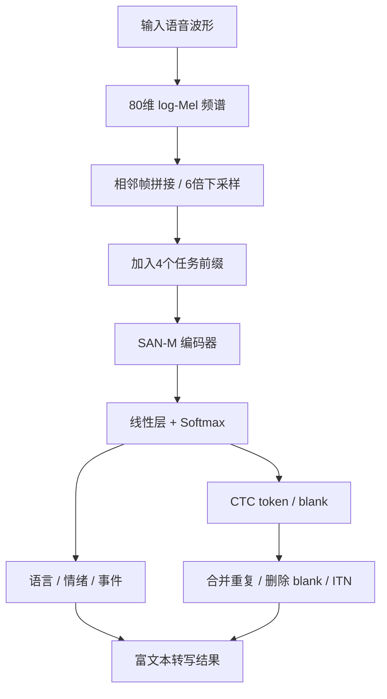
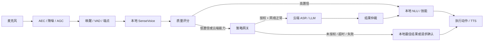

# SenseVoice架构原理与端侧部署

**核心摘要**：SenseVoice 是 FunAudioLLM 体系中的语音理解模型，开源常用的 SenseVoice-Small 采用 **encoder-only + 非自回归 + CTC** 架构，一次前向就可以并行得到文本、语言、情绪和音频事件。它不是所有场景下识别率最高的模型，但在 RK3588 这类带 NPU 的边缘设备上，很好地平衡了延迟、内存、多语言、隐私和工程落地成本，因此成为端侧 ASR 的热门选择。

> **阅读提示**
> 本文重点讲开源常用的 SenseVoice-Small。
> 文中的速度、内存只描述架构特性，不代表某一块板子的实测结果；实际 RTF、内存和功耗会受到 RKNN 版本、量化方式、输入长度、线程绑定和前后处理实现影响。

---

## 一、先建立整体印象

可以把 SenseVoice-Small 理解成一个“语音填空题工厂”：

1. 先把声波变成频谱图；
2. 再压缩语音序列；
3. 在句子前面放几个固定任务槽；
4. 编码器统一理解整段语音；
5. 各槽位分别填出语言、情绪、事件和文字；
6. 最后通过 CTC 后处理得到正常文本。



它和 Whisper 这类模型的重要区别是：SenseVoice-Small 没有自回归解码器，不需要一个 token 一个 token 循环生成，因此天然更适合并行计算和端侧部署。

---

## 二、SenseVoice-Small 是怎么工作的

### 1. 音频前端：先把声音变成“图像”

模型不能直接高效理解高采样率波形，因此先从音频中提取 **80 维 log-Mel filter-bank**。它可以理解为一张“时间 × 频率”的声纹图。

随后模型会拼接相邻帧，并做 **6 倍下采样**。这样做的好处很直接：

- 序列长度变短；
- 编码器计算量下降；
- 内存占用下降；
- 一次前向可以处理更长的音频。

### 2. 四个特殊任务槽：像表单中的固定空格

在语音特征前面，SenseVoice-Small 会加入 4 个特殊向量，用来说明任务和输出风格。

| 任务槽 | 作用 |
|---|---|
| LID | Language Identification，判断语言，例如中文、英文、日语 |
| SER | Speech Emotion Recognition，判断情绪，例如高兴、生气、中性 |
| AEC/AED | 音频事件分类/检测，例如笑声、音乐、掌声、哭声 |
| ITN / NoITN | 控制是否做逆文本规范化和标点恢复 |

其中 ITN 是 Inverse Text Normalization 的缩写。例如口语里的“二零二六年十月”，经过 ITN 后可以写成“2026年10月”。

语言槽还有一个实用设计：训练时有时会直接填入真实语言标签，因此推理时既可以让模型自动判断语言，也可以手动指定语言，减少语种识别错误。

### 3. SAN-M 编码器：全局注意力 + 局部记忆

SenseVoice-Small 的编码器使用 **SAN-M（Memory-equipped Self-Attention Network）**。它不是单纯的 Transformer 自注意力，而是把两部分能力结合起来：

- **多头自注意力**：动态查看整段语音，判断当前位置应该关注哪些位置；
- **DFSMN memory**：像一个固定窗口的上下文备忘录，用可学习的滤波器补充局部上下文。

核心形式可以简化为：

```text
Y = MultiHead(Q, K, V) + M(V)
```

通俗理解：

- 自注意力负责“主动去全句中找相关信息”；
- memory block 负责“把周围几个音素的上下文快速记下来”。

这比只使用自注意力更适合语音任务，因为语音中既有音素、音节这种局部关系，也有整句语义和情绪这种全局关系。

### 4. CTC：每个语音位置都猜一个 token

编码器输出后，每个语音帧位置都会预测一个文字 token 或 blank。

blank 可以理解为“这个位置没有新字”。例如：

```text
今 今 天 blank 天 天 气 blank
```

CTC 后处理会：

1. 合并相邻重复 token；
2. 删除 blank；
3. 得到“今天天气”。

这就是 SenseVoice-Small 能够非自回归、并行输出的关键。

它的代价是：CTC 往往假设各位置的输出相对独立，对 token 之间语言依赖的建模不如自回归解码器强，因此需要强大的编码器、充分的训练数据以及热词/语言模型来弥补。

### 5. 多任务训练

SenseVoice 不只是一个 ASR 模型，它同时学习四类任务：

| 任务 | 训练目标 |
|---|---|
| ASR 语音识别 | CTC loss |
| LID 语言识别 | 交叉熵 |
| SER 情绪识别 | 交叉熵 |
| AEC/AED 音频事件 | 交叉熵 |

这些任务共享同一个编码器。模型在学习“说了什么字”的同时，也学习“用什么语言、什么情绪、在什么声音环境中说”。

### 6. Small 和 Large 的区别

SenseVoice 有不同架构路线，Small 并不等于整个 SenseVoice 系列。

| 版本 | 架构 | 生成方式 | 能力特点 |
|---|---|---|---|
| SenseVoice-Small | encoder-only | 非自回归 | 支持中、粤、英、日、韩，速度快，适合端侧 |
| SenseVoice-Large | encoder-decoder | 自回归 | 支持 50+ 语言，精度更高，但速度更慢 |

如果目标是端侧离线部署，通常优先评估 Small；如果目标是多语言会议转写、长音频和更高准确率，则应评估 Large 或云端 ASR。

---

## 三、为什么 SenseVoice-Small 适合端侧部署

### 1. 延迟低，不依赖网络 RTT

本地链路通常是：

```text
采音 → VAD/端点 → 本地 ASR → 本地 NLU → 执行/播报
```

云端链路则还包括音频编码、无线上传、网络抖动、云端排队、结果回传等环节。即使云端模型本身推理很快，端到端延迟也可能明显高于本地。

### 2. 断网仍然可用

机器人、工业终端、车载设备、电梯、园区设备等场景并不保证网络始终可用。本地 ASR 可以保证：

- 弱网时基础指令可用；
- 断网时设备控制可用；
- 云端故障时业务不完全中断。

### 3. 隐私和合规压力更小

语音中可能包含声纹、家庭对话、儿童声音、医疗信息、金融信息和企业内部内容。默认本地识别可以减少音频出域，对政府、医院、学校、金融、工厂等私有化交付场景更友好。

### 4. 规模化后成本更低

云端 ASR 通常按音频时长或请求次数收费，设备量越大，长期成本越明显。端侧部署把成本前置到硬件 BOM 中，如果 RK3588 的 NPU 本来就用于视觉或其他 AI 任务，ASR 复用 NPU 的边际成本很低。

### 5. 版本和行为更可控

本地模型版本固定后，输出格式、延迟、功耗和识别行为都可以被测试和复现，不会因为云端模型静默升级、接口变更、价格调整或服务下线而影响产品。

### 6. 功能够用且附带富标签

SenseVoice-Small 同时提供：

- 多语言 ASR；
- 语种识别；
- 情绪识别；
- 音频事件识别。

对机器人产品来说，情绪和事件标签可以辅助表情、动作、对话策略和异常处理，而不必再额外部署多个小模型。

---

## 四、端侧部署的缺点和边界

SenseVoice-Small 并不是万能方案，端侧部署也有明确代价。

| 缺点 | 具体表现 |
|---|---|
| 上限受模型规模限制 | 长句、强噪声、复杂口音、专业领域和小语种场景可能不如云端大模型 |
| 不是原生流式模型 | 更适合在端点检测后识别整句，不能天然边听边出稳定中间结果 |
| RKNN 常受静态 shape 限制 | 固定 10 秒、20 秒输入时，短句要补齐，长句要截断或通过 VAD 切分 |
| 时间戳和说话人能力有限 | Small 不擅长说话人分离，事件时间戳能力也不如大模型或专用管线 |
| 工程维护成本前置 | 模型转换、量化、热词、OTA、版本回滚和兼容性测试都需要自己负责 |
| 资源可能与其他任务争抢 | 与视觉、LLM、TTS 同时运行时，可能争抢 NPU、CPU、DDR 带宽和内存 |
| 置信度需要校准 | softmax 或 CTC 分数不能直接等同于真实正确率，需要用业务数据校准 |

特别是在 RK3588 上，如果模型转换不当，某些算子会回退到 CPU，短音频还可能因 padding 到固定长度而导致 NPU 实际表现不如预期。因此不能只看“NPU 加速”四个字，必须在真实音频长度和真实业务负载下测 RTF、内存、功耗和长稳。

---

## 五、RK3588 类设备的落地建议

推荐最小可用链路：

```text
麦克风
 → AEC / NS / AGC
 → VAD / 端点检测
 → SenseVoice-Small
 → 热词 / FST / ITN
 → 本地 NLU
 → 技能执行 / TTS
```

工程上建议优先做好以下几件事：

1. **统一音频规格**：默认 16kHz、单声道、16-bit PCM；
2. **先接 VAD**：用 VAD 切出有效人声，减少空识别和误触发；
3. **处理长音频**：长音频通过 VAD 分段，不能直接截断用户句子；
4. **准备多档固定窗口**：RKNN 不支持动态 shape 时，可导出短句、中句、长句多个 bucket；
5. **接入热词和专有名词**：机器人点位、设备名、人名、业务词应优先通过热词或 FST 解决；
6. **做核心绑定**：需要稳定延迟时，可将 ASR 绑定到指定 NPU 核心或 CPU 核心；
7. **记录全链路指标**：包括 ASR 延迟、识别置信度、兜底原因、内存占用、业务执行成功率；
8. **保留回退路径**：模型异常、NPU OOM、语言不支持时，能降级到命令词、请求复述或云端兜底。

---

## 六、端云结合的 ASR 架构

更稳妥的方案不是二选一，而是“本地优先，云端兜底”。



### 1. 本地直接处理的场景

以下情况应优先走本地：

- 高频设备控制指令；
- 短句式机器人指令；
- 本地 NLU 能明确判断的意图；
- 用户开启隐私模式；
- 网络不可用或延迟过高；
- 不希望音频出端的场景。

### 2. 触发云端兜底的场景

以下情况可以调用云端：

- ASR 置信度低；
- 本地 NLU 意图不明确；
- 环境噪声大或多人重叠说话；
- 语言不支持；
- 长会议、长音频、翻译、说话人分离；
- 需要云端 LLM 做复杂推理；
- 本地模型或 NPU 发生异常。

### 3. 策略网关必须判断的事情

是否上云不应只由识别结果决定，还要判断：

```text
用户授权 / 租户策略 / 隐私模式
网络类型 / RTT / 信号质量
ASR 置信度 / NLU 置信度
噪声水平 / OOV 比例 / 音频长度
业务风险 / 云端成本 / 熔断器状态
```

### 4. 结果仲裁原则

云端结果不能无条件覆盖本地结果，尤其是设备控制、运动控制和支付类动作。

| 情况 | 处理方式 |
|---|---|
| 本地和云端一致 | 正常执行，标记为双端一致 |
| 本地高置信、云端不同 | 不自动覆盖，必要时请求确认 |
| 本地低置信、云端明确 | 可采用云端结果 |
| 云端超时或失败 | 使用本地最佳结果，仍不确定则请求复述 |
| 云端结果晚到 | 只记录差异，不重复执行 |

所有执行都要使用统一的 `request_id` 做幂等控制，避免本地执行一次、云端返回后又执行一次。

### 5. 云端适合提供的增强能力

云端不一定要承担默认 ASR，但适合做增强：

- 大模型 ASR；
- 多语种识别；
- 实时翻译；
- 说话人分离；
- 长会议纪要；
- 复杂多轮对话；
- 领域知识问答；
- 大规模数据评测和模型训练。

---

## 七、如何判断该不该选 SenseVoice-Small

适合选择 SenseVoice-Small 的场景：

- 机器人本体语音控制；
- 家庭或园区智能终端；
- 车载、工业面板、电梯等弱网环境；
- 私有化交付；
- 高频短句和命令词扩展；
- 希望识别结果不出端；
- 硬件已经具备 NPU 或足够的 CPU 算力。

不适合单独依赖 SenseVoice-Small 的场景：

- 多人会议转写；
- 说话人分离；
- 实时翻译；
- 专业医疗、法律长文本；
- 50 种以上语言；
- 必须边说边出中间结果的流式字幕；
- 噪声复杂且没有领域语料优化。

---

## 附：一行账

> SenseVoice-Small 的核心价值不是“识别率全球第一”，而是用 encoder-only、非自回归、CTC 和 SAN-M 结构，把多语言语音识别、语言识别、情绪识别和事件识别压缩到端侧可承受的范围内；它的优势是低延迟、可离线、隐私友好、长期成本低和行为可控，短板是复杂长音频、流式识别、说话人分离和小语种能力不如云端大模型。工程上最稳妥的做法是本地 SenseVoice 默认闭环，云端只做低置信兜底和复杂能力增强。

---

## 参考资料

- FunAudioLLM 论文：https://arxiv.org/abs/2407.04051
- SenseVoice GitHub：https://github.com/FunAudioLLM/SenseVoice
- FunASR 项目：https://github.com/modelscope/FunASR
- SAN-M 论文：https://arxiv.org/abs/2006.01713
- sherpa-onnx RKNN 文档：https://k2-fsa.github.io/sherpa/onnx/rknn/
- RK3588 Brief Datasheet：https://www.rock-chips.com/uploads/pdf/2022.8.26/192/RK3588%20Brief%20Datasheet.pdf
- 相关文章：`2026-06-10_asr-llm-tts-三类模型部署策略.md`
- 相关文章：`2026-10-08_端侧半双工语音链路选型与实麦闭环.md`
- 相关文章：`2026-09-09_端到端语音模型在机器人端的适用性.md`
