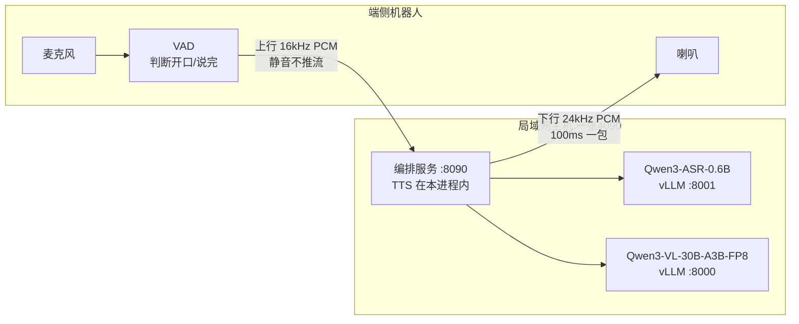
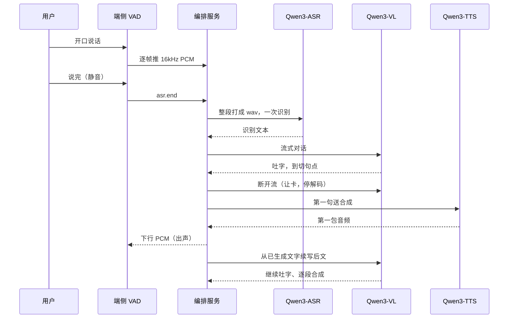

# 局域网语音交互方案：端侧动口，4090 动脑

**核心摘要**：这套方案是纯端侧方案的"分工版"——机器人（端侧）不再自己听懂和思考，只保留 VAD（判断你在不在说话）和喇叭，真正的语音识别、对话、视觉模型和语音合成全部搬到局域网内一台带 RTX 4090 的主机上。机器人通过 WebSocket 把声音发上去，主机把回答的声音发回来，全程数据只在局域网内流转，不经过公网。一张 4090 上同时常驻三份模型：视觉对话模型占 80% 显存，识别再留出约 5 GiB，合成跟编排服务进同一个进程。最关键的设计是"让卡"：第一句切出来之后，对话先断开解码、把显卡让给合成，第一包音频发出去之后，再从这句已经生成的文字续写后文。

硬件：NVIDIA GeForce RTX 4090，49140 MiB（约 48 GB）。2026-10-22 三份模型都在跑时，`nvidia-smi` 空闲约 2089 MiB。主机地址来自 DHCP，当天是 192.168.18.27，地址变了以 `hostname -I` 为准。

---

## 一、先建立整体印象：大脑搬到"机房"

上一篇纯端侧方案里，耳朵、大脑、嘴巴都在 RK3588 一块板子上。这套局域网方案做了一次"搬家"：

- **耳朵和嘴巴留在端侧**：机器人身上的麦克风、VAD、喇叭。VAD 负责判断你什么时候开口、什么时候说完，这件事计算量小、且必须实时，留在端侧。
- **大脑和"声带"搬到主机**：一台带 4090 的局域网主机，跑识别（ASR）、对话（Qwen3-VL）、合成（TTS）三份模型。
- **一根 WebSocket 连接两头**：机器人把音频帧推上去，主机把回答的音频帧推下来，编排服务统一调度。

通俗类比：机器人是"前台"，只负责接待和转述；4090 主机是后方"机房"，真正的脑力活都在那里。前台和机房之间走内部电话（局域网），不打外线（公网）。

---

## 二、一轮对话的完整旅程

先看时序，再逐步拆解。

### 2.1 端侧推流：只在说话时推，静音不推

端侧 VAD 判定为说话时，把 16 kHz、单声道、s16le 的 PCM 发到 `ws://<主机>:8090/v1/duplex`；静音时不推流，不浪费带宽和主机缓冲。一句话最长 30 秒；短于 200 毫秒的音频在 `asr.end` 时直接丢弃（多半是咳嗽、磕碰的误触发）。

### 2.2 asr.end：说完了，整段识别一次

`asr.end` 排在这句最后一帧音频之后。服务端把缓冲的音频打成 wav，整段送一次 Qwen3-ASR-0.6B。

为什么不边说边识别？因为流式识别会和正在合成的语音抢同一张卡。这套方案的原则是：**识别等你说完再做，一次前向出结果**，实测中位只要 60 ms，等整段反而更划算。

### 2.3 对话流式吐字，思考关掉

识别文本交给 Qwen3-VL-30B-A3B-Instruct-FP8，流式吐字。两个设置值得注意：

- **思考（thinking）关闭**：模型不输出内心独白，避免把"我想想该怎么回答"这类思考过程送进合成、念给用户听。
- **单轮最多新生成 256 个 token**，温度 0.3，回答更稳定。

输出按标点切段：句号、问号、叹号、分号和换行**立刻切开**；逗号和顿号要凑满 12 字才切。这比纯端侧那套"15–25 字意群"更依赖标点，因为主机算力强，模型生成的标点本身就规范。

### 2.4 第一句切出来，立刻"让卡"

这是整套方案最核心的动作。第一句切出来之后，编排**立刻断开对话流**，vLLM 收到断连后停掉后续解码——这一句送进 Qwen3-TTS（说话人 Vivian，中文），让合成在这一小段时间里独占显卡，把第一包音频尽快解出来。

为什么需要让卡？因为 4090 虽然强，但三份模型同时在跑，解码和合成的 CUDA kernel 挤在同一时刻，第一包就会被拖慢。用"断连"来停解码是个干净的办法：不需要特殊的暂停接口，断流即停。

### 2.5 合成的分块解码：不等整句，凑够就出声

TTS 内部有一个 code predictor（码本预测器），一帧一帧吐出 16 层的声学码。官方接口要等整句码本全部结束才解波形；这里做了提前截取：

- 每凑够 **2 帧码本**就解出一次波形推下去，大约对应 160 毫秒音频；
- 之后每 **3 帧**推一包，每块左侧保留 **25 帧上下文**，和官方分块解码方式对齐，保证块与块之间声音连贯；
- 下行按 100 毫秒切成 24 kHz PCM 包发给端侧，最后一截可以更短。

整句结束时不再解第二次，避免重复计算。

### 2.6 第一包发出后，续写后文

第一包音频写进 WebSocket 之后，对话从这句**已经生成的文字**处续写（前面生成的内容不丢），后文再按同样的标点切段、逐段合成。同一时刻只算一句合成，即使两台设备同时连着，也排队用这一张卡。

### 2.7 打断：立刻停播，已在算的算完即丢

播报过程中，端侧再把新的说话音频发上来，当前轮立刻停播，并回 `turn.cancelled`：

- 已经在算的那一小句让它算完，但算完即丢，不再下发；
- 新一轮的识别等这一小句的计算结束再开始（合成内部有锁，抢不过它）；
- 如果只发了 `asr.end`、缓冲里没有新音频，只停当前轮，不开启新回合。

上下文保留最近 8 轮。被打断的轮次只留下用户原话、以及已经开始下发音频的句子；只生成、还没下发的半句不进入下一轮。空识别（没听清）不调用对话模型，避免无意义的回答。

---

## 三、三份模型怎么挤在一张卡上

### 3.1 启动时的显存预算

三份模型同时常驻，靠启动时的额度先隔开：

| 模型 | 显存策略 |
|------|----------|
| Qwen3-VL-30B-A3B-FP8 | `gpu_memory_utilization` 设为 0.80，权重加载占 30.34 GiB；8192 token 下 KV 约 4.42 GiB（并发约 5.9 倍） |
| Qwen3-ASR-0.6B | 启动时读取空闲显存，扣掉 5120 MiB 再换算利用率；实际权重加缓存约 1.76 GiB（权重 1.53 GiB） |
| Qwen3-TTS-0.6B | 编排启动前要求空闲至少 3000 MiB，够权重和一次预热 |

识别启动时"扣掉 5 GiB 再算利用率"，是为了把剩余显存留给合成，避免它把卡吃光、合成起不来。

### 3.2 预热：把冷启动留在用户开口之前

编排把合成权重加载后会做预热，预热句是「好的，我看一下。」，作用有两个：

1. **核对正确性**：分块解码出的波形要和官方整句解码一致，对不上就不起服务，等于把"分块解码"这个非标准做法先自检一遍；
2. **触发冷启动编译**：CUDA 内核首次运行时的编译开销发生在预热里，不落在用户已经说完、正在等回答的时刻。

### 3.3 智能拉起，不盲目重启

启动脚本 `duplex/start.sh` 会先看现状：

- 已经在跑、且空闲显存仍够合成时，不重启视觉模型和识别；
- 视觉模型在、识别不在、空闲达到 8000 MiB 时，只补拉识别；
- 8000 端口上如果不是名字里带 VL 的模型，先停掉再按全双工预算重拉（识别服务名固定为 `Qwen3-ASR-0.6B`）。

### 3.4 让卡只保第一句，后面靠一把锁

回合中间的让卡**只发生在第一句**——第一句决定用户多久听到反应，值得专门保障；第一包下发后，后续句子和续写共享这张卡，所以后句的模块首包仍可能被解码拖长。

合成内部有一把锁：上一小句没算完，下一句进不去，打断后的新识别也会等这把锁。这保证了同一张卡上不会出现两个合成任务互相挤占，代价是打断后最早的那一包可能要等上一小句算完。

---

## 四、各模块用的模型一览

| 模块 | 模型 | 运行位置 |
|------|------|----------|
| 编排 | 本服务，入口 `ws://0.0.0.0:8090/v1/duplex` | 主机进程 |
| 识别 | Qwen3-ASR-0.6B，vLLM，整段一次，`max-model-len` 2048，`max-num-seqs` 1 | `127.0.0.1:8001`，GPU |
| 对话 | Qwen3-VL-30B-A3B-Instruct-FP8，vLLM，`max-model-len` 8192，思考关闭，温度 0.3 | 监听 `0.0.0.0:8000`，编排走 `127.0.0.1:8000`，GPU |
| 合成 | Qwen3-TTS-12Hz-0.6B-CustomVoice，bfloat16，说话人 Vivian，24 kHz | 编排进程内，`cuda:0` |

两点说明：

- 这一路对话**只送识别文本，不上传图片**。视觉模型进程开着工具解析和每请求最多两张图，是给同机另一路带摄像头的服务留的；全双工请求不带图、不带工具。
- 权重路径：视觉模型在 `/home/qingbao/models/Qwen3-VL-30B-A3B-Instruct-FP8`，识别在 `/home/qingbao/models/Qwen3-ASR-0.6B`，合成在 `Qwen3-TTS-12Hz-0.6B-CustomVoice/model`。

---

## 五、启动与就绪

- **启动**：`duplex/start.sh`，按显存预算先拉起视觉模型和识别，再拉起编排。
- **就绪判定**：编排把合成权重加载并预热完成后，`/health` 的 `ready` 才为 `true`；未就绪时 WebSocket 以关闭码 **1013**（Try Again Later）拒绝连接，端侧可以据此重试。
- **停止**：`duplex/stop.sh`，先停编排（合成在这个进程里），再卸识别和视觉模型。

---

## 六、实际快不快：板端实测数字

数字来自 `duplex/run/duplex.log`，进程于 2026-10-21 20:37 就绪。统计 2026-10-22 11:04–13:17 期间走完识别、对话首字和合成首包、且没有被打断的 24 轮，打断轮不进表。

口径说明：

- **识别出字**：从 `asr.end` 进入回合到发出 `asr.result`；上一轮还占着卡时，这段等待算在里面。
- **对话首字**：从说完到第一条 `llm.delta`，已经含识别。
- **合成模块首包**：从这一句调用合成算起，不含识别和对话；卡空着时，就是声码器凑够两帧再解波形的时间。
- **说完到出声**：从 `asr.end` 到第一包下行 PCM 写进 WebSocket，含识别、吐到切句点、该段合成第一包，计时停在写入 WebSocket 的时刻。这是端侧说完之后真正等待的时间。

### 6.1 说完到出声（24 轮）

| 指标 | 中位 | 范围 |
|------|------|------|
| 识别出字 | 60 ms | 38–126 ms |
| 对话首字 | 100 ms | 82–170 ms |
| 说完到出声 | 274 ms | 230–1779 ms |

22 轮落在 230–364 ms。839 ms 和 1779 ms 这两轮，识别和对话首字仍在 90 ms 以内，时间耗在合成模块首包（717 ms、1627 ms）——上一小句的计算还没从卡上退出。126 ms 那次识别对应的对话首字是 170 ms，多出来的几十毫秒同样是在等上一轮让卡，识别本身没有慢一个量级。

### 6.2 合成模块首包（128 次合成）

- 105 次首包在 95–152 ms，中位 111 ms；
- 另外 23 次超过 200 ms，中位 1353 ms，原因是卡上还有没停干净的解码或上一句合成。

第一句让卡时，已生成的字数中位 13 字（2–25 字）。模块首包约 110 ms 的那些轮，说完到出声 = 识别 + 吐到切句点 + 这一包，正好对得上 230–364 ms 那一档。

---

## 七、总结

这套局域网方案的核心是"**端侧做小活，主机干重活，一张卡上靠预算和让卡做调度**"：

1. **分工清晰**：VAD 留在端侧保证实时，识别、30B 级视觉对话、合成全部集中在 4090 主机，机器人可以用很弱的算力获得大模型的回答能力，数据只在局域网内流转。
2. **显存靠预算隔开**：视觉模型 80% 利用率打底，识别扣出 5 GiB 余量，合成保底 3 GiB，三份模型全部常驻、互不挤爆。
3. **第一包靠让卡保障**：第一句切出就断开对话流、停掉解码，合成独占显卡出第一包（实测说完到出声中位 274 ms，22/24 轮在 364 ms 以内），之后再续写后文。
4. **冷启动靠预热消化**：分块解码的正确性自检和内核编译都在预热句里完成，用户开口时系统已经处于热状态。
5. **打断有规矩**：停播、回 `turn.cancelled`、算完即丢、新识别等锁，保证抢话时链路不乱。

和纯端侧方案相比，这一套用"局域网内的一台主机"换到了 30B 级模型的能力和 274 ms 级的端到端响应；代价是依赖网络和主机，主机一旦关机或离网，机器人就失去了大脑。两种方案没有绝对的好坏，取决于现场有没有条件部署这台"机房"。
