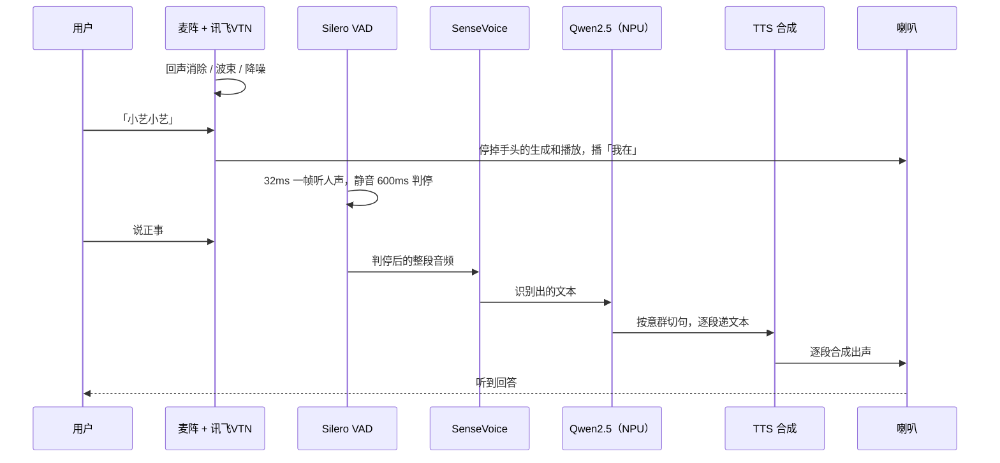
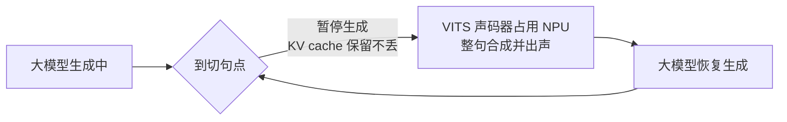

# 纯端侧语音交互方案：RK3588 上的「耳朵、大脑和嘴巴」

**核心摘要**：这套方案做的事可以用一句话概括——你和机器人说的每一句话，从「听见」「听懂」「想答案」到「说出来」，全部在 RK3588 这块板子上完成，不经过任何云端服务器，真正的对话链路（识别、生成、合成）完全不走网络。默认配置下只有大模型一个模块占用 NPU，其余都在 CPU 上跑；如果换成 VITS 合成，声码器也要上 NPU，这时大模型会主动「礼让」，两个重活排队使用同一块 NPU。

板端频率（以 2026-10-09 会话为准）：A55 小核 1.8 GHz，A76 大核 2.352 GHz，NPU 1 GHz。内存占用：空闲时 Python 约 700 MB，常驻大模型约 1.7 GB，相加约 2.4 GB。

---

## 一、先建立整体印象：把它想象成一个人

理解这套系统最简单的办法，是把它想象成一个正在和你对话的人，它也有耳朵、大脑和嘴巴：

- **耳朵（采集与理解）**：8 路阵列麦负责收声音；讯飞 VTN 做回声消除、波束成形、降噪和唤醒；Silero VAD 判断你什么时候开始说、什么时候说完；SenseVoice 把你说的一整段话转成文字。
- **大脑（思考）**：Qwen2.5-1.5B-Instruct，量化成 W8A8 的 rkllm 格式，跑在 NPU 上，而且是一个常驻进程，随时待命。
- **嘴巴（表达）**：默认用 Matcha-TTS 在 CPU 上合成；也可以换成多说话人 VITS，它的声码器跑在 NPU 上。合成好的声音从耳机口（es8388）播出。

关键的一点：**大脑是常驻的，嘴巴是分段念稿的**。这两个设计贯穿全文，后面会详细讲。

---

## 二、一轮对话的完整旅程

先看一轮对话从开口到出声的时序，再逐步拆解每个环节。

### 2.1 耳朵一直竖着：阵列麦 + 讯飞 VTN

Bothlent USB 阵列麦（`hw:3,0`，8 路、16 kHz）把声音送进讯飞 VTN。VTN 分两部分：

- **前端**：回声消除（AEC）、波束成形（把"听觉注意力"对准说话人方向）、降噪。这相当于人耳的耳廓和注意力，让你在嘈杂房间里也能听清面前的人。
- **后端**：唤醒，即判断有没有人喊它。

### 2.2 唤醒：「小艺小艺」，先停手再应答

唤醒词是「小艺小艺」。命中唤醒后有两个动作：**先停掉手头正在进行的生成和播放**（不管它正在念什么，立刻打住），然后播一句「我在」。

另外有一个自定义命令词「停止」，必须分数达到 1400 才会真正退出。设置这个高门槛是为了防止误触发——日常对话里偶尔出现类似发音，不应该让它直接罢工。

### 2.3 VAD 判断你什么时候说完

唤醒之后，Silero VAD 按 32 ms 一帧持续"听"你有没有在说话。它的判定参数是：

- **进入阈值 0.5**：人声分数超过 0.5，认为你开始说话了；
- **退出阈值 0.35**：分数低于 0.35，才认为你停了。

进入和退出用两个不同的阈值，这叫**迟滞**，类似冰箱温控：到了温度才停机、回升一点才重启，避免在边界上反复横跳。

具体判停规则：连续静音 600 ms 就判定你说完了；如果你一口气说了 15 秒还没停，强制断句兜底，防止异常情况把整个链路卡死。

### 2.4 整段识别：一次前向，不出中间结果

判停之后，这一整段音频交给 SenseVoice（int8 ONNX）做一次识别。注意它是**整句一次前向**，不是边说边出字的流式识别，所以它的前向耗时就是"出字时间"。识别出的文本随后交给常驻大模型。

### 2.5 大脑流式吐字，按意群切分递稿

大模型不是等整段回答全部生成完才交给合成，而是**流式吐字**，边生成边切分。切分不等句末标点，而是按"意群"（说话时自然的换气和停顿单元）切：

- 标点优先级：句号 / 问号 > 分号 > 逗号；
- 单段控制在 15–25 字；
- 遇到超长且没有标点的文本，按长度强切。

这就像播音员拿到的稿子不是整篇文章，而是写好一段递一段，第一段很快就能开口念。

### 2.6 嘴巴出声，半双工/全双工两种模式

合成结果从耳机口（es8388，`hw:2,0`）播出。系统支持两种对话模式：

- **半双工（默认）**：像对讲机，你说完我才说，我播完了才重新开听。
- **全双工**：像两个人面对面，我在播音的同时 VAD 还在跑，你一出声就立刻掐掉生成和播放，把你这段声音接成下一轮。

半双工模式下，播完之后还会**额外留 0.2 s 才开听**。这是一个保护措施：在回采（回声消除）效果不理想时，喇叭的尾音可能被麦克风收进去，0.2 s 的缓冲可以避免把"自己的尾音"误判成用户开口，类似对着山谷喊话要等回声散了再听。全双工模式下如果回采效果好，这段保护可以去掉。

---

## 三、四个值得讲的工程巧思

### 3.1 大模型常驻：宁可"养着"，也不临时请

1.5B 的模型（量化后约 1.7 GB）如果每轮对话都从磁盘重新加载，等待时间会非常破坏对话感。所以大模型跑在一个常驻进程 `llm_resident` 里，开机加载一次，之后一直"在岗"。代价是约 1.7 GB 内存被持续占用，但换来的是每轮对话都能立刻开始思考。

上下文默认 2048 token，单轮最多新生成 128 个 token，遇到 EOS（结束符）就停。

### 3.2 意群切分：不等句号，先念一段

传统做法是等大模型输出一个完整句子（等到句号）再送合成，回答长时第一句就要等很久。按意群切分后，只要凑够 15–25 字、有自然停顿点，就先送这一段去合成出声。这是"判停到出声"这个端到端指标能压到 1 秒以内的关键手段之一。

### 3.3 NPU 礼让：一块 NPU，两个重活排队

默认 Matcha 合成全部在 CPU 上，大模型独占 NPU，两者互不干扰。但 VITS 模式下，声码器（`flow_decoder.rknn`）也要用 NPU——NPU 只有一块，不能同时干两件重活，就像一个厨房只有一口灶，炒菜和炖汤不能同时开大火。

解决办法是一套**礼让机制**：

1. 大模型生成到切句点后**暂停**，已经生成的 KV cache 原样保留，上下文不丢；
2. VITS 声码器优先占用 NPU，把这一整句合成完、播出去；
3. 出声之后大模型再恢复生成，直到下一个切句点，再次礼让。

注意 VITS 是**整句合成**（8 kHz），一句话全部合成完才有音频，不像 Matcha 能出流式首帧。所以它的"首包"时间等于整句合成时间，但因为声码器在 NPU 上很快（实测中位 36 ms），整句首包反而很快。

### 3.4 不绑核：一次"好心办坏事"的实验

RK3588 是 4 个 A55 小核（cpu0–3，1.8 GHz）+ 4 个 A76 大核（cpu4–7，2.352 GHz）。所谓"绑核"，就是规定某个线程只能在指定的 CPU 核心上跑。直觉上，把重活钉在大核上、轻活钉在小核上，似乎更合理。

为此专门试过一版：识别三个工作线程钉 cpu4–6，Matcha 共享这三颗大核，host 线程钉 cpu7，采集和全双工 VAD 钉小核。半双工对比日志为 `logs/20261022-135838.jsonl`（未绑）和 `logs/20261022-145629.jsonl`（已绑）。

按说话时长对齐后，结果是反的：

- 判停到出声变慢，主要是首段回复变长，每字耗时仍约 40 ms；
- 识别在 2.2–4 秒那档，前向中位从 124 ms 增加到 252 ms；
- 合成首帧没有变好；
- 播放欠载两边都是 0（即没有出现声音卡顿）。

原因在于：**RKLLM 运行库自己就会把工作线程钉在 cpu4–7**，这是它向 NPU 提交任务的方式，不能拆。识别线程再被钉到同一批大核上，等于和运行库的线程抢工位，又没有别的核可去。短句大约只慢 10 ms，句子一长就明显。当时尝试用 `chrt` 设实时优先级，结果是 denied，没有生效。

最终结论：**交互链路不绑核**。识别、Matcha、VAD、讯飞前端、音频回调、大模型 host 和主循环都不调用 `sched_setaffinity`。日志里仍记录 `placement`（线程落点），只用来核对。以后只有两种情况才单独绑核：出现播放欠载，或者识别明显落在 A55 小核且前向变慢；而且绑之前先确认目标核是空的。

---

## 四、各模块用的模型一览

| 模块 | 模型 | 运行位置 |
|------|------|----------|
| 麦阵前端 | 讯飞 CAE `line4mic`，权重在 `vtn/res/cae_line4mic_std/` | 板端闭源引擎 |
| 唤醒 | 讯飞 IVW 3.17.12，资源 `xyxy`（小艺小艺） | 板端闭源引擎 |
| 人声检测 | Silero VAD 官方 ONNX `silero_vad_op18_ifless.onnx` | CPU，单线程 |
| 识别 | SenseVoice int8 ONNX `sense_voice_asr/asr_onnx_pkg/model.int8.onnx`，动态帧长，贪心 CTC | CPU |
| 大模型 | Qwen2.5-1.5B-Instruct，W8A8 rkllm，常驻进程 `llm/build/llm_resident` | NPU |
| 合成（默认） | Matcha-TTS icefall 中英：声学模型 `model-steps-3.onnx`，声码器 `vocos-16khz-univ.onnx`，16 kHz | CPU |
| 合成（可选） | 多说话人 VITS，说话人表为 AISHELL-3 的 SSB 编号，当前 sid=21；`front.onnx` + `flow_decoder.rknn`，8 kHz | 文本前端 CPU，声码器 NPU |

另外两点说明：

- 测量链路里那份固定 64 帧的 SenseVoice RKNN **没有接进这套交互**，实际用的是动态帧长的 ONNX 版本。
- VITS 说话人可以换，当前固定 sid=21；换 sid 即换音色，不需要重新加载模型。

---

## 五、实际快不快：板端实测数字

以下数字全部来自板上实机会话，不是离线压测，且只统计走完识别、生成、合成的完整对话轮，被中断的轮次不进表。

先把几个指标的口径说清楚（这也是看语音系统性能时最容易混淆的地方）：

- **识别出字**：SenseVoice 是整句一次前向，没有流式中间结果，前向时间就是出字时间。CTC 后处理约 0.3–0.5 ms，不单列。
- **大模型首 token**：RKLLM 上报的预填（prefill）时间，预填结束才开始吐字。
- **解码速度**：生成 token 数 × 1000 / 生成耗时，单位 token/s，是整段生成的平均速度；合成与解码重叠时会被拉低。
- **合成首帧**：Matcha 指第一个音频回调到来的时间（声学模型和声码器在同一次生成里，拆不开）；VITS 整句合成完才有音频，首包等于整句耗时，它的 `front_ms` 只是 CPU 文本前端，不是喇叭上的第一声。
- **判停到出声**：从 VAD 判停到喇叭发出第一声的端到端时间，含识别、预填、解码到切句点、该段合成——**这是真正决定对话感的指标**。

### 5.1 默认 Matcha，全双工

日志 `logs/20261009-151310.jsonl`，2026-10-09 15:13，4 轮：

| 指标 | 中位 | 范围 |
|------|------|------|
| 识别出字 | 87 ms | 76–95 ms |
| 大模型首 token | 232 ms | 217–242 ms |
| 解码速度 | 9.5 token/s | 9.0–9.9 token/s |
| 合成首帧 | 217 ms | 186–576 ms |

招呼「我在」的合成首帧是 155 ms。576 ms 出现在第一轮的长句上，短句大约 190 ms。判停到出声的中位是 746 ms（633–1547 ms），里面含预填、等到第一处句号、以及这句的合成。

### 5.2 可选 VITS，全双工

日志 `logs/20261009-110855.jsonl`，2026-10-09 11:08，8 轮：

| 指标 | 中位 | 范围 |
|------|------|------|
| 识别出字 | 81 ms | 48–95 ms |
| 大模型首 token | 213 ms | 208–258 ms |
| 解码速度 | 11.6 token/s | 11.0–12.3 token/s |
| 合成首包（整句） | 51 ms | 30–110 ms |
| 判停到出声（端到端） | 待回填 | 待回填 |

同一次会话里，CPU 文本前端中位 14 ms，NPU 声码器中位 36 ms，加起来就是整句首包。10 月 8 日和 10 月 9 日上午的 VITS 会话落在同一带：识别出字约 50–110 ms，预填约 210–290 ms，解码约 10.5–12.4 token/s。

### 5.3 读表的两个注意事项

1. **配置已变更，数字需复测**：以上两组数据采集于 2026-10-09，当时尾静音为 100 ms、合成按句末标点切分；当前配置为 600 ms 尾静音 + 意群切分，需复测后更新。
2. **两套合成的解码速度不能直接比**：Matcha 在 CPU 上合成时，大模型仍在吐后面的 token，日志里的 token/s 会被这段重叠拖慢；VITS 模式下大模型在合成段暂停，decode 的统计区间不同。两边的 t/s 只作各自的稳定性参考，不代表模型本身有快慢差异。

---

## 六、启动方式

启动入口是 `serve.py`：

- 默认：半双工 + Matcha；
- `--mode full`：开启全双工；
- `--tts vits_npu`：换成 VITS 合成（声码器上 NPU，大模型礼让）。

---

## 七、总结

这套方案的价值可以归纳为四点：

1. **纯端侧，断网可对话**：识别、生成、合成全部在 RK3588 板上完成，语音数据不出设备，天然具备隐私优势、无云端调用成本。
2. **资源分配有分工、有礼让**：大模型常驻 NPU 随时待命，其余模块在 CPU 上各司其职；VITS 模式下声码器也要用 NPU，大模型在切句点暂停、出声后恢复，用"排队"而不是"硬抢"解决算力冲突。
3. **边想边说，把首包压到 1 秒内**：流式吐字 + 意群切分，写好一段就念一段，板端实测判停到出声中位约 746 ms（旧切分口径，意群切分后待复测），这是对话感的来源。
4. **不折腾调度，按需干预**：绑核实验证明默认调度反而更快，问题的根因是运行库已经占住大核；只在出现播放欠载或识别明显落小核时，才针对单个模块绑核。

半双工是当前稳妥的基线（配 0.2 s 尾音保护），全双工是体验更好的目标模式——它的上限不取决于软件逻辑，而取决于回采（回声消除）的硬件质量。这也是这套方案下一步继续打磨的方向。
