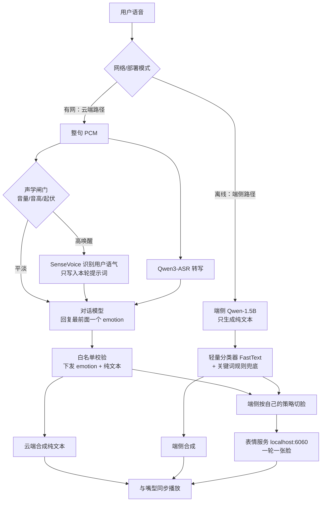
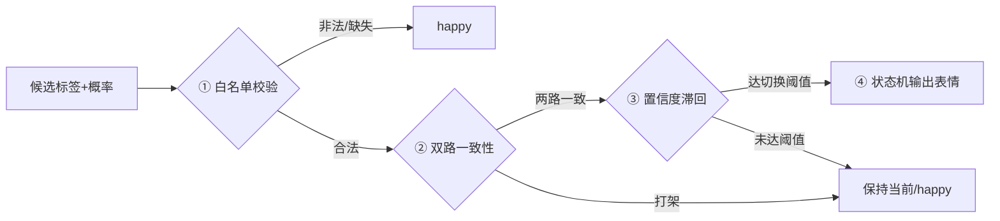

# 机器人表情生成方案：云端「带脸说话」，端侧「离线配脸」

**核心摘要**：这套方案解决一个问题 —— 机器人回话时，脸上该挂什么表情。结论可以用一句话概括：**有网时让云端大模型在回复最前面打一个表情标签，校验后和纯文本一起下发；断网时端侧小模型只负责说话，一个几 MB 的轻量分类器给它配一张脸。** 表情一共 10 个 key（9 类情绪 + 中性），一次回复只挂一张脸，不设强度；用户语气只在「高唤醒」（明显激动）时才用 SenseVoice 识别，写进本轮提示词影响「怎么说」，但不直接贴到脸上。切脸的节奏 —— 一张脸保持多久、两轮之间冷却多久 —— 全部由端侧自己决定，云端不操心。

> 适用硬件：LubanCat RK3588（7.7G 内存）。
> 云端 duplex：识别 Qwen3-ASR-0.6B，对话 Qwen3-VL-30B-A3B-Instruct-FP8，情感 SenseVoice-Small int8（仅高唤醒时调用）。
> 端侧：Qwen-1.5B。表情消费端：本地表情服务 
>
> [localhost:6060](https://localhost:6060)
>
> 。


***

## 一、先建立整体印象：人说话时，脸是怎么动的

观察两个人面对面聊天：一方说完，另一方开口之前，脸上其实已经有表情了 —— 听到好消息先眼睛一亮，听到难过事先面露关切。而且**一段话里表情不会乱跳**，基本是「这段话什么基调，就挂什么脸」。

机器人的表情方案就是照着这个常识设计的，整条链路分两条路：




记住两个关键词：**一轮一张脸**、**云端管「说什么」，端侧管「怎么播」**。这两个决策贯穿全文。


***

## 二、表情长什么样：句首一个标签

对话模型的输出不是 JSON，而是在整段回复最前面直接写一个尖括号标签：


```
<surprised>哇，真的假的！恭喜你呀，这也太厉害了。
```

云端收到流式 token 后，先把句首这个标签「攒」完整（它可能被拆成 `<hap` 和 `py>` 两段流过来），确认是合法 key 后：


1. 先发一条 `emotion` 消息，保证**表情在第一句话出声之前就位**；

2. 再把剥掉尖括号的纯文本按 `llm.delta` 流式下发，送去合成；

3. 轮次结束时 `turn.end` 再带一遍同一个 key，用 `turn_id` 把这一轮的脸、字、音频对齐。


```
{"type": "emotion", "turn_id": "uuid", "emotion": "surprised"}
{"type": "llm.delta", "turn_id": "uuid", "emotion": "surprised", "text": "哇，真的假的！"}
```

尖括号和 key 不会送进 TTS，合成器只看到纯文本。


***

## 三、表情体系：为什么是这 10 个 key

### 3.1 9 类情绪 + 中性

最早的表情库里有 11 种表情，其中两对高度相似：「悲伤 vs 抑郁」「生气 vs 愤怒」。最终各保留一个：**悲伤（sad）、生气（angry）**，加上中性兜底，共 10 个标签。


| key         | 中文  | 什么时候用      | 区分要点                 |
| ----------- | --- | ---------- | -------------------- |
| happy       | 愉悦  | 日常应答、查询、闲聊 | **默认脸**；别把惊喜、反讽误判成愉悦 |
| sad         | 悲伤  | 被具体事件触动的难过 | 可能带哭腔                |
| angry       | 生气  | 还能讲道理的责备   | 不是失控的暴怒              |
| surprised   | 惊喜  | 意外的好事      | 必须「意外 + 正面」          |
| scared      | 害怕  | 负面的意外、发怵   | 恐惧、受惊、心虚             |
| eye\_roll   | 翻白眼 | 反讽、「我服了」   | 社交态度类                |
| embarrassed | 尴尬  | 说错话、冷场、打圆场 | 下不来台                 |
| confused    | 疑惑  | 没听懂、追问     | 「你是说…？」              |
| shy         | 害羞  | 被夸、被表白     | 偏正面的难为情              |
| neutral     | 中性  | 严肃安全提示等    | **少用**，愉悦会违和时才用      |

### 3.2 几个关键取舍

**为什么合并抑郁和愤怒？** 抑郁是持续的病理状态、愤怒是失控的暴怒，机器人日常交互里极少出现；而且一张「暴怒脸」或「抑郁脸」很容易让用户不适。悲伤、生气是更通用的情绪，能覆盖绝大多数场景。标签越少，模型选得越准 —— 这是个划算的精简。

**为什么不设强度（intensity）？** 早期方案里同一情绪还分「有点开心 / 很开心」等档位。实际想想：强度分档首先让模型的输出复杂度翻倍，其次脸上很难稳定呈现「开心 70% vs 80%」的差别，最后分档太细必然导致表情频繁跳动。砍掉强度，脸上只有 10 个离散状态，简单、稳定、可解析。

**为什么一次回复只给一个表情？** 按句标表情，机器人就会「一句微笑、一句惊讶、一句翻白眼」地乱变脸，真人不这么说话，看起来像故障。一段话的情绪基调在开头基本就定了，所以标签只在整段最前面出现一次，后面的句子共用这张脸。

**为什么默认 happy、少用 neutral？** 机器人的定位是「伙伴」而不是「客服或百科」，日常问候、查询、确认时一张微笑脸最自然；中性脸在这些场景反而显得冷漠。只有严肃的安全提示这类「愉悦会违和、又够不上其他情绪」的场合才用中性。

**为什么 key 用英文？** 英文 key 稳定、无歧义、方便程序解析（中文标签可能出现全角半角、同义词等问题），中文只用于展示。


***

## 四、云端：大模型「带脸说话」

### 4.1 为什么标签放句首，而不是包一段 JSON

一个看似自然的替代方案是让模型输出 `{"emotion": "happy", "text": "..."}` 这样的结构化 JSON。但在流式对话里这是个坑：**JSON 必须等整段输出闭合（或至少等前面的字段吐完）才能解析，第一句话被「对象壳子」堵在后面出不来**，直接拉长首包。

句首标签只有几个字符，模型一开口就先吐出来，云端攒到尖括号收口就能确定表情，此时正文还没开始播 ——**脸先于声音就位**，这是和真人对话一致的节奏。

### 4.2 白名单校验：宁落 happy，不卡住

云端只做一件校验：key 必须在 10 类白名单里。


* 标签被模型自造（比如 `<joy>`）、漏标、或格式残缺 → **不重试、不追问，本轮直接记为 happy**，正文照常合成；

* 正文里再出现尖括号（比如模型聊嗨了写了个 `<sad>`）→ 剥掉，脸不改；

* 只认最前面第一个标签。

为什么容错这么宽松？因为表情是「锦上添花」，为了一个标签让用户等重试、或者本轮没有声音，是本末倒置。happy 是最安全的兜底脸。

### 4.3 用户语气：高唤醒才识别，写进提示词

同一句「我没事」，平静说和吼出来，文本完全相同、情绪完全相反。要让机器人接得住，得「听语气」。但语气识别不是每轮都做，而是先过一道**零模型声学闸门**（只看音频，几毫秒）：


* 音量是否明显偏高（前三句没有参照时用绝对阈值，之后对比本会话最近几句的中位音量）；

* 浊音能量是否大起大落；

* 基频（音高）是否偏高或发飘；

* 能量包络起伏是否过密。

四项都平淡 → 直接对话，首包和原来一样（约 210–310 ms）。任何一项明显升高 → 闸门打开，才和识别并行跑 SenseVoice-Small。


### 4.4 为什么语气不直接「贴脸」

这是最容易想错的一个决策。SenseVoice 输出的类别是：开心、难过、生气、害怕、厌恶、吃惊、中立。**这些类别不会原样变成机器人脸上的 key**，而是在本轮 user 消息前加一行字（不进历史、下一轮就消失）：

> \[系统检测到用户语气为：难过。先接住这个情绪，再回答，不要用开心带过。]

为什么？因为**用户的情绪 ≠ 机器人该有的情绪**。用户生气时，机器人该做的是安抚，而不是也挂一张生气脸；用户害怕时，该让对方安心。语气影响的是「怎么说、选什么共情表情」，这个判断交给对话模型，而不是做一次简单的情绪映射。中立、识别失败、闸门没开，都不写这行。

### 4.5 为什么不用更重的情感模型


* **emotion2vec**：CPU 上要几百毫秒到一秒，每轮都等会把首包拖到接近一秒，不可接受；

* **几 MB 的小语音情感网络**：没有可靠的中文公开权重，英文模型搬到中文对话上不可靠，不能挡在交互前面；

* **SenseVoice-Small int8（约 230MB）**：非自回归，10 秒音频约 70 ms，实时率约 0.02，而且它是非流式的，本来就只能等整句收完再跑一次 —— 所以只在闸门打开时调用，用偶尔一轮的延迟增加，换真实语气。

另外两个细节：仓库里为热词微调过的 SenseVoice 不用，因为微调不保证还输出情感标签；推理用 sherpa-onnx 而不是 funasr-onnx，因为后者会把环境里的 numpy 从 2.x 降到 1.26，连累同环境的语音合成。


***

## 五、端侧：小模型专心说话，分类器配脸

### 5.1 为什么不让 1.5B 自己输出表情标签

离线时大脑换成 Qwen-1.5B。直觉上它也可以像云端大模型一样打句首标签，但实测这个级别的小模型在资源紧张时标签很不稳定：括号缺失、自造标签、漏标频发；多输出的 token 还会进一步拉长本已紧张的推理延迟。

所以原则是：**让小模型只做它最擅长的事 —— 生成回复文本，表情判断交给专用的轻量分类器。** 这也符合「一个模块只干一件事」的工程分工。

### 5.2 三级能力，由轻到重


| 级别    | 形态                                       | 资源占用       | 定位        |
| ----- | ---------------------------------------- | ---------- | --------- |
| 规则层   | 关键词 + 标点（「哈哈」「谢谢」「对不起」「为什么」「？」「！」）       | 零模型，≈0     | 永远可用的最终兜底 |
| 轻量分类器 | **FastText**（几 MB，CPU 亚毫秒）               | 极低         | **端侧主力**  |
| 增强分类器 | MiniLM / BERT-tiny（10–25MB，转 RKNN 走 NPU） | 低，需 NPU 空闲 | 数据积累后升级   |

端侧工作流很简单：


1. Qwen-1.5B 生成纯文本；

2. 整段文本只过一次 FastText，得到 10 类概率，不按句重复分类；

3. 低置信或分类器不可用 → 规则层兜底 → 最终落到 happy。

### 5.3 切脸节奏为什么交给端侧

云端只下发一个 key，**一张脸保持多久、两轮之间冷却多久、要不要过渡表情，全部由端侧自己的策略决定**，云端不计算也不下发这些参数。

道理很简单：端侧最清楚播放状态 —— 音频播到哪了、脸是什么时候切的、当前负载如何。这些「播放层」的细节如果让云端算，不但要多传一堆状态，网络一抖动策略就乱。端侧离线时还有一套自己的闸门可以参考：白名单校验 → 双路一致性（LLM 与分类器打架就保持当前脸，避免「该尴尬时傻笑」）→ 置信度滞回（切新脸 > 0.65，维持当前 > 0.40，类似冰箱温控防止边界横跳）→ 状态机输出。




### 5.4 TTS 不按表情改韵律

合成器只读剥掉标签后的纯文本，不会因为表情是 sad 就放慢语速、压低音色。按表情改韵律听起来美好，但会让「文本 → 语音」的链路显著复杂化，属于后续体验增强项，当前刻意不做 ——**先保证脸和话对得上，再追求声音里的情绪。**


***

## 六、降级阶梯：任何情况下都有一张脸

表情模块的红线是：**永远不抢 ASR / 对话 / TTS 主链路的资源，资源紧张时自动收缩，用户无感。** 从云端到极端负载，一共五级：


| 级别 | 方案                 | 触发条件             |
| -- | ------------------ | ---------------- |
| L0 | 云端句首标签，白名单后下发      | 网络正常             |
| L1 | 端侧 LLM 句首标签（若格式稳定） | 离线且硬件空闲          |
| L2 | 端侧 LLM 纯文本 + 分类器   | 端侧 LLM 标签格式不稳    |
| L3 | 模板话术 + 分类器         | NPU/CPU 被视觉、导航占满 |
| L4 | happy + 倾听点头       | 极端负载、冷启动         |

任一级都有表情输出，最差的情况也是一张微笑的脸 —— 这比「表情服务挂了导致整轮对话失败」可接受得多。


***

## 七、数据飞轮：端侧分类器的「老师」在云端

FastText 分类器不需要冷启动时人工标注，因为云端大模型上线后，标签会自动源源不断地产生：


1. 收集真实对话中的机器人回复文本；

2. 云端用更大模型 / 多模型投票重打标签，可要求输出判定理由；

3. 人工只抽检两类：**分类器低置信的、标签不一致的**（主动学习，省约 80% 人力）；

4. 用这批数据训练 FastText / MiniLM，目标是「对齐云端老师的行为」；

5. 表情体系变更（比如调整标签）时，让老师按新标签重跑一遍即可，无需重新标注。


   ```mermaid
   flowchart LR
       A[线上日志/云端标签] --> B[大模型重打标 + 人工抽检]
       B --> C[训练 FastText/MiniLM]
       C --> D[端侧分类器升级]
       D -.真实对话回流.-> A
   ```

这就是端侧小模型越来越像云端的路径：**云端当老师，端侧当学生，真实对话当教材。**


***

## 八、技术决策速查


| 决策点    | 备选方案        | 最终选择与理由                                     |
| ------ | ----------- | ------------------------------------------- |
| 表情数量   | 11 种全保留     | 合并抑郁 / 愤怒为悲伤 / 生气，共 10 个 key；标签越少越准，避免不适脸   |
| 强度     | 每类分强度档      | 砍掉；分档难呈现、易跳脸、增加模型负担                         |
| 标签位置   | 整段 JSON     | 句首标签；流式直出不堵首包，脸先于声就位                        |
| 标签数量   | 每句一个        | 一轮一个；按句变脸像故障                                |
| 默认脸    | neutral     | happy；伙伴定位，中性显冷漠                            |
| 端侧表情来源 | 1.5B 打标签    | FastText 分类器 + 规则兜底；小模型标签不稳定                |
| 情感识别   | 每轮都跑        | 声学闸门 + 高唤醒才跑 SenseVoice；保住常规轮 210–310 ms 首包 |
| 语气用途   | 原样贴脸        | 写入提示词影响「怎么说」；用户情绪 ≠ 机器人表情                   |
| 切脸节奏   | 云端下发        | 端侧自管；播放状态端侧最清楚                              |
| 情感推理   | funasr-onnx | sherpa-onnx；避免 numpy 降级连累合成                 |


***

## 九、总结


1. **云端带脸说话**：大模型在回复最前面打一个标签，白名单校验后和纯文本一起下发，非法标签一律落 happy、不重试；

2. **高唤醒才听语气**：声学闸门拦住平淡的大多数句子，SenseVoice 只在用户明显激动时识别语气，写进本轮提示词教模型「先接住情绪再回答」，但不替机器人选脸；

3. **端侧离线配脸**：1.5B 专心说话，FastText 分类器（几 MB、亚毫秒）配脸，规则兜底，切脸节奏完全自主；

4. **表情永远让路**：五级降级阶梯保证任何负载、任何网络下都有脸，且不抢主链路资源；

5. **数据飞轮自我进化**：云端标签自动成为端侧分类器的训练数据，老师重打标即可应对体系变更。

> **一句话：让最强的模型决定「这轮挂什么脸」，让最贴近播放的模块决定「脸怎么切」；语气只改怎么说，不直接改脸。**